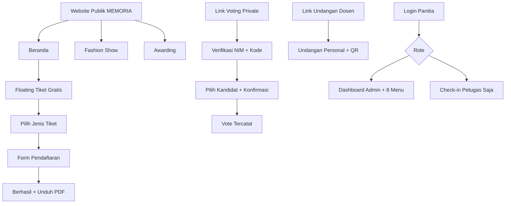
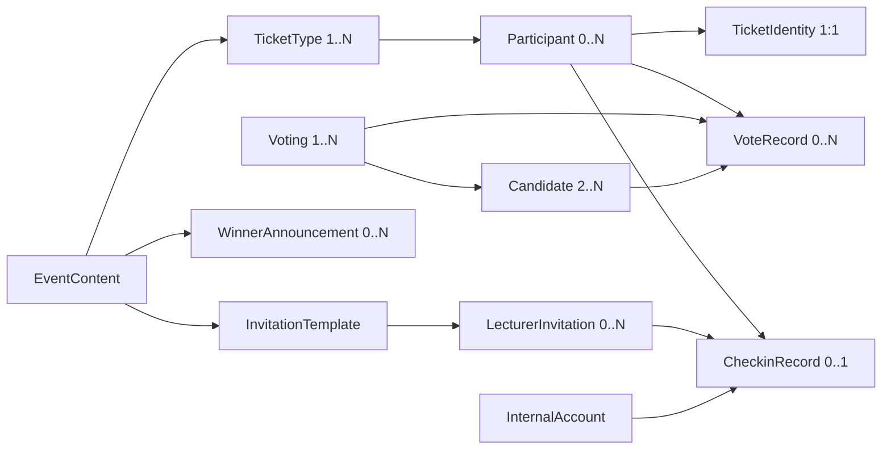

# MEMORIA — PRODUCT REQUIREMENTS DOCUMENT (PRD) FRONTEND

> **Dokumen:** `MEMORIA-PRD-FRONTEND-V1-FINAL-BASELINE.md`  
> **Versi:** 1.0 — Baseline Frontend berdasarkan keputusan brainstorming hingga 28 Oktober 2026  
> **Status:** Siap menjadi acuan perancangan UI dan implementasi frontend berbasis mock data; bukan PRD Backend  
> **Produk:** MEMORIA, website event & dashboard penyelenggara  
> **Bahasa antarmuka:** Indonesia; zona waktu acara **Asia/Jakarta (WIB)**  
> **Jenis event:** Satu event MEMORIA (bukan platform multi-event)  
> **Catatan penting:** Warna, font, ikon spesifik, ilustrasi, gaya visual, dan pilihan framework **belum ditetapkan**; akan dibahas sesudah PRD frontend.

---

## Daftar isi

1. [Visi, tujuan, dan batas lingkup](#1-visi-tujuan-dan-batas-lingkup)
2. [Daftar keputusan yang terkunci](#2-daftar-keputusan-yang-terkunci)
3. [Role, akses, dan privasi](#3-role-akses-dan-privasi)
4. [Sitemap, route, dan pola navigasi](#4-sitemap-route-dan-pola-navigasi)
5. [Komponen bersama dan aturan UI global](#5-komponen-bersama-dan-aturan-ui-global)
6. [Halaman publik: Beranda](#6-halaman-publik-beranda)
7. [Halaman publik: Fashion Show dan Awarding](#7-halaman-publik-fashion-show-dan-awarding)
8. [Halaman publik: Pendaftaran tiket gratis](#8-halaman-publik-pendaftaran-tiket-gratis)
9. [Halaman publik: Private Voting](#9-halaman-publik-private-voting)
10. [Halaman publik: Undangan dosen](#10-halaman-publik-undangan-dosen)
11. [Autentikasi internal dan layout dashboard](#11-autentikasi-internal-dan-layout-dashboard)
12. [Admin: Dashboard utama](#12-admin-dashboard-utama)
13. [Admin: Kelola Website](#13-admin-kelola-website)
14. [Admin: Kelola Tiket](#14-admin-kelola-tiket)
15. [Admin: Data Peserta, Edit, Arsip, Pemulihan](#15-admin-data-peserta-edit-arsip-pemulihan)
16. [Admin: Voting dan hasil](#16-admin-voting-dan-hasil)
17. [Admin: Undangan Dosen](#17-admin-undangan-dosen)
18. [Admin/Petugas: Check-in](#18-adminpetugas-check-in)
19. [Admin: Kelola Akun](#19-admin-kelola-akun)
20. [Model data mock frontend](#20-model-data-mock-frontend)
21. [Aturan bisnis, status, dan kalkulasi](#21-aturan-bisnis-status-dan-kalkulasi)
22. [Penanganan error, empty, loading, dan edge case](#22-penanganan-error-empty-loading-dan-edge-case)
23. [Responsivitas, aksesibilitas, dan keamanan tampilan](#23-responsivitas-aksesibilitas-dan-keamanan-tampilan)
24. [Acceptance criteria dan skenario uji](#24-acceptance-criteria-dan-skenario-uji)
25. [Strategi implementasi frontend & handoff](#25-strategi-implementasi-frontend--handoff)
26. [Asumsi desain operasional & hal yang belum diputuskan](#26-asumsi-desain-operasional--hal-yang-belum-diputuskan)

---

## 1. Visi, tujuan, dan batas lingkup

### 1.1 Ringkasan produk

MEMORIA adalah website untuk **satu acara** yang mencakup informasi acara, penampilan band, teaser Fashion Show, teaser Awarding, pendaftaran beberapa jenis tiket gratis, undangan personal dosen, private voting bagi mahasiswa terdaftar, pengumuman pemenang yang ditentukan manual oleh panitia, pengelolaan peserta, dan check-in QR/manual.

Pengunjung publik **tidak perlu akun**. Akses internal hanya melalui akun yang dibuat Admin Panitia.

### 1.2 Sasaran pengalaman

- **Mahasiswa:** melihat acara → memilih satu jenis tiket gratis → mengisi form → menerima e-ticket PDF (unduh langsung dan dikirim via email) → dapat mengikuti private voting melalui tautan dan verifikasi → menunjukkan QR saat hadir.
- **Dosen:** mendapat pesan undangan email/WhatsApp → membuka undangan personal → menunjukkan QR undangan atau diverifikasi manual saat check-in.
- **Admin Panitia:** seluruh proses konten, tiket, peserta, voting, dosen, kehadiran, dan akun dalam satu dashboard.
- **Petugas Check-in:** masuk langsung ke antarmuka check-in sederhana, tanpa akses mengedit administrasi event.

### 1.3 Termasuk dalam frontend V1

- Seluruh halaman publik dan internal di dokumen ini.
- Navigasi, form, input, tabel, filter, dialog, preview, feedback tindakan, akses berbasis role di sisi UI.
- State dan aturan bisnis lokal menggunakan **mock data**; simulasi unduh PDF/QR, mail, kamera, serta verifikasi.
- Mock interaksi antarmodul secara konsisten: pendaftaran mengubah peserta/kuota; voting mengubah hasil/status; check-in mengubah kehadiran; arsip dan pemulihan mengubah kapasitas.
- Rute, responsivitas, empty/loading/error states, serta skenario uji yang jelas.

### 1.4 Tidak termasuk pada tahap ini

- Backend, database sebenarnya, endpoint/API produksi, email SMTP/provider, WhatsApp API, pemindaian QR fisik yang terhubung server, autentikasi produksi, hashing password produksi, audit log server, deployment, payment gateway, multi-event, sistem RSVP dosen, e-wallet, login/register mahasiswa/dosen, CMS drag-and-drop, penilaian juri otomatis, dan pemilihan gaya visual final.
- Rundown internal panitia (loading barang, cek sound, dll.) **bukan** section wajib landing page; pengelolaan rundown tidak dimasukkan dalam V1 karena belum disepakati sebagai fitur.

### 1.5 Prinsip produk

1. **Simpel bagi pengguna:** tidak memaksa registrasi akun publik.
2. **Konten bukan hardcode:** isi website berasal dari entri dashboard panitia; hanya struktur/layout komponen yang disiapkan di kode.
3. **Satu pendaftaran per NIM untuk seluruh MEMORIA**, meskipun tiket punya banyak jenis.
4. **Setiap identitas tiket stabil** walau NIM dikoreksi.
5. **Pemisahan data bisnis:** voting peserta tidak otomatis menentukan pengumuman pemenang.
6. **Arsip bukan hapus permanen**; jejak kehadiran dan voting dipertahankan.
7. **Tidak mengklaim sukses transaksi eksternal** bila implementasi masih simulasi.

---

## 2. Daftar keputusan yang terkunci

| ID | Keputusan hasil ACC | Implikasi frontend |
|---|---|---|
| K-01 | Dua role internal: **Admin Panitia** dan **Petugas Check-in** | Login sama, akses menu berbeda; mahasiswa/dosen tanpa akun |
| K-02 | Hanya Admin Panitia dapat membuat/mengelola akun | Sidebar `Kelola Akun`, form nama/email/password/role |
| K-03 | Navbar publik memakai **halaman terpisah**: Beranda, Fashion Show, Awarding | Bukan anchor per-section untuk ketiga menu |
| K-04 | Tiket gratis ditampilkan sebagai **floating button kanan bawah**, bukan section tiket paling bawah | Tombol membuka pemilihan jenis tiket |
| K-05 | Beberapa **jenis tiket gratis** dapat diterbitkan panitia | Halaman pilih tiket, tanpa pembayaran |
| K-06 | Satu NIM hanya satu tiket untuk **seluruh event** | Validasi lintas jenis tiket, bukan per jenis |
| K-07 | Form: nama, NIM, HP, email; prodi **D4 Sistem Informasi Kota Cerdas** dan fakultas **Fakultas Ilmu Terapan** terkunci | Nama kembar diperbolehkan; email/HP tidak wajib unik |
| K-08 | Tiket sukses: PDF langsung bisa diunduh **dan** dikirim via email | Email gagal tidak menggagalkan pendaftaran |
| K-09 | Setiap tiket mahasiswa punya nomor/kode unik, QR check-in, kode voting | PDF dan tampilan sukses menampilkan identitas relevan |
| K-10 | Konten Beranda/Band/teaser langsung tayang setelah **Simpan** | Tidak memakai workflow draft konten biasa |
| K-11 | Fashion Show/Awarding: pengumuman kategori, foto, nama, keterangan pemenang | Pemenang dipilih manual, **Draft → Publish** |
| K-12 | Voting via **tautan private**; tidak ada menu voting di navbar | Halaman khusus token/link |
| K-13 | Voting hanya peserta terdaftar aktif, verifikasi **NIM + kode tiket** | Form verifikasi sebelum kandidat tampil |
| K-14 | Satu suara per NIM pada setiap voting; boleh ikut banyak voting | Riwayat vote per voting, bukan satu vote global |
| K-15 | Voting dibuka/ditutup **otomatis sesuai jadwal** | Status Draft/Terjadwal/Aktif/Selesai berdasarkan waktu |
| K-16 | Kandidat dapat diubah sampai suara pertama masuk; setelah itu terkunci | Nonaktifkan tambah/edit/hapus kandidat setelah `totalVotes > 0` |
| K-17 | Hasil voting dapat dilihat panitia; tidak menetapkan pemenang otomatis | Dashboard hasil terpisah dari publikasi pemenang |
| K-18 | Undangan dosen personal, dikirim email atau WA melalui pesan/link; memiliki QR | Template + data dosen + tombol Kirim Email/Kirim WhatsApp/Salin Link |
| K-19 | Satu email dosen hanya satu undangan aktif | Validasi email duplikat |
| K-20 | Check-in QR dan manual; mahasiswa cari NIM, dosen cari email/kode undangan | Identifikasi tipe tamu dari QR, input manual bertipe |
| K-21 | **Tidak ada buka/tutup check-in**, boleh check-in kapan pun | Catat tanggal, jam WIB, metode, dan petugas; status hanya Belum Check-in/Hadir |
| K-22 | Data Peserta menampilkan status voting dinamis, status dan waktu check-in | Kolom mengikuti voting yang dibuat panitia |
| K-23 | Ekspor Data Peserta hanya **Excel (.xlsx)** | Tanpa ekspor CSV |
| K-24 | Data Peserta: **Kirim Email, Edit Data, Hapus Data** | Tanpa kolom status kirim email permanen |
| K-25 | Edit dan Hapus Data harus melalui **dua tahap verifikasi** | Konfirmasi/pratinjau kemudian otorisasi admin |
| K-26 | Hapus = **Arsip/nonaktif**, bukan hard delete | Tiket/QR/vote baru tidak berlaku; riwayat tetap |
| K-27 | Peserta arsip dapat **dipulihkan** jika kapasitas jenis tiket cukup | Memulihkan tiket identik, tanpa mengulang registrasi |
| K-28 | Arsip mengembalikan kuota; pulihkan mengonsumsi kuota lagi | Statistik kapasitas mengikuti peserta aktif |
| K-29 | Suara yang sudah diberikan peserta arsip **tetap dihitung** | Hasil tidak dikurangi; histori tidak dihapus |
| K-30 | Saat NIM diedit, **nomor tiket, kode voting, QR tetap identik** | Hanya NIM/data tampilan PDF yang diperbarui |

**Interpretasi operasional:** keputusan K-xx merupakan baseline yang telah disepakati. Pilihan UX tambahan yang belum di-ACC secara spesifik ditempatkan dalam §26 sebagai **asumsi pelaksanaan**, bukan aturan bisnis baru yang diklaim sudah disetujui.

---

## 3. Role, akses, dan privasi

### 3.1 Definisi role

| Role | Identitas & akses | Halaman awal |
|---|---|---|
| Pengunjung/mahasiswa | Tanpa login; dapat membaca publik, daftar tiket, vote setelah verifikasi | `/` |
| Dosen | Tanpa login; undangan personal via token tautan | `/undangan/:token` |
| Admin Panitia | Akun internal melalui `/panitia/login` | `/panitia` |
| Petugas Check-in | Akun internal melalui `/panitia/login` | `/panitia/check-in` |

### 3.2 Matriks izin detail

| Kapabilitas | Publik | Admin | Petugas |
|---|:---:|:---:|:---:|
| Melihat Beranda/Fashion Show/Awarding Published | Ya | Ya | Ya |
| Pilih/daftar tiket | Ya | Sebagai publik | Sebagai publik |
| Buka voting via private link dan verifikasi peserta | Ya (peserta sah) | Sebagai peserta sah | Sebagai peserta sah |
| Buka undangan personal via link | Dengan link | Dengan link | Dengan link |
| Lihat dashboard statistik lengkap | Tidak | Ya | Tidak |
| Ubah konten website/pemenang | Tidak | Ya | Tidak |
| Buat/edit jenis tiket | Tidak | Ya | Tidak |
| Lihat/edit/arsip/pulihkan peserta | Tidak | Ya | Tidak |
| Lihat hasil/kelola kandidat & jadwal voting | Tidak | Ya | Tidak |
| Kelola data undangan dosen | Tidak | Ya | Tidak |
| Scan QR, cari manual, Hadirkan | Tidak | Ya | Ya |
| Lihat hasil pencarian identitas di check-in | Tidak | Ya | Ya (minimum perlu) |
| Kelola akun internal | Tidak | Ya | Tidak |

### 3.3 Guard UI

- Rute internal tanpa sesi: alihkan ke `/panitia/login` dan simpan tujuan rute aman untuk kembali setelah login.
- Petugas mengakses rute Admin di luar Check-in: tampilkan `403 Akses Ditolak`, sediakan `Kembali ke Check-in`.
- User sudah login membuka `/panitia/login`: redirect sesuai role.
- Keluar: hapus sesi mock, pindah ke login, tidak lagi memperlihatkan data internal.
- **Backend nanti tetap wajib memvalidasi izin.** Menyembunyikan tombol/frontend route saja tidak dianggap pengamanan produksi.
- Data mahasiswa/dosen, nomor HP, NIM, kode voting, dan token QR tidak ditampilkan di URL publik yang bisa disalin sebagai parameter mudah dibaca (selain tautan undangan/vote bertoken opak).

---

## 4. Sitemap, route, dan pola navigasi

### 4.1 Sitemap ringkas



### 4.2 Tabel route publik

| Route (usulan konsisten FE) | Halaman | Akses | Layout |
|---|---|---|---|
| `/` | Beranda | Publik | Navbar publik + floating tiket |
| `/fashion-show` | Fashion Show | Publik | Navbar publik + floating tiket |
| `/awarding` | Awarding | Publik | Navbar publik + floating tiket |
| `/daftar` | Pilih jenis tiket gratis | Publik | Public focused, tombol kembali |
| `/daftar/:ticketId` | Form pendaftaran terpilih | Publik | Form focused |
| `/daftar/berhasil` | Konfirmasi & Unduh PDF | Setelah submit sukses | Public focused |
| `/vote/:voteToken` | Verifikasi / pilih kandidat / status suara | Akses dari tautan private | Minimal, tanpa tautan di navbar |
| `/undangan/:inviteToken` | Undangan personal dosen | Akses dari tautan personal | Layout surat undangan |
| `/404` atau fallback | Halaman tidak ditemukan | Semua | Sesuai konteks |

**Catatan rute berhasil:** akses langsung `/daftar/berhasil` tanpa konteks pendaftaran tidak boleh menampilkan tiket orang lain; tampilkan state aman `Sesi pendaftaran tidak ditemukan` + tombol Beranda. Kontrak akses PDF produksi akan didefinisikan saat backend.

### 4.3 Tabel route internal

| Route | Halaman | Role |
|---|---|---|
| `/panitia/login` | Login internal | Guest internal |
| `/panitia` | Dashboard utama | Admin |
| `/panitia/website/beranda` | Konten Beranda & teaser | Admin |
| `/panitia/website/band` | Daftar/editor band | Admin |
| `/panitia/website/fashion-show` | Konten teaser & pemenang fashion | Admin |
| `/panitia/website/awarding` | Konten teaser & pemenang awarding | Admin |
| `/panitia/tiket` | List jenis tiket | Admin |
| `/panitia/tiket/baru` | Form buat tiket | Admin |
| `/panitia/tiket/:id/edit` | Form edit tiket | Admin |
| `/panitia/peserta` | Peserta aktif & arsip, via tab | Admin |
| `/panitia/peserta/:id` | Detail peserta (dapat berupa drawer/modal ter-route) | Admin |
| `/panitia/voting` | Daftar voting | Admin |
| `/panitia/voting/baru` | Form voting baru + kandidat | Admin |
| `/panitia/voting/:id/edit` | Pengaturan voting/kandidat | Admin |
| `/panitia/voting/:id/hasil` | Hasil voting | Admin |
| `/panitia/undangan/template` | Editor template undangan | Admin |
| `/panitia/undangan/dosen` | Daftar dosen + undangan personal | Admin |
| `/panitia/check-in` | Scan QR, Manual, Riwayat | Admin, Petugas |
| `/panitia/akun` | Daftar akun + modal form | Admin |
| `/403` | Hak akses ditolak | Login terbatas |

### 4.4 Aturan navbar/sidebar

- **Navbar publik:** `Beranda`, `Fashion Show`, `Awarding`; ketiganya pindah **halaman**, bukan scroll anchor.
- **Floating tiket:** posisi kanan bawah pada halaman publik utama, berlabel `Tiket Gratis` dan ikon tiket; tampil bila ada jenis tiket Published. Klik → `/daftar`. Pada halaman form/sukses/voting/undangan, floating tidak wajib ditampilkan agar tidak mengganggu tugas utama.
- **Sidebar Admin (8):** Dashboard, Kelola Website, Tiket, Data Peserta, Voting, Undangan Dosen, Check-in, Kelola Akun.
- **Kelola Website (4 submenu):** Beranda, Band, Fashion Show, Awarding.
- **Sidebar Petugas:** Check-in dan Keluar saja; tidak melihat seluruh database peserta.
- Breadcrumbs untuk halaman edit/detail di dashboard; kembali mempertahankan pencarian/filter ketika mungkin.

---

## 5. Komponen bersama dan aturan UI global

### 5.1 Komponen publik

| Komponen | Konten/data | Perilaku |
|---|---|---|
| `PublicNavbar` | Logo/nama MEMORIA, tiga menu | Menandai halaman aktif; collapsed menu di mobile |
| `EventHero` | Nama event, tagline/deskripsi, tanggal, jam, tempat, gambar | Seluruh isi dari pengaturan panitia |
| `Countdown` | Event start datetime | Menghitung real-time; setelah tanggal terlewati tampil `Acara telah dimulai` atau `Acara telah berlangsung` tanpa nilai negatif |
| `BandCard` | Foto, nama, deskripsi | Jumlah dinamis; state kosong disembunyikan/placeholder proporsional |
| `TeaserCard` | Judul, deskripsi, foto, CTA | CTA ke halaman Fashion Show/Awarding |
| `FloatingTicketButton` | Label tiket, ketersediaan | Posisi fixed kanan bawah, aman terhadap safe-area mobile, klik pilih tiket |
| `CategoryWinnerCard` | Kategori, foto, nama, keterangan | Hanya data Published |
| `TicketTypeCard` | Nama, kuota tersedia/tanpa batas, jadwal, status | Pilih jika pendaftaran sedang dibuka |
| `FormField` | Label, required, hint, error | Validasi blur + submit; tidak menghapus input saat error |
| `QRPreview` | QR visual dari token opak mock | Tidak mengubah QR saat NIM diedit |
| `StateFeedback` | Sukses, error, kosong, invalid, expired | Pesan jelas dan aksi pemulihan |

### 5.2 Komponen dashboard

| Komponen | Isi & perilaku |
|---|---|
| `AdminShell` | Sidebar role-aware, header nama login, logout, area halaman |
| `StatCard` | Label, angka, subteks, shortcut |
| `DataTable` | Sort/pencarian/filter/pagination bila perlu, horizontal scroll pada mobile |
| `RowActionMenu` | Aksi tiga titik, hanya yang diizinkan & sesuai status |
| `FormDrawerOrPage` | Form tambah/edit; indikator perubahan belum disimpan |
| `ConfirmModal` | Pratinjau dampak + keputusan Lanjut/Batal |
| `ReauthModal` | Langkah ke-2 untuk edit/arsip peserta; password admin; khusus arsip ketik `HAPUS` |
| `Toast` | Feedback singkat (termasuk simulasi kirim email) |
| `EmptyState` | Tidak ada data, tautan Tambah bila punya akses |
| `StatusBadge` | Draft, Terjadwal, Aktif, Selesai; Hadir/Belum; Published/Arsip |
| `DateTimePickerWIB` | Input tanggal/jam lokal WIB dengan validasi urutan |
| `UnsavedChangeGuard` | Konfirmasi sebelum meninggalkan form berubah |

### 5.3 Standar aksi

- Aksi yang mengubah data mempunyai label eksplisit: `Simpan`, `Publikasikan`, `Arsipkan Peserta`, `Pulihkan`, `Hadirkan`.
- Submit disabled selama proses simulasi; cegah double-click dan duplikasi.
- Mutasi berhasil → update semua halaman terkait dari sumber mock data yang sama dan tampilkan umpan balik.
- Kegagalan proses → perubahan tidak diterapkan secara parsial; input tetap tersimpan untuk diperbaiki.
- Untuk aksi eksternal `Kirim WhatsApp`, pembukaan chat **bukan** bukti pesan terkirim.
- Untuk `Kirim Email`, **tidak perlu** kolom/status riwayat pengiriman pada tabel; tampilkan hasil percobaan pada notifikasi saat tombol ditekan.

---

## 6. Halaman publik: Beranda

**Route:** `/`  
**Pengguna:** semua pengunjung  
**Tujuan:** mengenalkan MEMORIA dan mendorong pendaftaran tiket tanpa mengganggu informasi acara.

### 6.1 Susunan blok UI dari atas ke bawah

| Urutan | Blok | Isi wajib/dinamis | Aksi |
|---|---|---|---|
| 1 | Navbar | MEMORIA, Beranda, Fashion Show, Awarding | Navigasi halaman |
| 2 | Hero | Nama event, subtitle/deskripsi, tanggal, waktu, tempat, gambar utama | Tidak perlu form di hero |
| 3 | Countdown | Hari, jam, menit, detik menuju acara | Otomatis mengikuti datetime acara |
| 4 | Band / Lineup | Daftar band: foto, nama, deskripsi | Kartu berulang sesuai data panitia |
| 5 | Teaser Fashion Show | Judul teaser, foto, ringkasan | `Lihat Fashion Show` → `/fashion-show` |
| 6 | Teaser Awarding | Judul teaser, foto, ringkasan | `Lihat Awarding` → `/awarding` |
| 7 | Footer | Identitas event dan informasi yang disediakan panitia | Navigasi dasar |
| Floating | Tiket Gratis | Tombol kanan bawah fixed | `/daftar` |

### 6.2 Sumber data dan validasi tampilan

- Semua konten teks/gambar berasal dari pengaturan `WebsiteContent` milik panitia, bukan konstanta isi dalam komponen.
- Countdown memakai `eventStartAt`. Jika tanggal sudah lewat, ubah label tanpa membuat countdown negatif.
- Band bisa 0..N; bila kosong, sembunyikan blok band atau tampilkan placeholder teks yang ditentukan panitia (asumsi UX: sembunyikan).
- Teaser tidak menampilkan kandidat voting atau data pemenang otomatis.
- Floating tiket ada jika minimal satu tipe tiket `published=true`. Bila seluruh tiket Published sedang belum buka, sudah tutup, atau penuh, tautan tetap boleh membuka halaman pilih tiket untuk menunjukkan status; form tidak dapat diproses untuk tiket yang tidak tersedia.
- Jika belum ada tiket Published, sembunyikan tombol untuk menghindari dead end.

### 6.3 Status halaman

- **Loading:** skeleton hero/lineup singkat.
- **Success:** semua blok dengan data tersimpan.
- **No band:** hero dan teaser tetap tampil, tanpa kotak kosong besar.
- **Event date passed:** countdown diubah menjadi status waktu.
- **Data error:** fallback pesan `Informasi acara belum dapat ditampilkan` dan tombol Muat Ulang.

### 6.4 Flow

`Buka Beranda → baca informasi → klik Fashion Show/Awarding untuk halaman masing-masing`, atau `klik floating Tiket Gratis → /daftar`.

---

## 7. Halaman publik: Fashion Show dan Awarding

**Routes:** `/fashion-show`, `/awarding`  
**Tujuan:** menampilkan detail umum acara terkait serta daftar pemenang yang **dipublikasikan manual** oleh Admin Panitia.

### 7.1 Kesamaan kedua halaman

| Area UI | Isi |
|---|---|
| Header & navbar | Sama dengan Beranda |
| Hero halaman | Judul, deskripsi, foto/ilustrasi teaser dari konten panitia |
| Info pemenang | Hanya entri Published |
| Kartu pemenang | **Kategori, foto, nama, keterangan** |
| Footer | Identitas event |
| Floating tiket | Sesuai aturan halaman publik utama |

### 7.2 Perbedaan informasi

- `/fashion-show`: pembuka Fashion Show, daftar pemenang kategori Fashion Show yang Published.
- `/awarding`: pembuka Awarding, daftar pemenang kategori penghargaan yang Published.
- Halaman tetap bisa diakses sebelum ada pemenang: tampil `Pemenang akan diumumkan saat acara MEMORIA` (copy dapat diedit admin).
- Data **Draft tidak pernah muncul** di request/list publik; status Published tidak boleh terlepas hanya karena halaman di-refresh.
- Pemenang dipilih secara manual. Tidak ada auto-pemenang dari peringkat suara voting.

### 7.3 Field pemenang (render publik)

`categoryName`, `winnerName`, `winnerPhoto`, `winnerDescription` (keterangan), urutan tampil bila lebih dari satu. **Jangan** tampilkan kolom `status` atau tombol edit di publik.

### 7.4 Flow

`Navbar → halaman detail → sebelum publish: teaser/pesan menunggu → Admin Publish pemenang → halaman publik memperlihatkan kartu → Admin kembalikan Draft → kartu hilang dari publik.`

---

## 8. Halaman publik: Pendaftaran tiket gratis

### 8.1 Halaman pilih jenis tiket

**Route:** `/daftar`  
**Masuk dari:** floating button pada halaman publik.

**Bagian UI:** judul `Pilih Tiket MEMORIA`, informasi event singkat, daftar kartu tiket Published, tombol kembali ke Beranda, ringkasan `1 NIM hanya boleh 1 tiket untuk seluruh event`.

**Kartu tiket menampilkan:** `nama`, `deskripsi` opsional, label `GRATIS`, sisa kuota atau `Tanpa batas`, waktu buka/tutup pendaftaran, status ketersediaan (`Belum Dibuka`, `Tersedia`, `Penuh`, `Ditutup`), tombol `Pilih Tiket` aktif hanya bila terbuka dan tersedia.

**Aturan:** beberapa jenis tiket gratis; **tidak ada** harga berbayar, keranjang, pembayaran, atau ganti jenis tiket selepas sukses secara mandiri. Apabila tidak ada tiket Published, tampil state `Pendaftaran belum tersedia`.

### 8.2 Halaman formulir pendaftaran

**Route:** `/daftar/:ticketId`  
**Masuk dari:** tombol `Pilih Tiket` pada tipe tiket yang tersedia.

| Field | Tipe UI | Required | Nilai/validasi | Editable |
|---|---|:---:|---|:---:|
| Jenis tiket terpilih | Summary card | Ya | ID valid, Published, dalam jadwal, kuota tersedia | Tidak di form; tombol `Ganti Jenis` kembali ke pemilihan |
| Nama lengkap | Text | Ya | Trim, tidak kosong; nama sama **boleh** | Ya |
| NIM | Text numeric-string | Ya | Trim, format digit sesuai aturan kampus saat final; **unik di seluruh MEMORIA**, termasuk arsip yang menyimpan NIM | Ya |
| Program Studi | Read-only | Ya | `D4 Sistem Informasi Kota Cerdas` | Tidak |
| Fakultas | Read-only | Ya | `Fakultas Ilmu Terapan` | Tidak |
| Nomor HP | Tel | Ya | Format nomor valid; **boleh sama dengan peserta lain** | Ya |
| Email | Email | Ya | Format email valid; **boleh sama dengan peserta lain** | Ya |

**Validasi UX:**

- Validasi format saat blur dan submit; NIM memunculkan petunjuk jika sudah terdaftar; cek final ulang saat submit.
- **Nama duplikat bukan error** (dua mahasiswa dapat bernama sama).
- Jangan menolak email atau telepon hanya karena sudah digunakan pendaftar lain.
- Peserta di arsip **tidak melakukan pendaftaran ulang dengan NIM yang sama**; panitia memulihkannya bila sah (asumsi konsistensi kebijakan satu NIM).
- Bila kuota penuh atau jadwal tutup ketika peserta sedang mengisi, saat submit munculkan error bisnis yang jelas dan arahkan untuk kembali memilih tiket tanpa membuat tiket parsial.
- Tampilan prodi/fakultas terlihat tetapi tidak bisa diubah; nilai tetap ikut tersimpan.

**Tombol:** `Kembali`, `Ganti Jenis Tiket`, `Daftar Gratis`.

### 8.3 Proses saat klik Daftar Gratis

1. Validasi semua field dan ketersediaan tiket.
2. Validasi NIM belum terikat peserta aktif/arsip pada event.
3. Buat peserta aktif, satu reservasi tiket, `ticketNo`, `voteCode`, dan token QR tetap; kurangi sisa kuota satu (bila dibatasi).
4. Bangun representasi PDF menggunakan data terbaru; QR berisi token check-in opak, bukan NIM mentah.
5. Pindahkan ke halaman Berhasil, sediakan tombol **Unduh Tiket PDF** saat itu juga.
6. Simulasikan pengiriman email otomatis ke alamat yang diisikan. Jika gagal, pendaftaran dan tiket **tetap sah**; tampilkan pesan lembut di halaman berhasil, tanpa merusak PDF.
7. Jika pengguna mencoba submit dua kali, hanya satu peserta/tiket yang tercatat.

### 8.4 Halaman pendaftaran berhasil

**Route:** `/daftar/berhasil`  
**Isi:** ikon/teks sukses, nama peserta, jenis tiket, nomor tiket, NIM, prodi, fakultas, tanggal event, QR preview, kode voting yang perlu disimpan, pesan `Tiket dikirim ke email yang didaftarkan`, tombol `Unduh Tiket PDF`, tombol `Kembali ke Beranda`.

Jika email mock gagal, ubah hanya notifikasi menjadi `Pendaftaran berhasil. Pengiriman email belum berhasil; silakan unduh PDF sekarang atau hubungi panitia.` **Tidak perlu status kirim email disimpan/dipajang sebagai kolom Data Peserta**.

**Keamanan halaman:** tanpa state pendaftaran sukses yang sah, jangan menampilkan data/tiket milik orang lain. Saat frontend saja, mock store dapat menyediakan one-session confirmation id; implementasi final ditentukan bersama backend.

### 8.5 Isi e-ticket PDF (spesifikasi konten, bukan desain visual)

- Identitas acara: nama MEMORIA, tanggal, waktu, lokasi.
- Identitas peserta: nama, **NIM terkini**, prodi, fakultas.
- Jenis tiket gratis dan nomor tiket tetap.
- **QR Code check-in** yang sama sepanjang umur identitas tiket.
- **Kode unik voting** tetap agar dapat digunakan bersama NIM di halaman voting private.
- Petunjuk singkat: tunjukkan QR saat masuk; link voting dibagikan panitia.
- Tidak memuat nominal pembayaran atau status bayar.

**Ketika NIM diedit Admin:** PDF yang diunduh/dikirim ulang memuat NIM terbaru, tetapi **nomor tiket, kode voting, dan token QR tidak berubah**.

### 8.6 Edge cases

| Kasus | Tanggapan frontend |
|---|---|
| Tiket tidak ada/tidak Published | `Jenis tiket tidak tersedia`, kembali pilih tiket |
| Belum jam pendaftaran | Nonaktif `Pilih Tiket`, label `Belum Dibuka` |
| Pendaftaran sudah lewat | Label `Ditutup` |
| Kuota habis | Label `Penuh`, submit ditolak |
| NIM sudah ada aktif/arsip | Tolak daftar baru; arahkan hubungi panitia untuk koreksi/pemulihan |
| Email gagal | Registrasi sah, PDF tetap bisa diunduh |
| Refresh sukses tanpa state | Pesan aman; tidak membuka data peserta lain |
| Pengguna klik submit berulang | Tombol loading/nonaktif; satu pendaftaran |

---

## 9. Halaman publik: Private Voting

**Route:** `/vote/:voteToken`  
**Akses:** hanya dari tautan private yang disalin dan dibagikan panitia; tidak ada tautan di navbar publik.

### 9.1 Tahap A — verifikasi

UI berisi judul voting, deskripsi, status waktu voting, form `NIM` dan `Kode Unik Tiket`, tombol `Verifikasi & Mulai Voting`.

Validasi:

- Token voting dikenal dan voting sudah sesuai jadwal `Aktif`.
- NIM sesuai data peserta aktif pada event; peserta arsip ditolak.
- Kode voting sesuai identitas tiket milik NIM tersebut.
- Belum pernah ada suara untuk kombinasi peserta + voting ini.
- Sebelum jadwal: `Voting belum dibuka`; sesudah jadwal: `Voting telah selesai`. Jangan tampilkan form pengiriman suara yang masih aktif.
- Jika NIM telah dikoreksi, **NIM baru + kode lama** yang berlaku.

### 9.2 Tahap B — pilih kandidat

| Elemen | Isi/aksi |
|---|---|
| Header | Judul/deskripsi voting |
| Identitas terverifikasi | Nama peserta (ringkas), NIM; jangan membuka data kontak |
| Kartu kandidat | Foto opsional, nama, keterangan |
| Pilihan | Radio, **satu kandidat** untuk satu voting |
| Tombol `Lanjutkan` | Disabled jika belum pilih |
| Dialog konfirmasi | Menampilkan nama kandidat dipilih; `Kembali` atau `Kirim Suara` |

**Catatan:** satu mahasiswa bisa melakukan tiga voting berbeda melalui tiga tautan, namun hanya satu suara pada **masing-masing** voting. Tidak wajib melakukan semua voting sekaligus.

### 9.3 Tahap C — hasil tindakan

- Sukses: `Suara kamu berhasil dicatat untuk [judul voting]`, tombol `Selesai` (kembali beranda). Tidak tampilkan hasil sementara publik.
- Sudah pernah vote: `Kamu sudah memberikan suara pada voting ini`, tanpa tombol vote ulang.
- Terlambat karena jadwal berakhir saat form terbuka: submit ditolak, tampil `Voting sudah selesai`.
- Jika peserta diarsipkan setelah halaman verifikasi: submit harus ditolak meski form sudah terbuka.
- Saat suara pertama tersimpan: UI admin mengunci tambah/edit/hapus kandidat voting tersebut.

### 9.4 Jadwal otomatis

- Admin menetapkan awal/akhir waktu lokal WIB.
- State yang ditampilkan: `Draft` (belum dijadwalkan), `Terjadwal` (sudah dijadwalkan sebelum start), `Aktif` (now berada dalam window), `Selesai` (now >= end).
- **Tidak** ada aksi manual wajib untuk membuka/menutup tepat waktu.
- Frontend menghitung status live dari mock clock dan jadwal; saat produksi, backend menjadi sumber kebenaran waktu dan penerimaan suara.

### 9.5 Keamanan pemilihan

- Token URL adalah identitas **voting**, bukan pengganti verifikasi peserta; jangan menganggap link rahasia cukup.
- Mock memblokir pilihan ulang untuk kombinasi `participantId + votingId`.
- Jika lebih dari satu voting tersedia, semua menggunakan **kode voting tiket yang sama**, bukan kode baru per kategori.
- Token QR check-in dan kode voting tiket adalah dua atribut berbeda.

---

## 10. Halaman publik: Undangan dosen

**Route:** `/undangan/:inviteToken`  
**Akses:** dibuka dari tautan undangan personal yang dikirim via email atau WhatsApp.

### 10.1 Susunan konten

1. Identitas/heading MEMORIA.
2. Salam dan sapaan personal: nama dosen dari record undangan.
3. Kata-kata/template undangan yang diatur Admin Panitia.
4. Informasi acara: judul, tanggal, waktu, lokasi; diambil dari data event agar konsisten.
5. QR Code undangan **unik per dosen**, label `Tunjukkan QR untuk check-in`.
6. Kode undangan (jika diperlukan untuk check-in manual).
7. Footer/salam penutup dari template.

**Tidak ada:** login dosen, RSVP wajib, form daftar dosen mandiri, pembayaran, atau pengelolaan profil dosen.

### 10.2 State

- Token dikenal + undangan aktif: tampil undangan lengkap.
- Token tidak dikenal: pesan `Undangan tidak ditemukan`.
- Undangan tidak aktif: pesan `Undangan tidak tersedia`, tanpa QR aktif.
- Re-send undangan: tautan dan QR **tetap sama**, tidak membuat identitas baru.
- Edit nama/kontak dosen oleh admin: undangan personal memuat data terbaru tanpa mengganti identitas QR.

---
## 11. Autentikasi internal dan layout dashboard

### 11.1 Login internal

**Route:** `/panitia/login`. **Bukan** tempat registrasi publik.

| Elemen | Tipe | Validasi/aksi |
|---|---|---|
| Judul | `Login Panitia MEMORIA` | Penanda hanya akun internal |
| Email | Input email | Wajib, format valid, akun terdaftar/aktif |
| Password | Password + toggle lihat | Wajib, tidak dipajang saat mengetik |
| Tombol | `Masuk` | Loading saat proses; cegah submit ganda |
| Pesan error | Inline/general | Kredensial salah, akun nonaktif, gangguan login |

**Flow:** masukkan kredensial → mock autentikasi → redirect `Admin Panitia` ke `/panitia`; `Petugas Check-in` ke `/panitia/check-in`. Kegagalan tidak mengungkap apakah email atau password yang salah pada pesan publik (`Email atau password tidak sesuai`).

**Akun pertama:** disiapkan (seed) pada mock data, tidak ada alur signup Admin Panitia di publik. Pengelolaan akun selanjutnya via `Kelola Akun`.

**Perilaku sesi:** logout menghapus sesi mock; refresh halaman mempertahankan sesi demo hanya dengan mekanisme simulasi yang aman; browser back setelah logout tidak boleh menampilkan halaman internal tanpa sesi.

### 11.2 Layout dashboard Admin Panitia

- Header: judul halaman, nama admin login, menu profil sederhana, `Keluar`.
- Sidebar 8 menu final, ikon placeholder (desain visual menyusul), active indicator.
- Area konten: heading, subjudul ringkas, aksi utama kanan atas, isi tabel/form/statistik.
- Breadcrumb untuk halaman tambah/edit dan detail.
- Pada mobile: sidebar menjadi drawer, tabel dapat scroll horizontal; aksi kritis tidak tertutup.

### 11.3 Layout Petugas Check-in

- Header: MEMORIA, nama petugas, keluar.
- Sidebar minimal: `Check-in` saja; konten tab `Scan QR`, `Manual`, `Riwayat` sesuai izin baca terbatas.
- Tidak ada tombol untuk mengubah konten, tiket, peserta, undangan, hasil vote, atau akun.
- Login Petugas tidak memuat dashboard Admin terlebih dahulu.

---

## 12. Admin: Dashboard utama

**Route:** `/panitia` | **Role:** Admin Panitia.

### 12.1 Area dan metrik

| Area | Isi yang ditampilkan | Aksi |
|---|---|---|
| Judul | `Dashboard MEMORIA`, ringkasan event | Tidak edit |
| Statistik peserta | Total peserta **aktif** terdaftar | `Lihat Data Peserta` |
| Kehadiran mahasiswa | Hadir dari peserta aktif, Belum Check-in dari peserta aktif | `Buka Check-in` |
| Tiket | Jumlah tipe tiket Published, kuota terpakai/tersedia per tipe | `Kelola Tiket` |
| Voting | Jumlah voting Aktif/Terjadwal/Selesai, total suara ringkas | `Lihat Voting` |
| Dosen | Jumlah undangan dosen aktif, total yang sudah check-in | `Lihat Undangan Dosen` |
| Aksi cepat | Tombol ke `Check-in`, `Data Peserta`, `Voting` | Navigasi |

### 12.2 Ketentuan penghitungan

- `Peserta aktif` **tidak** termasuk arsip.
- `Hadir aktif mahasiswa` = peserta aktif dengan check-in pertama yang valid tercatat. Riwayat hadir peserta arsip tetap ada untuk audit, tidak dihapus, tetapi bukan bagian dari metrik *peserta aktif saat ini*.
- `Belum Check-in aktif` = total peserta aktif - hadir aktif; **tidak** otomatis berubah menjadi `Tidak Hadir` walau tanggal event lewat.
- `Kuota terpakai` per tiket = jumlah peserta aktif yang memegang tipe tiket tersebut; peserta arsip tidak memakai kursi.
- `Total suara` dapat termasuk suara historis peserta yang kini diarsipkan, sesuai keputusan; beri label `Total suara sah tercatat` agar tidak disamakan dengan peserta aktif.
- Ringkasan dosen dipisahkan dari mahasiswa sehingga tidak tertukar dengan kuota tiket.

### 12.3 States dan batasan

- Tanpa peserta: statistik 0, CTA `Lihat Tiket` untuk menyiapkan pendaftaran.
- Tanpa voting: `Belum ada voting`, CTA `Buat Voting`.
- Tidak ada formulir edit langsung pada kartu statistik.
- Refresh manual / refresh data mock mempertahankan hasil mutasi dari store yang sama.

---

## 13. Admin: Kelola Website

**Akses:** `/panitia/website/*` | Admin Panitia.  
**Prinsip:** panitia mengubah **isi**, bukan layout website; konten biasa langsung tayang setelah **Simpan**. Pengumuman pemenang memakai Draft/Publish sendiri.

### 13.1 Submenu Beranda (`/panitia/website/beranda`)

| Field | Input | Ketentuan |
|---|---|---|
| Nama acara | Text | Wajib, contoh mock `MEMORIA` |
| Tagline/subjudul | Text | Opsional |
| Deskripsi acara | Textarea | Wajib untuk hero konten |
| Tanggal acara | Date | Wajib |
| Waktu mulai acara | Time | Wajib; zona WIB |
| Waktu selesai acara | Time | Opsional untuk informasi publik |
| Lokasi/tempat | Text | Wajib |
| Alamat/rincian tempat | Textarea | Opsional |
| Gambar hero | Upload/preview image | Format/ukuran sesuai batas mock; kelak validasi media produksi |
| Teks/footer informasi | Text | Opsional |
| Teaser Fashion Show | Judul, ringkasan, gambar | Mengendalikan section teaser di Beranda |
| Teaser Awarding | Judul, ringkasan, gambar | Mengendalikan section teaser di Beranda |

**Aksi:** `Edit` (bila mode view), `Simpan`, `Batal`, `Pratinjau Website` (membuka halaman publik baru), `Ganti/Hapus Gambar` bila ada. **Klik Simpan langsung mengubah konten publik**; tidak ada tombol Publish umum.

**Validasi:** nama, tanggal/jam dan tempat wajib; tanggal disimpan dengan timezone WIB; form berisi perubahan wajib ditangani unsaved guard. Ubah tanggal event harus memperbarui Countdown, pilihan tiket yang menampilkan info acara, halaman undangan, dan PDF baru/unduh ulang secara konsisten.

### 13.2 Submenu Band (`/panitia/website/band`)

**List:** thumbnail, nama band, ringkasan, urutan tampil, aksi `Edit`, `Hapus`; tombol `+ Tambah Band`.

**Form Tambah/Edit Band:** `namaBand` wajib, `foto` opsional namun direkomendasikan, `deskripsi` opsional, `urutan` opsional/drag-reorder jika nanti dipilih. Panitia menyimpan, kartu band pada Beranda langsung terbarui.

**Alur:** tambah → isi → simpan → tampil di Beranda; edit → simpan → pembaruan langsung; hapus → dialog konfirmasi → tidak tampil lagi. **Hapus Band** tidak berhubungan dengan data peserta/voting.

### 13.3 Submenu Fashion Show (`/panitia/website/fashion-show`)

Dua area terpisah:

**A. Konten halaman:** judul/teks pengantar/foto halaman, teks pesan sebelum pemenang dipublikasikan; tombol `Simpan` langsung memperbarui konten publik biasa.

**B. Kelola pemenang Fashion Show:** tabel kategori, nama pemenang, thumbnail, status Draft/Published, tanggal publish bila ada, aksi.

**Field pemenang:**

| Field | Tipe | Ketentuan |
|---|---|---|
| Kategori | Text | Wajib, contoh `Best Fashion Show` |
| Nama pemenang | Text | Wajib untuk publish |
| Foto pemenang | Image | Wajib bila panitia ingin publikasi dengan foto; draft boleh belum lengkap |
| Keterangan | Textarea | Wajib untuk publish |
| Status | Draft/Published | Tidak langsung Published ketika baru dibuat |

**Aksi:** `+ Tambah Pemenang`, `Simpan Draft`, `Edit`, `Pratinjau`, `Publikasikan`, `Kembalikan ke Draft` (unpublish), `Hapus Draft` dengan konfirmasi.

**Flow:** buat Draft → lengkapi → lihat pratinjau → klik Publish → modal konfirmasi → kartu terlihat di `/fashion-show`; untuk menyembunyikan → `Kembalikan ke Draft` → kartu hilang dari publik. *Tidak ada pengisian otomatis dari voting.*

### 13.4 Submenu Awarding (`/panitia/website/awarding`)

Memiliki komponen, field, dan workflow yang **sama** dengan Fashion Show, tetapi daftar/pengumumannya tampil di `/awarding`. Kategori Fashion Show tidak tercampur dengan kategori Awarding. Admin memilih pengumuman secara manual.

### 13.5 Perilaku bersama Kelola Website

- Semua list memiliki empty state dan tombol tambah.
- Gambar yang diunggah memperlihatkan preview, `Ganti`, `Hapus` jika belum terpakai wajib/atau ada fallback.
- Draft winner tidak terlihat oleh pengunjung, termasuk melalui URL detail publik.
- Published winner bisa dikembalikan Draft oleh Admin dengan konfirmasi; perubahan langsung terlihat di halaman publik.
- Konten yang sudah `Simpan` konsisten di semua halaman pembaca data.
- **Bukan** page builder bebas, tidak mengizinkan panitia menambah layout/section baru di luar komponen disediakan.

---

## 14. Admin: Kelola Tiket

**Routes:** `/panitia/tiket`, `/panitia/tiket/baru`, `/panitia/tiket/:id/edit` | Admin Panitia.

### 14.1 Halaman daftar tiket

| Kolom | Sumber |
|---|---|
| Nama jenis tiket | `TicketType.name` |
| Harga | Selalu `Gratis` / Rp0 |
| Kuota | Jumlah atau `Tanpa batas` |
| Terpakai | Jumlah peserta aktif pada jenis tiket tersebut |
| Tersedia | `kuota - terpakai` atau ∞ |
| Periode | Buka/tutup pendaftaran |
| Publikasi | Draft / Published |
| Ketersediaan saat ini | Belum Dibuka / Tersedia / Penuh / Ditutup |
| Aksi | Edit, Publish/Unpublish, Lihat Pendaftar, detail |

**Tombol:** `+ Tambah Tiket`, pencarian nama, filter publikasi, `Lihat Pendaftar` membawa filter terapan ke Data Peserta.

### 14.2 Form tambah/edit tiket

| Field | UI | Aturan |
|---|---|---|
| Nama tiket | Text | Wajib, unik secara praktis pada event (boleh gunakan validasi nama duplikat) |
| Deskripsi | Textarea | Opsional |
| Harga | Label `Gratis / Rp0` | Tidak dapat diedit menjadi berbayar |
| Kuota dibatasi? | Toggle | Off = tidak terbatas; On = angka wajib |
| Jumlah kuota | Number | Bilangan bulat positif, >= peserta aktif saat edit |
| Buka pendaftaran | Datetime WIB | Wajib |
| Tutup pendaftaran | Datetime WIB | Wajib, lebih akhir dari buka |
| Status publikasi | Draft / Published | Publish setelah validasi field |

**Aksi:** `Simpan Draft`, `Simpan Perubahan`, `Publikasikan`, `Batalkan`, `Lihat Pendaftar`, `Sembunyikan dari Publik` (menghentikan pendaftaran baru; tiket pendaftar yang sudah sah tidak dibatalkan).

### 14.3 State tiket dan tampilan publik

- **Draft:** tidak tampil di pilih tiket; floating tidak berasal dari jenis Draft.
- **Published, belum buka:** tampil `Belum Dibuka`, tombol pilih disabled.
- **Published, waktu berjalan, sisa kuota >0:** `Tersedia` dan tombol pilih aktif.
- **Published, kuota habis:** `Penuh`, tidak dapat dipilih.
- **Published, lewat waktu tutup:** `Ditutup`, tidak dapat dipilih.
- **Unpublish/arsip tipe yang sudah memiliki pendaftar:** jangan menghilangkan tiket eksisting dari peserta; hanya berhenti menerima pendaftaran baru. Tidak ada hapus permanen tipe dengan relasi peserta pada V1 (asumsi keamanan data).

### 14.4 Konsistensi kapasitas

- Pendaftaran mahasiswa baru: kuota terpakai jenis tiket +1.
- Admin arsip peserta: kuota terpakai jenis tiket -1.
- Admin pulihkan peserta: kuota terpakai jenis tiket +1 **jika kapasitas masih cukup**, sekalipun jadwal pendaftaran publik telah berlalu (pemulihan adalah aksi admin, bukan pendaftaran baru).
- Admin mengubah jenis tiket peserta: kapasitas tiket lama -1 dan tiket baru +1 **secara atomik**, dengan cek kapasitas tujuan.
- Kuota tidak boleh diset lebih rendah daripada jumlah peserta aktif pemegang tiket itu.
- Tidak ada konsep multi-keranjang; satu peserta aktif → tepat satu jenis tiket dan satu identitas tiket.

### 14.5 Edge cases

| Kasus | UX |
|---|---|
| Kuota 100 terpakai 100 | Tidak bisa mengurangi kuota menjadi 90 |
| Hapus jenis tiket berpendaftar | Sembunyikan aksi penghapusan permanen, berikan opsi tutup/unpublish |
| Jadwal tidak valid | Error inline `Waktu tutup harus setelah waktu buka` |
| Kuota habis saat submit registrasi | Tolak submit, jangan menambah peserta setengah jadi |
| Pemulihan arsip ke tiket penuh | Tampilkan error kapasitas; peserta tetap arsip |

---

## 15. Admin: Data Peserta, Edit, Arsip, Pemulihan

**Route:** `/panitia/peserta`, detail `/panitia/peserta/:id` | Admin Panitia.  
**Tab:** `Peserta Aktif` / `Arsip Peserta` dalam satu menu sidebar.

### 15.1 Tabel Peserta Aktif

| Kolom | Field & tampilan |
|---|---|
| Nama lengkap | `fullName` |
| NIM | `nim` (string; jangan hilangkan nol di depan) |
| Email | `email` |
| Nomor HP | `phone` |
| Program Studi | Terkunci D4 Sistem Informasi Kota Cerdas |
| Fakultas | Terkunci Fakultas Ilmu Terapan |
| Jenis tiket | Nama tipe tiket terkait |
| Status kehadiran | `Belum Check-in` / `Hadir` |
| Tanggal check-in | DD MMM YYYY atau `—` |
| Jam check-in | HH:mm WIB atau `—` |
| Vote [judul A], Vote [judul B], ... | **Kolom dinamis** setiap voting yang dibuat panitia; nilai `Sudah` / `Belum` |
| Aksi | Menu `Lihat Detail`, `Kirim Email`, `Edit Data`, `Hapus Data` (arsip) |

**Pencarian:** nama, NIM. **Filter:** jenis tiket, Hadir/Belum Check-in, status voting per judul (opsional UI filter multi-select). **Ekspor:** `Ekspor Excel (.xlsx)` saja. Dengan banyak kolom voting, sediakan horizontal scroll, sticky nama/NIM bila layak, atau mode detail responsif.

### 15.2 Halaman/Drawer Detail Peserta

**Informasi identitas:** nama, NIM, prodi, fakultas, email, HP, jenis tiket, nomor tiket, kode voting (ditampilkan hanya untuk Admin), QR/tiket PDF preview sesuai kebutuhan.

**Info kehadiran:** status, tanggal+jam check-in pertama (WIB), metode `QR/MANUAL`, nama petugas jika tersedia. **Info voting:** daftar dinamis judul voting dengan status Sudah/Belum; boleh tampil kandidat yang dipilih **hanya Admin Panitia** sesuai kebutuhan audit (di mock simpan relasi agar akurat). **Info arsip:** bila sudah diarsipkan, alasan/tanggal/aktor arsip dan riwayat penting.

**Aksi detail:** `Kirim Email`, `Edit Data`, `Arsipkan`, `Kembali`.

### 15.3 Aksi Kirim Email tiket

**Flow:** menu tiga titik atau Detail → `Kirim Email` → dialog ringkas (alamat tujuan email tersimpan, jenis tiket, nomor tiket) → `Kirim Sekarang` → proses simulasi → toast berhasil/gagal.

**Aturan:** tiket yang dikirim adalah identitas tiket **yang sama**, tidak memproduksi nomor/QR/kode baru. PDF dibuat menggunakan data peserta yang **terkini**. Jika email gagal, tidak memengaruhi pendaftaran. **Tidak ada** kolom `status pengiriman`, tab histori, atau badge email waiting/failed/terkirim permanen.

### 15.4 Aksi Edit Data — dua verifikasi wajib

**Field editable:** nama, NIM, email, HP, jenis tiket. **Field tetap:** prodi/fakultas. Nomor tiket, QR token, kode voting, ID peserta, waktu check-in, dan suara **tidak editable**.

**Flow UI terperinci:**

1. Klik `Edit Data` → buka form terisi nilai lama.
2. Admin mengubah data; validasi NIM baru tidak duplikat **termasuk pada arsip** selain record yang sedang diubah; validasi email/HP format; jika ganti jenis tiket, cek kuota tujuan.
3. Klik `Lanjutkan` → **Verifikasi Tahap 1**: modal/halaman ringkasan `Sebelum → Sesudah`, sorot perubahan, tampilkan info `Nomor tiket, QR dan kode voting tidak berubah`.
4. Klik `Konfirmasi Perubahan` → **Verifikasi Tahap 2**: Admin memasukkan password akunnya untuk otorisasi tindakan; tombol `Simpan Perubahan` hanya aktif jika terisi.
5. Jika lolos simulasi verifikasi → simpan perubahan secara utuh, catat siapa/waktu/perubahan pada mock audit → tampil detail dengan nilai terbaru.
6. Jika password salah, duplikat NIM, kuota tujuan penuh, atau penyimpanan gagal → **tidak ada perubahan parsial**; tampil pesan dan memungkinkan coba lagi/batal.

**PENTING — NIM diperbarui:** hanya nilai `nim` dan teks NIM di PDF regenerasi yang berubah; `ticketNo`, `voteCode`, `checkinQrToken` **identik**. Voting selanjutnya memerlukan **NIM baru + voteCode lama**. Check-in QR lama tetap mengenali tiket yang sama. Vote/check-in historis tetap terkait `participantId`, bukan angka NIM lama.

### 15.5 Aksi Hapus Data = Arsipkan — dua verifikasi wajib

1. Dari peserta aktif, klik `Hapus Data` → modal **Tahap 1** menampilkan nama, NIM, jenis tiket, dan dampak: data dipindahkan ke Arsip, tiket dan QR dinonaktifkan, vote baru/check-in baru diblokir, kuota dikembalikan, suara/kehadiran lama tetap tersimpan.
2. Klik `Lanjutkan Pengarsipan` → modal **Tahap 2**: input password Admin dan teks konfirmasi **`HAPUS`**; tombol `Arsipkan Peserta` aktif bila syarat UI terpenuhi.
3. Jika verifikasi berhasil → `archiveStatus=archived`, `archivedAt`, `archivedBy`, opsional `archiveReason`, dan kuota aktif tiket berkurang satu; tampil notifikasi berhasil; peserta pindah ke tab Arsip.
4. Aksi gagal/batal → peserta tetap aktif, semua relasi tidak berubah.

**Akibat:**

- Tiket/QR lama **tidak valid untuk check-in baru** selama diarsipkan.
- NIM + kode lama **tidak dapat memberikan vote baru** selama diarsipkan.
- Suara sah yang sudah diberikan **tetap dihitung** dalam hasil voting.
- Check-in yang pernah terjadi **tetap disimpan** dalam riwayat.
- NIM tidak otomatis menjadi tersedia untuk pendaftaran baru; pemulihan melalui admin adalah alur yang sesuai keputusan satu NIM per event.

### 15.6 Tab Arsip Peserta

**Kolom:** nama, NIM, jenis tiket, tanggal arsip, admin pengarsip, alasan (jika dipakai), riwayat Hadir/Belum ketika diarsipkan, aksi `Lihat Detail` dan `Pulihkan Peserta`.

**Aksi Pulihkan:**

1. Klik `Pulihkan Peserta` → tampil data dan pengecekan kuota tipe tiket semula.
2. Jika cukup, tampil dialog konfirmasi → klik `Pulihkan`.
3. Ubah status menjadi aktif; konsumsi satu kuota tipe tiket; aktifkan **identitas tiket/QR/kode voting semula** (bukan generate ulang); kembali ke Peserta Aktif.
4. Riwayat voting dan check-in sebelumnya tetap utuh. Jika dulu sudah Hadir, statusnya tetap Hadir, tanpa mencatat check-in kedua; jika sudah voting pada kategori tertentu, tidak bisa vote ulang.
5. Jika kuota tidak cukup, pemulihan ditolak dan data tetap di arsip. Admin dapat menyesuaikan kuota tiket sesuai kebijakan sebelum mencoba lagi.

**Tidak ada** tombol hard delete permanen pada V1.

### 15.7 Ekspor Excel (.xlsx)

- Tombol `Ekspor Excel` pada halaman Data Peserta.
- Export aktif mengikuti filter yang diterapkan atau seluruh data aktif (jelaskan opsi pada UI); arsip diekspor dari tab arsip bila dipilih secara terpisah.
- Kolom minimum: nama, NIM, prodi, fakultas, HP, email, jenis tiket, status kehadiran, tanggal check-in, jam check-in, satu kolom untuk **setiap judul voting** (`Sudah/Belum`).
- Nama kolom voting dinamis; urutkan menurut tanggal pembuatan voting; jika judul voting diedit, gunakan judul terbaru pada header Excel.
- Format NIM/HP **sebagai teks**, sehingga nol depan tidak hilang ketika dibuka di Excel.
- Simulasi FE membuat `.xlsx` sungguhan dari mock data menggunakan pustaka frontend pada saat implementasi; jangan mengganti permintaan dengan CSV ber-ekstensi `.xlsx`.

### 15.8 Pengujian lintas-modul penting

- NIM diedit: dokumen PDF menampilkan NIM baru dan QR tetap sama; voting NIM lama ditolak, NIM baru diterima bersama kode lama.
- Peserta arsip: QR valid secara token tetapi status pemilik nonaktif → ditolak hadirkan.
- Peserta arsip dengan suara terdahulu: angka suara kandidat tidak berubah.
- Pulihkan arsip: QR sama aktif lagi; cek kapasitas dan jangan menggandakan record.
- `Kirim Email`: tidak menghasilkan status tabel atau tiket baru.

---

## 16. Admin: Voting dan hasil

**Routes:** `/panitia/voting`, `/panitia/voting/baru`, `/panitia/voting/:id/edit`, `/panitia/voting/:id/hasil`.

### 16.1 Daftar Voting

| Kolom | Isi |
|---|---|
| Judul | Judul voting |
| Deskripsi singkat | Opsional, dipotong di tabel |
| Kandidat | Jumlah kandidat |
| Jadwal | Mulai–selesai (WIB) |
| Status otomatis | Draft / Terjadwal / Aktif / Selesai |
| Total suara | Jumlah suara sah tercatat, termasuk peserta yang kemudian diarsipkan |
| Aksi | Edit, Kelola Kandidat, Salin Link, Lihat Hasil, detail |

**Tombol utama:** `+ Tambah Voting`. Filter status + cari judul.

### 16.2 Form Buat/Edit Voting

| Field | Input | Validasi |
|---|---|---|
| Judul voting | Text | Wajib |
| Deskripsi voting | Textarea | Opsional |
| Mulai | DateTime WIB | Wajib sebelum menjadwalkan |
| Selesai | DateTime WIB | Lebih akhir dari mulai |
| Kandidat (minimal 2) | Repeater card | Setiap kandidat memiliki nama wajib, foto opsional, keterangan opsional |
| Status penyusunan | Draft / Jadwalkan | `Jadwalkan` memerlukan minimal dua kandidat dan jam valid |

**Aksi form:** `Tambah Kandidat`, `Edit Kandidat`, `Hapus Kandidat`, `Simpan Draft`, `Jadwalkan Voting`, `Salin Link Private`, `Lihat Hasil` (bila sudah ada data).

**Jadwal:** jika voting dijadwalkan untuk waktu mendatang, status `Terjadwal`. Saat `startAt ≤ now < endAt` status `Aktif`. Setelah `now ≥ endAt`, status `Selesai`. Status dibaca saat halaman dibuka dan diperbarui ketika waktu berganti; **tidak** memerlukan admin klik tombol Buka/Tutup.

### 16.3 Aturan edit kandidat — terkunci setelah suara pertama

- Sebelum ada suara (`totalVotes === 0`), Admin dapat menambah/edit/hapus kandidat, termasuk voting yang saat itu Aktif, sesuai keputusan user.
- Setelah minimal satu suara masuk (`totalVotes > 0`), ketiga aksi tersebut **disabled dan ditolak oleh layer mock**, bahkan jika masih ada orang yang membuka halaman edit lama.
- UI memberi alasan: `Kandidat tidak dapat diubah karena voting sudah menerima suara.`
- UI perlu mencegah penghapusan kandidat terakhir yang membuat kandidat kurang dari dua untuk voting terjadwal.
- Perubahan **jadwal setelah suara masuk** perlu batasan agar voting sah tidak rusak; baseline implementasi yang aman: tampil read-only dan tandai perlu kebijakan perubahan khusus (lihat §26).

### 16.4 Salin link private

Setiap voting punya tautan seperti `/vote/:voteToken`; tombol `Salin Link` menyalin URL lengkap yang benar untuk dibagikan di luar website (misal grup WhatsApp). Link **tidak muncul** sebagai menu/sitemap publik dan sebaiknya diberi metadata noindex saat implementasi.

### 16.5 Halaman hasil voting

**Komponen:** header judul/status/jadwal, total suara masuk, jumlah peserta yang telah memilih voting tersebut, kartu setiap kandidat dengan foto/nama/keterangan, jumlah suara, persentase, grafik batang, tombol `Kembali ke Voting` dan `Salin Link`.

**Perhitungan:** `percentage = candidateVotes / totalVotes * 100`, jika `totalVotes=0` tampil 0% tanpa pembagian nol. Tidak perlu memublikasikan peringkat/pemenang otomatis.

**Data peserta:** dalam halaman Data Peserta, status setiap judul voting diturunkan dari ada/tidaknya `VoteRecord` milik `participantId`, sehingga tidak membutuhkan kolom vote1/vote2 statis.

**Arsip:** suara historis dari peserta arsip tetap masuk total. Setelah diarsipkan, tidak bisa memberikan suara berikutnya.

### 16.6 Kasus khusus

- Belum ada voting → state kosong dan CTA tambah.
- Voting Draft → link belum menerima suara, tampilan publik menyatakan belum tersedia.
- Jadwal berubah karena clock → status UI mengikuti saat pengguna kembali/fokus ulang.
- Dua submit vote hampir bersamaan → mock mutasi idempoten pada pasangan `participantId + votingId`.
- Kandidat dihapus sebelum suara → tampil perubahan langsung setelah simpan.
- Vote tercatat → admin editor kandidat dibatasi seketika.

---

## 17. Admin: Undangan Dosen

**Menu sidebar:** Undangan Dosen. **Subtab:** `Template Undangan`, `Daftar Dosen`.

### 17.1 Template Undangan (`/panitia/undangan/template`)

**Form:**

| Field | Input | Aturan |
|---|---|---|
| Judul/subjek undangan | Text | Wajib untuk email |
| Salam pembuka | Textarea | Dapat memakai placeholder nama dosen |
| Isi undangan | Textarea | Wajib, menggunakan data event dinamis |
| Salam penutup | Textarea | Opsional |
| Tanda tangan/pengirim | Text | Opsional |
| Detail acara | Read-only/linked | Dari pengaturan Beranda: tanggal, jam, lokasi |
| Preview | Panel contoh dosen | Tidak memicu pengiriman |

**Aksi:** `Simpan Template`, `Lihat Pratinjau`. Perubahan Simpan otomatis dipakai untuk halaman undangan personal yang dirender setelahnya; tidak perlu draft/publish tersendiri pada template (asumsi mengikuti kesederhanaan konten biasa).

**Variabel template (contoh konseptual):** `{{nama_dosen}}`, `{{nama_acara}}`, `{{tanggal_acara}}`, `{{waktu_acara}}`, `{{lokasi_acara}}`, `{{link_undangan}}`. Variabel substitusi menggunakan data record terkait; admin tidak perlu mengetik URL unik satu per satu.

### 17.2 Daftar Dosen (`/panitia/undangan/dosen`)

| Kolom | Isi |
|---|---|
| Nama dosen | `name` |
| Email | `email` (unik untuk undangan aktif) |
| WhatsApp/No HP | `phone` |
| Kode undangan | Kode pendek untuk pencarian manual |
| Kehadiran | Belum Check-in / Hadir |
| Waktu check-in | Tanggal dan jam WIB atau `—` |
| Aksi | Lihat Undangan, Kirim Email, Kirim WhatsApp, Salin Link, Edit |

**Tombol utama:** `+ Tambah Dosen`. Pencarian nama/email, filter kehadiran.

### 17.3 Form Tambah/Edit Dosen

**Field:** `nama` wajib, `email` wajib valid dan tidak sama dengan undangan aktif lain, `nomor WA` wajib format valid. Tidak ada NIM. Sistem mock menghasilkan `inviteToken`, `inviteCode`, `qrToken` stabil per undangan.

**Aksi:** `Simpan`, `Batal`, `Lihat Undangan`, `Kirim Email`, `Kirim WhatsApp` setelah record tersimpan.

**Perubahan email:** cek unik dan pertahankan token undangan/QR yang sama; mengubah kontak tidak membuat undangan baru.

### 17.4 Kirim Email

- Admin klik `Kirim Email` dari baris dosen atau detail.
- Dialog menginformasikan nama, email tujuan, subjek, ringkasan isi, tautan personal; tombol `Kirim Sekarang`.
- Mock menyimulasikan hasil sukses/gagal via toast; tidak perlu kolom permanen status email karena user tidak menginginkan pemantauan status yang rumit.
- Email berisi kata-kata undangan dan **link menuju halaman undangan**. QR tersedia di halaman undangan itu.
- Kirim ulang menggunakan **link dan QR yang sama**.

### 17.5 Kirim WhatsApp

- Admin klik `Kirim WhatsApp` → sistem menyusun pesan dari template: sapaan nama dosen, penjelasan acara, kalimat `Silakan klik tautan undangan berikut: [link undangan personal]`.
- Buka tautan WhatsApp dengan penerima sesuai nomor dosen dan teks terisi (WA web/app sesuai perangkat). Panitia **masih menekan Kirim di WhatsApp**.
- Jangan menampilkan `WhatsApp terkirim` hanya karena jendela berhasil dibuka. Respons UI yang tepat: `WhatsApp dibuka dengan pesan yang disiapkan`.
- `Salin Link` tersedia jika panitia memilih berbagi manual.

### 17.6 QR check-in dosen

- QR di halaman undangan personal selalu identik selama record undangan aktif.
- Saat dipindai di dashboard Check-in, sistem mengenali jenis `DOSEN`, menampilkan nama dan email/kode undangan secukupnya; petugas menekan Hadirkan.
- Jika sudah Hadir, waktu pertama tidak ditimpa.
- Manual dosen via **email atau kode undangan**, bukan NIM.

### 17.7 Validasi dan state

| Kasus | Respons |
|---|---|
| Email dosen duplikat dengan undangan aktif | Tolak tambah; arahkan Edit/Kirim Ulang record tersedia |
| Nomor WA invalid | Error inline; tidak membuka tautan |
| Token undangan salah | Halaman publik 404/undangan tidak tersedia |
| Pengiriman email gagal | Toast gagal, record undangan tetap ada |
| Data dosen berubah | Link dan QR tetap; teks undangan terbaru mengikuti record/template |
| Dosen sudah check-in | Tombol Hadirkan tidak membuat hadir ganda |

---

## 18. Admin/Petugas: Check-in

**Route:** `/panitia/check-in` | **Akses:** Admin Panitia + Petugas Check-in.  
**Ketentuan LOCKED:** check-in **tidak mempunyai tanggal buka/tutup, tombol penutupan, atau auto-absen**. Boleh dilakukan kapan saja; sistem mencatat tanggal/jam pertama yang sebenarnya.

### 18.1 Susunan layar

| Area | Isi |
|---|---|
| Heading | `Check-in MEMORIA` |
| Ringkasan | Total tiket mahasiswa aktif, mahasiswa Hadir, mahasiswa Belum Check-in, undangan dosen aktif, dosen Hadir |
| Tabs | `Scan QR`, `Manual`, `Riwayat` |
| Hasil pencarian/scan | Identitas minimum + jenis tamu + status + tombol `Hadirkan` |
| Notifikasi | Berhasil, sudah hadir, tidak ditemukan, QR invalid, peserta arsip |

**Statistik** boleh tampil lebih ringkas di layar petugas, tetapi tidak menambah akses ke tabel lengkap Data Peserta.

### 18.2 Tab Scan QR

1. Petugas klik `Scan QR` (tab utama) → tampil area kamera dan tombol `Mulai Scan` jika izin kamera belum tersedia.
2. Izinkan kamera (produksi), scan QR tiket mahasiswa/undangan dosen; frontend mock memakai **Simulasikan Scan** atau input token test, bukan berpura-pura kamera produksi tersambung.
3. Sistem mengurai token dan mencari identitas record; otomatis membedakan **MAHASISWA** / **DOSEN**.
4. Tampilkan kartu konfirmasi:
   - Mahasiswa: nama, NIM, jenis tiket, status kehadiran.
   - Dosen: nama, email/kode undangan, status kehadiran.
5. Jika aktif dan Belum Check-in → tombol `Hadirkan` aktif.
6. Klik Hadirkan → simpan check-in pertama (`checkedInAt`, metode `QR`, `operatorAccountId`) → status `Hadir` + tampil jam/tanggal WIB.
7. Jika sudah Hadir → tampil `Sudah Check-in pada ...`; tombol disabled; **jangan** mengubah timestamp pertama.
8. Jika peserta diarsipkan/QR tidak valid → tolak dan tampilkan alasan tanpa melakukan perubahan.

**Tombol:** `Mulai Scan`, `Ulangi Scan`, `Hadirkan`, `Kembali`. Kamera menampilkan kondisi izin ditolak/tidak didukung, dan rujukan ke tab Manual.

### 18.3 Tab Manual

**Mode pilihan:** `Mahasiswa` / `Dosen`.

**Mahasiswa:** input `NIM` → tombol `Cari Peserta` → tampil nama, NIM, jenis tiket, status → `Hadirkan`. Input NIM yang telah diperbarui cocok dengan record tiket lama (QR/token sama).

**Dosen:** pilih jenis identitas `Email` atau `Kode Undangan` → ketik → `Cari Dosen` → tampil nama, email/kode, status → `Hadirkan`.

**Perilaku hasil:**

| Hasil pencarian | Tampilan |
|---|---|
| Ditemukan, belum Hadir | Kartu identitas + tombol `Hadirkan` |
| Ditemukan, sudah Hadir | Kartu + waktu check-in awal; tombol tidak aktif |
| Tidak ditemukan | `Data tidak ditemukan`; cek kembali input |
| Mahasiswa diarsipkan | `Peserta diarsipkan. Tiket tidak berlaku` |
| Undangan tidak aktif | `Undangan tidak aktif` |

**Catatan:** check-in manual tetap menghasilkan satu catatan hadir dan menyimpan operator/jenis metode; berbeda input tetapi hasil akhir sama dengan QR.

### 18.4 Tab Riwayat

**Kolom minimal:** waktu check-in (tanggal + jam WIB), jenis tamu, nama, NIM atau kode undangan yang relevan, metode `QR`/`Manual`, petugas. Ada pencarian dalam riwayat sesuai scope akses; Admin dapat melihat semua, Petugas hanya melihat data minimum yang diperlukan operasional (asumsi view terbatas).

**Tidak ada:** tombol Hapus Riwayat, ubah waktu kehadiran, `Tutup Check-in`, `Tidak Hadir otomatis`.

### 18.5 Aturan utama

- Status kehadiran otomatis: `Belum Check-in` atau `Hadir` saja.
- Simpan timestamp pertama sebagai sumber kebenaran; setiap scan berikutnya membaca record yang sama dan tidak memperbarui waktunya.
- Check-in boleh dilakukan sebelum/selama/setelah hari acara; tidak dibatasi waktu maupun status periode.
- Jika Admin mengarsipkan peserta yang sudah Hadir, riwayat hadir tetap, tetapi tidak menerima check-in baru saat arsip. Jika dipulihkan, status Hadir sebelumnya tetap.
- Identitas QR/nomor tiket tidak berubah ketika NIM diperbaiki; input manual wajib menggunakan NIM terbaru.
- Catat zona WIB saat ditampilkan; simpan data mock dalam format ISO bertimestamp, tidak hanya string jam.
- Gagal kamera: arahkan ke manual, bukan memaksa reload.

---
## 19. Admin: Kelola Akun

**Route:** `/panitia/akun` | **Role:** Admin Panitia saja.

### 19.1 Tabel akun

| Kolom | Isi |
|---|---|
| Nama lengkap | Nama pemilik akun |
| Email | Email login, unik |
| Role | Admin Panitia / Petugas Check-in |
| Status | Aktif / Nonaktif |
| Aksi | Edit Akun, Reset Password, Aktifkan/Nonaktifkan |

**Tombol utama:** `+ Tambah Akun`. Tidak ada link registrasi publik.

### 19.2 Form Tambah Akun

| Field | Input | Validasi |
|---|---|---|
| Nama | Text | Wajib, tidak kosong |
| Email | Email | Wajib, format valid, unik antar akun |
| Password awal | Password + toggle | Wajib, minimal 8 karakter pada mock; jangan disimpan sebagai teks terbaca dalam real app |
| Role | Select/Radio | `Admin Panitia` atau `Petugas Check-in` |
| Status | Read-only saat buat | `Aktif` default |

**Flow:** `Kelola Akun → + Tambah Akun → isi form → pilih role → Simpan → muncul tabel → pengguna dapat login dengan akun yang dibuat (mock)`.

### 19.3 Edit, Reset Password, Nonaktifkan

- **Edit:** ubah nama/email/role, cek email unik; tidak mengubah password jika field password tidak diedit.
- **Reset Password:** buka modal, minta password awal baru (dan konfirmasi password); simpan status mock; tampil pesan berhasil. Password lama tidak pernah ditampilkan.
- **Nonaktifkan:** modal konfirmasi → status nonaktif, akun tidak bisa login; jika sedang login, sesi yang terpengaruh seharusnya tidak lagi mendapat akses pada revalidasi berikutnya (simulasi mock).
- **Aktifkan:** mengembalikan akses login akun.
- **Tidak ada Hapus Akun permanen** V1; jejak petugas pada riwayat check-in tetap terkait ID akun lama walau nonaktif.
- **Proteksi Admin terakhir:** Admin Panitia aktif terakhir tidak boleh menonaktifkan atau mengubah rolenya sehingga tidak tersisa Admin aktif.

### 19.4 State dan pesan

| Kondisi | Pesan/UI |
|---|---|
| Email dipakai akun lain | `Email sudah digunakan oleh akun lain` |
| Password terlalu pendek | `Password minimal 8 karakter` |
| Konfirmasi password berbeda | `Konfirmasi password tidak sesuai` |
| Akun nonaktif mencoba login | Pesan generik `Akun tidak dapat digunakan, hubungi Admin` |
| Edit role Admin terakhir | `Minimal satu Admin Panitia aktif harus tersedia` |
| Tidak ada petugas | Empty state `Belum ada akun petugas` |

---

## 20. Model data mock frontend

Bagian ini mendefinisikan **bentuk data yang dibutuhkan tampilan dan interaksi frontend**, bukan skema database atau kontrak API final. Penamaan field dapat diganti saat arsitektur backend dibahas, selama makna dan aturan K-01..K-30 dipertahankan.

### 20.1 Entitas utama dan relasi



- Peserta dan identitas tiket **1:1**; `ticketNo`, `voteCode`, `checkinQrToken` immutable setelah dibuat.
- Suara mereferensikan `participantId` dan `candidateId`, **bukan** hanya NIM.
- Check-in mahasiswa/dosen mereferensikan identitas yang berbeda dengan `subjectType`; maksimal satu check-in pertama per identitas.
- Pemenang untuk Fashion Show/Awarding adalah entitas **terpisah dari voting**.

### 20.2 Bentuk tipe data acuan (TypeScript-like)

```ts
type UUID = string;
type ISODateTime = string; // contoh 2026-11-12T08:15:00+07:00

type AccountRole = 'ADMIN_PANITIA' | 'PETUGAS_CHECKIN';
type AccountStatus = 'ACTIVE' | 'INACTIVE';
type ParticipantStatus = 'ACTIVE' | 'ARCHIVED';
type CheckinSubject = 'MAHASISWA' | 'DOSEN';
type CheckinMethod = 'QR' | 'MANUAL';
type WinnerStatus = 'DRAFT' | 'PUBLISHED';

type EventContent = {
  id: UUID;
  eventName: string;
  tagline?: string;
  description: string;
  eventStartAt: ISODateTime;
  eventEndAt?: ISODateTime;
  venueName: string;
  venueAddress?: string;
  heroImage?: string;
  footerText?: string;
  fashionTeaser: { title: string; description: string; image?: string };
  awardingTeaser: { title: string; description: string; image?: string };
};

type Band = {
  id: UUID;
  name: string;
  description?: string;
  photo?: string;
  sortOrder: number;
};

type WinnerAnnouncement = {
  id: UUID;
  section: 'FASHION_SHOW' | 'AWARDING';
  categoryName: string;
  winnerName: string;
  winnerPhoto?: string;
  winnerDescription: string;
  status: WinnerStatus;
  sortOrder: number;
  publishedAt?: ISODateTime;
};

type TicketType = {
  id: UUID;
  name: string;
  description?: string;
  price: 0;
  capacity: number | null; // null = tanpa batas
  registrationOpensAt: ISODateTime;
  registrationClosesAt: ISODateTime;
  publication: 'DRAFT' | 'PUBLISHED';
};

type Participant = {
  id: UUID;
  fullName: string;
  nim: string; // STRING; jangan parse ke integer
  email: string;
  phone: string;
  studyProgram: 'D4 Sistem Informasi Kota Cerdas';
  faculty: 'Fakultas Ilmu Terapan';
  ticketTypeId: UUID;
  status: ParticipantStatus;
  registeredAt: ISODateTime;
  archivedAt?: ISODateTime;
  archivedByAccountId?: UUID;
  archiveReason?: string;
};

type TicketIdentity = {
  participantId: UUID;
  ticketNo: string;
  voteCode: string; // verifikasi NIM + kode ini; bukan QR token
  checkinQrToken: string; // opak, tidak mengandung NIM mentah
  issuedAt: ISODateTime;
};

type Voting = {
  id: UUID;
  title: string;
  description?: string;
  privateToken: string;
  mode: 'DRAFT' | 'SCHEDULED';
  startsAt?: ISODateTime;
  endsAt?: ISODateTime;
};

type Candidate = {
  id: UUID;
  votingId: UUID;
  name: string;
  photo?: string;
  description?: string;
  sortOrder: number;
};

type VoteRecord = {
  id: UUID;
  votingId: UUID;
  participantId: UUID;
  candidateId: UUID;
  votedAt: ISODateTime;
};

type InvitationTemplate = {
  subject: string;
  greeting: string;
  body: string;
  closing?: string;
  senderName?: string;
};

type LecturerInvitation = {
  id: UUID;
  name: string;
  email: string;
  phone: string;
  inviteCode: string;
  inviteToken: string;
  checkinQrToken: string;
  active: boolean;
};

type CheckinRecord = {
  id: UUID;
  subjectType: CheckinSubject;
  subjectId: UUID; // Participant.id atau LecturerInvitation.id
  checkedInAt: ISODateTime;
  method: CheckinMethod;
  operatorAccountId: UUID;
};

type InternalAccount = {
  id: UUID;
  fullName: string;
  email: string;
  role: AccountRole;
  status: AccountStatus;
  // credential mock khusus dev; tidak pernah ditampilkan di tabel UI
};

type MockAuditEvent = {
  id: UUID;
  actorAccountId: UUID;
  action: 'EDIT_PARTICIPANT' | 'ARCHIVE_PARTICIPANT' |
          'RESTORE_PARTICIPANT' | 'CHECK_IN' | 'CHANGE_ACCOUNT';
  subjectId: UUID;
  happenedAt: ISODateTime;
  summary: string;
};
```

### 20.3 Contoh seed data (100% fiktif, bukan jadwal MEMORIA aktual)

> Seluruh nama, NIM, alamat email, tanggal dan angka berikut **hanya mock**. Tanggal acara sebenarnya, lokasi, band asli, peserta, dosen, dan kandidat akan diisi panitia melalui aplikasi. Hindari menyalin seed ke konten produksi.

| Entitas | Seed ilustratif |
|---|---|
| Event | `MEMORIA`, `2026-11-12 08:00 WIB`, `Lokasi Contoh Kampus` |
| Jenis tiket 1 | General Admission, gratis, kuota 150, Published |
| Jenis tiket 2 | Student Special, gratis, kuota 50, Published |
| Jenis tiket 3 | Additional Session, gratis, kuota 30, Draft |
| Band | `Fosca Band` (contoh dari rundown), `Audio Track` (isi/foto tetap dikelola panitia) |
| Mahasiswa A | Andi Pratama, NIM `120001`, General Admission, Hadir |
| Mahasiswa B | Citra Amelia, NIM `120002`, Student Special, Belum Check-in |
| Mahasiswa C | Budi Santoso, NIM `120003`, diarsipkan, punya suara voting historis |
| Voting 1 | `Best Fashion Show`, 3 kandidat, Terjadwal/Aktif sesuai mock clock |
| Voting 2 | `Favorite Performance`, 2 kandidat, belum ada suara |
| Dosen | Dosen Contoh A, `dosen.a@example.test`, undangan personal aktif |
| Admin | `Admin MEMORIA`, role Admin Panitia, Active |
| Petugas | `Petugas Pintu A`, role Petugas Check-in, Active |
| Pemenang Fashion | Kategori Best Fashion Show, Draft |
| Pemenang Awarding | Kategori Favorite Moment, Published |

### 20.4 Contoh objek tiket/peserta agar perubahan NIM teruji

```json
{
  "participant": {
    "id": "p-001",
    "fullName": "Andi Pratama",
    "nim": "129002",
    "ticketTypeId": "t-general",
    "status": "ACTIVE"
  },
  "ticketIdentity": {
    "participantId": "p-001",
    "ticketNo": "MEM-0001",
    "voteCode": "X7K92P",
    "checkinQrToken": "qr_opaque_a1b2"
  },
  "note": "NIM lama 120001 diperbaiki menjadi 129002; tiga atribut identitas tiket tidak berubah."
}
```

**Catatan:** contoh perubahan NIM memakai nilai yang tidak bentrok dengan peserta lain. Skenario NIM duplikat diuji terpisah melalui AC-D06.

### 20.5 Derived state/selectors (bukan disimpan duplikat)

| Fungsi selector | Hasil |
|---|---|
| `getRegistrationAvailability(ticket, now)` | draft/hidden, belum buka, tersedia, penuh, tutup |
| `getVotingRuntimeStatus(vote, now)` | draft, terjadwal, aktif, selesai |
| `getRemainingQuota(ticketId)` | kuota - jumlah peserta **aktif** pada tipe; null=unlimited |
| `isNimTaken(nim, exceptParticipantId?)` | cek semua peserta termasuk arsip |
| `hasVoted(participantId, votingId)` | boolean berdasarkan `VoteRecord` |
| `getParticipantVoteColumns()` | daftar judul voting dinamis |
| `getAttendance(subjectType, subjectId)` | Hadir jika ada CheckinRecord pertama, selain itu Belum Check-in |
| `getVotesByCandidate(votingId)` | agregasi suara **termasuk suara peserta arsip** |
| `getPublicWinnerAnnouncements(section)` | hanya Published |
| `getCheckinSubject(qrToken)` | tipe mahasiswa/dosen + status aktif |

### 20.6 Repository/service frontend mock (nama kontrak abstrak)

Untuk menghindari logika tersebar di setiap komponen, frontend memakai satu adapter layanan yang awalnya mock dan kelak dapat diganti adapter API.

```ts
interface MemoriaFrontendService {
  getPublicContent(): Promise<EventContent>;
  listPublishedTicketTypes(): Promise<TicketType[]>;
  registerStudent(input: RegistrationInput): Promise<RegistrationResult>;
  buildTicketPdf(participantId: string): Promise<Blob>;
  sendTicketEmail(participantId: string): Promise<void>; // simulasi FE
  getPrivateVote(token: string): Promise<VotingView>;
  verifyVoter(token: string, nim: string, voteCode: string): Promise<VoterContext>;
  castVote(votingId: string, participantId: string, candidateId: string): Promise<void>;
  getInvitation(token: string): Promise<InvitationView>;
  recordCheckin(subjectType: CheckinSubject, subjectId: string, method: CheckinMethod): Promise<CheckinRecord>;
  updateParticipant(id: string, changes: ParticipantChanges): Promise<Participant>;
  archiveParticipant(id: string): Promise<void>;
  restoreParticipant(id: string): Promise<void>;
  exportParticipantsXlsx(filters: ParticipantFilters): Promise<Blob>;
  // Metode manajemen admin lainnya mengikuti halaman 12–19.
}
```

**Ini bukan rancangan API Backend.** Nama metode adalah pemisah tanggung jawab frontend untuk dipakai mock state dan diuji; endpoint dan otorisasi final akan disusun pada PRD Backend terpisah.

### 20.7 Aturan penyimpanan mock & simulasi

- Gunakan satu store bersama agar perubahan tiket, peserta, voting, undangan, dan check-in tercermin di seluruh halaman tanpa refresh manual.
- Beri seed akun/admin dan peserta demo; tombol dev-only `Reset Mock Data` dapat disediakan di lingkungan demo, **tidak dalam UI produksi**.
- Uji invalid input dan error eksternal dengan kontrol dev/test (bukan tombol publik).
- Untuk simulasi email, tampilkan toast tanpa benar-benar mengirim ke alamat orang; ketika user meminta integrasi sungguhan, dilakukan saat backend.
- Untuk demo scanner, tampilkan token QR contoh dan tombol scan mock; kamera fisik/validasi server baru pada tahap integrasi teknis.
- Jangan menampilkan password mock di UI biasa atau menaruh password realistis dalam repository publik.

---

## 21. Aturan bisnis, status, dan kalkulasi

### 21.1 Status sumber kebenaran

| Domain | Status | Pemicu |
|---|---|---|
| Tipe tiket | Draft / Published | Tindakan Admin |
| Pendaftaran tiket | Belum Dibuka / Tersedia / Penuh / Ditutup | Waktu, publikasi, kapasitas (derived) |
| Peserta | Active / Archived | Pendaftaran, arsip, pulihkan |
| Check-in | Belum Check-in / Hadir | Ada/tidaknya record check-in valid |
| Voting | Draft / Terjadwal / Aktif / Selesai | Mode dan rentang jam WIB |
| Vote individu | Belum / Sudah | Ada/tidaknya VoteRecord per voting |
| Pemenang | Draft / Published | Tindakan Admin manual |
| Undangan | Aktif / Nonaktif (jika dikelola) | Keberlakuan record undangan |
| Akun | Active / Inactive | Admin Kelola Akun |

**Tidak ada:** `Tidak Hadir` otomatis, status email permanen, status pembayaran, status voting terbuka manual yang wajib dipencet saat jam mulai.

### 21.2 Invarians lintas fitur

1. `Count(Peserta dengan NIM sama dalam event, termasuk archived) ≤ 1`, kecuali mengoreksi record yang sama.
2. `Count(TicketIdentity per Participant) = 1` dan identity fields immutable.
3. Setiap Participant aktif merujuk tepat satu jenis tiket.
4. `Count(VoteRecord WHERE participantId=X AND votingId=Y) ≤ 1`.
5. Jika Participant Archived: tidak boleh registrasi ulang NIM sama, check-in baru, atau vote baru; histori tetap.
6. Jika suara voting sudah >0: Candidate untuk voting itu tidak dapat tambah/edit/hapus.
7. `Count(CheckinRecord WHERE subjectType=A AND subjectId=B) ≤ 1`.
8. Perubahan NIM tidak mengubah `participantId`, `ticketNo`, `voteCode`, `checkinQrToken` dan relasi historis.
9. `remainingQuota` dipengaruhi **hanya** Participant Active; Pulihkan gagal jika tidak cukup.
10. Tidak ada data pemenang Draft yang muncul di publik; hasil voting bukan otomatis pengumuman pemenang.
11. Hanya satu undangan **aktif** per email dosen.
12. Hanya Admin Panitia dapat mengelola akun; minimal satu Admin tetap aktif.
13. Tidak ada akun login mahasiswa dan dosen.
14. Tidak ada klaim pengiriman email/WA nyata ketika masih mode mock.

### 21.3 Kalkulasi kuota

`available = capacity === null ? unlimited : max(0, capacity - count(activeParticipantsByTicketType))`.

- Jika tipe tiket `capacity=100`, peserta aktif 99, arsip 1 → tersedia 1.
- Pemulihan arsip saat tersedia 1 → kembali 100 terpakai, tersedia 0.
- Edit peserta pindah tipe tiket melakukan dua perubahan kuota bersamaan, bukan langkah terpisah terlihat pengguna.

### 21.4 Kalkulasi voting

- `votesForCandidate = count(VoteRecord where candidateId == candidate.id)` **termasuk** peserta yang kini Archived.
- `totalVotes = sum(votesForCandidate)` untuk satu voting.
- `percentage = totalVotes > 0 ? votesForCandidate / totalVotes * 100 : 0`.
- Pilih aturan pembulatan tampilan (mis. 1 angka desimal) secara konsisten, tanpa memaksa total angka pembulatan selalu tepat 100%.

### 21.5 Timestamp dan timezone

- Semua input jam event, pendaftaran, dan voting dipahami sebagai **WIB / Asia/Jakarta**.
- Semua check-in mencatat timestamp aktual check-in pertama beserta operator dan metode; ditampilkan tanggal dan jam WIB.
- Mengubah tanggal acara pada Beranda **tidak** mengubah timestamp check-in yang sudah terjadi.

---

## 22. Penanganan error, empty, loading, dan edge case

### 22.1 Matriks halaman/state standar

| Halaman | Loading | Empty | Error | Success |
|---|---|---|---|---|
| Beranda | Hero skeleton | Tidak ada band | Gagal baca konten | Konten dinamis + floating |
| Fashion/Awarding | Kartu skeleton | Belum ada pemenang Published | Gagal muat | Pemenang Published tampil |
| Pilih Tiket | Kartu skeleton | Tidak ada Published | Gagal cek | Jenis aktif dapat dipilih |
| Form Pendaftaran | Validasi loading | Tidak berlaku | NIM ganda/kuota penuh/jadwal | Ke Berhasil |
| Berhasil | PDF preparing | Tidak ada konteks sukses | PDF/email mock gagal | Unduh PDF |
| Private Voting | Kandidat skeleton | Voting belum tersedia | Verifikasi salah/sudah vote/sudah tutup | Vote diterima |
| Undangan personal | Preview skeleton | Undangan nonaktif | Token invalid | Surat & QR tampil |
| Dashboard | Stat skeleton | Statistik nol | Gagal ambil | Angka konsisten |
| Kelola Website | Form skeleton | Band/pemenang kosong | Media/field invalid | Konten tersimpan |
| Tiket Admin | Tabel skeleton | Belum ada tiket | Kuota/jadwal invalid | Tiket Published |
| Data Peserta | Tabel skeleton | Tidak ada pendaftar/arsip | Edit/arsip invalid | Data mutakhir |
| Voting Admin | List skeleton | Belum ada voting | Kandidat terkunci | Hasil benar |
| Dosen Admin | Tabel skeleton | Belum ada dosen | Email duplikat | Link/QR personal |
| Check-in | Reader loading | Riwayat belum ada | QR salah/arsip/izin kamera | Hadir + waktu |
| Kelola Akun | Tabel skeleton | Belum ada petugas | Email duplikat/role terakhir | Akun tersedia |

### 22.2 Template pesan (copy UX acuan)

| Kode | Pesan pengguna |
|---|---|
| UI-001 | `Data wajib diisi.` |
| UI-002 | `Format email belum sesuai.` |
| UI-003 | `Nomor HP belum valid.` |
| UI-004 | `NIM sudah terdaftar pada MEMORIA. Hubungi panitia jika perlu koreksi atau pemulihan tiket.` |
| UI-005 | `Kuota tiket sudah penuh. Silakan pilih jenis tiket lain yang tersedia.` |
| UI-006 | `Pendaftaran tiket ini belum dibuka.` |
| UI-007 | `Pendaftaran tiket ini sudah ditutup.` |
| UI-008 | `Pendaftaran berhasil. Tiket dapat diunduh sekarang.` |
| UI-009 | `Pendaftaran berhasil, tetapi email belum berhasil dikirim. Unduh tiket di halaman ini.` |
| UI-010 | `NIM atau kode tiket tidak sesuai.` |
| UI-011 | `Kamu sudah memberikan suara pada voting ini.` |
| UI-012 | `Voting belum dibuka.` / `Voting telah selesai.` |
| UI-013 | `Kandidat tidak dapat diubah karena voting sudah menerima suara.` |
| UI-014 | `Peserta telah check-in pada [tanggal dan jam WIB].` |
| UI-015 | `Peserta diarsipkan. Tiket tidak berlaku untuk check-in.` |
| UI-016 | `Kuota jenis tiket tidak mencukupi untuk pemulihan peserta.` |
| UI-017 | `Password verifikasi tidak sesuai. Perubahan belum disimpan.` |
| UI-018 | `Undangan untuk email dosen ini sudah ada.` |
| UI-019 | `WhatsApp dibuka. Silakan kirim pesan melalui WhatsApp.` |
| UI-020 | `Kamera tidak tersedia. Gunakan check-in manual.` |
| UI-021 | `Tidak punya izin mengakses halaman ini.` |

### 22.3 Modal dan pembatalan

- Tombol aksi destruktif tidak langsung menjalankan mutasi tanpa konfirmasi.
- Ketika Edit/Arsip peserta dua tahap dibatalkan di tahap 1 atau 2, record harus tetap sama.
- Setelah satu aksi check-in sukses, tombol `Hadirkan` disabled dan hasil menampilkan waktu tercatat.
- Jika browser offline pada mock, berikan state `Perubahan belum dapat diproses`; jangan tampil sukses palsu tanpa mutasi.
- QR rusak/tidak dikenali jangan mengakibatkan crash scanner atau menandai hadir orang yang salah.

### 22.4 Empty state penting

- **Band:** Beranda tetap rapi tanpa kartu dummy.
- **Pemenang:** sebelum publish tampil pesan tunggu pengumuman, bukan pemenang placeholder palsu.
- **Tiket:** jika semua Draft, floating tidak perlu tampil; jika Published tetapi tutup, halaman pilih tiket menampilkan status.
- **Voting hasil nol:** semua kandidat 0 suara; tanpa bar dengan nilai `NaN`.
- **Data Peserta:** beri pesan `Belum ada peserta` dan akses ke menu Tiket bagi Admin.
- **Arsip:** `Belum ada peserta yang diarsipkan`.
- **Dosen:** `Belum ada dosen yang ditambahkan`.
- **Riwayat check-in:** `Belum ada check-in tercatat`.

---

## 23. Responsivitas, aksesibilitas, dan keamanan tampilan

### 23.1 Perangkat dan adaptasi layout

| Area | Desktop | Tablet | Mobile |
|---|---|---|---|
| Navbar publik | Horizontal 3 menu | Horizontal/collapse bila sempit | Menu ringkas, tidak menutup CTA tiket |
| Hero/countdown | Konten lebar | 2 kolom fleksibel | 1 kolom, countdown tetap terbaca |
| Band/winner cards | Grid 3/2 kolom adaptif | 2 kolom | 1 kolom |
| Floating tiket | Fixed kanan bawah | Fixed kanan bawah | Fixed kanan bawah, posisi aman di atas safe-area |
| Form pendaftaran/voting | Card terpusat | Lebar terbatas | Full width dengan padding aman |
| Dashboard | Sidebar permanen | Sidebar dapat collapse | Drawer, aksi tetap terlihat |
| Tabel data panjang | Tabel penuh | Scroll horizontal | Scroll horizontal/row detail; jangan hilangkan kolom data dari ekspor |
| Check-in | Area kamera + hasil | Kamera vertikal | Kamera portrait dengan tombol besar |

**Breakpoint angka (px) bukan keputusan desain visual**; implementasi memakai responsivitas berdasarkan ruang, sementara keputusan grid dan warna nanti dibahas pada fase desain.

### 23.2 Aksesibilitas minimum

- Semua input memiliki label, required state, dan error yang dibacakan secara semantik.
- Navigasi keyboard: fokus terlihat, tab order logis, dialog fokus terjebak dan dikembalikan setelah tutup.
- Kontras teks/tombol memenuhi standar aksesibilitas umum setelah warna dipilih.
- Area sentuh nyaman untuk floating tiket, tombol voting, dan check-in pada HP.
- Foto kandidat/pemenang/band memiliki alt text sesuai nama.
- Status tidak hanya diwakili warna; sertakan teks `Aktif`, `Hadir`, `Gagal`, dst.
- Countdown dan perubahan statistik tidak memicu pengumuman screen-reader setiap detik yang mengganggu.
- PDF memuat konten teks yang masih bisa dibaca, tidak hanya gambar penuh bila memungkinkan.

### 23.3 Privasi & batas keamanan frontend

- Jangan menyimpan NIM, nomor telepon, email, kode voting, maupun QR token pada URL query publik atau log console produksi.
- Link undangan dosen dan private vote memakai identifier/token yang tidak mudah ditebak; identitas tamu bukan disimpulkan dari slug nama.
- Data peserta dan kode voting hanya tampil di dashboard sesuai hak akses; petugas check-in melihat minimum informasi verifikasi.
- Password Admin pada dialog verifikasi ditampilkan sebagai input password; jangan menyimpan plaintext ketika sistem produksi dipasang.
- Simulasi autentikasi dan verifikasi dua tahap pada frontend **bukan perlindungan produksi**; backend nanti wajib menegakkan RBAC, verifikasi ulang, idempotensi vote/check-in, dan validasi token.
- Export Excel berisi informasi pribadi; hanya Admin Panitia, unduh melalui tindakan eksplisit, tanpa URL publik bebas.
- Jangan secara otomatis memublikasikan data pemenang Draft melalui preview cache/list publik.
- Permintaan kamera hanya muncul di Check-in saat diperlukan dan setelah interaksi user.

---

## 24. Acceptance criteria dan skenario uji

Tabel ini adalah dasar QA manual/frontend unit/integration dengan mock store. Kode skenario dimaksudkan agar setiap flow dapat diverifikasi sebelum integrasi backend.

### 24.1 Publik dan konten

| ID | Langkah uji | Hasil yang diharapkan |
|---|---|---|
| AC-P01 | Buka `/` | Hero, countdown, band dan teaser mengambil data mock terkini |
| AC-P02 | Klik navbar Fashion Show | Pindah ke `/fashion-show`, bukan scroll section |
| AC-P03 | Klik navbar Awarding | Pindah ke `/awarding` |
| AC-P04 | Edit hero melalui Admin lalu Simpan | Beranda menampilkan perubahan tanpa Publish tambahan |
| AC-P05 | Tambah/Edit/Hapus Band | Daftar band publik langsung sesuai data tersimpan |
| AC-P06 | Simpan pemenang sebagai Draft | Tidak terlihat pada halaman publik |
| AC-P07 | Publish pemenang | Kartu kategori/foto/nama/keterangan muncul |
| AC-P08 | Kembalikan Published menjadi Draft | Pemenang langsung tersembunyi |
| AC-P09 | Event start sudah lewat | Countdown tidak negatif; pesan status benar |
| AC-P10 | Semua tipe tiket Draft | Floating tiket tidak ditampilkan |
| AC-P11 | Tipe tiket Published tersedia | Floating di kanan bawah membuka halaman pilihan |

### 24.2 Pendaftaran tiket

| ID | Langkah uji | Hasil yang diharapkan |
|---|---|---|
| AC-T01 | Publish 3 jenis tiket gratis | Halaman pilih menampilkan tepat 3 tiket Published |
| AC-T02 | Pilih tiket A | Form menampilkan tiket A dan data field lengkap |
| AC-T03 | Lihat Prodi/Fakultas | Nilai ditampilkan terkunci, benar |
| AC-T04 | Daftar nama sama dengan orang lain, NIM beda | Diterima bila valid dan kuota cukup |
| AC-T05 | Daftar NIM yang sudah aktif di jenis tiket lain | Ditolak untuk seluruh event |
| AC-T06 | Daftar NIM yang sedang diarsipkan | Ditolak; diarahkan ke panitia untuk pemulihan |
| AC-T07 | Dua peserta memakai email/no HP sama | Tidak ditolak karena duplikasi kontak saja |
| AC-T08 | Tiket belum buka/tutup/penuh | Tidak dapat lanjut daftar |
| AC-T09 | Submit valid | Satu peserta + satu tiket dibuat; kuota berkurang satu |
| AC-T10 | Klik submit berulang | Tidak ada peserta/tiket duplikat |
| AC-T11 | Sukses daftar | Tombol Unduh Tiket PDF tersedia segera |
| AC-T12 | Simulasikan email gagal | Pendaftaran tetap sukses, PDF tetap bisa diunduh |
| AC-T13 | Cek konten PDF | Nama/NIM/prodi/fakultas/jenis tiket/nomor/QR/kode vote benar |
| AC-T14 | Akses langsung `/daftar/berhasil` tanpa konteks | Tidak membuka PDF milik peserta lain |

### 24.3 Voting

| ID | Langkah uji | Hasil yang diharapkan |
|---|---|---|
| AC-V01 | Buka private link voting aktif | Form NIM + kode muncul |
| AC-V02 | NIM benar, kode salah | Verifikasi ditolak |
| AC-V03 | NIM tidak terdaftar/diarsipkan | Tidak bisa membuka kandidat sebagai pemilih sah |
| AC-V04 | NIM dan kode benar | Pilihan kandidat ditampilkan |
| AC-V05 | Tanpa pilih kandidat klik lanjut | Tombol tidak aktif / validasi |
| AC-V06 | Pilih kandidat, konfirmasi, kirim | Satu suara tersimpan |
| AC-V07 | Vote lagi pada voting yang sama | Ditolak, pesan Sudah Voting |
| AC-V08 | Vote pada voting berbeda | Diperbolehkan dengan identitas tiket yang sama |
| AC-V09 | Waktu sebelum jadwal | Voting belum dibuka |
| AC-V10 | Waktu lewat jadwal | Voting ditutup otomatis |
| AC-V11 | Submit tepat setelah waktu selesai | Ditolak walau form sudah terbuka |
| AC-V12 | Kandidat belum menerima suara | Admin masih bisa edit kandidat |
| AC-V13 | Setelah suara pertama masuk | Tambah/edit/hapus kandidat nonaktif dan ditolak |
| AC-V14 | Tidak ada suara | Hasil 0, persentase 0%, bukan NaN |
| AC-V15 | Arsipkan pemilih yang sudah vote | Suara terdahulu tetap dihitung |

### 24.4 Data Peserta, arsip dan pemulihan

| ID | Langkah uji | Hasil yang diharapkan |
|---|---|---|
| AC-D01 | Buka Data Peserta | Identitas, jenis tiket, hadir/waktu, kolom judul vote dinamis |
| AC-D02 | Tambah judul voting baru | Kolom vote baru muncul, tidak perlu ubah kode tabel |
| AC-D03 | Kirim Email dari baris peserta | PDF identik secara nomor/QR, toast sukses/gagal, tanpa status tabel |
| AC-D04 | Edit NIM, lanjut tahap 1 saja lalu batal | Data belum berubah |
| AC-D05 | Edit NIM, gagal password tahap 2 | Data belum berubah |
| AC-D06 | Edit NIM menjadi NIM orang lain | Ditolak meskipun orang lain ada di arsip |
| AC-D07 | Edit NIM valid dan dua tahap berhasil | Hanya NIM berubah, nomor tiket/voteCode/QR tetap |
| AC-D08 | Setelah edit NIM, voting dengan NIM baru + kode lama | Diterima bila belum voting pada kategori itu |
| AC-D09 | Setelah edit NIM, scan QR lama | Tetap mengenali peserta yang sama |
| AC-D10 | Arsip tahap 1 lalu batal | Status tetap aktif, kuota tidak berubah |
| AC-D11 | Arsip tahap 2 password/ketik HAPUS salah | Tidak mengubah record |
| AC-D12 | Arsip sukses | Pindah tab Arsip, kuota kembali satu |
| AC-D13 | Scan QR milik peserta arsip | Ditolak, tidak catat hadir |
| AC-D14 | Coba vote baru memakai identitas arsip | Ditolak |
| AC-D15 | Arsip peserta yang sudah vote/check-in | Riwayat tetap, suara tetap dihitung |
| AC-D16 | Pulihkan saat kuota tersedia | Kembali Active, tiket/QR/kode sama, kuota terpakai satu |
| AC-D17 | Pulihkan saat kuota penuh | Ditolak; tetap Archived |
| AC-D18 | Pulihkan peserta yang pernah Hadir/vote | Tidak menghapus timestamp atau mengizinkan vote ganda |
| AC-D19 | Ekspor Data Peserta | File valid `.xlsx`, bukan CSV rename |
| AC-D20 | Buka Excel dengan NIM/HP berawalan nol | Nol depan tidak hilang |
| AC-D21 | Edit jenis tiket ke tiket penuh | Ditolak; kapasitas dan peserta tetap semula |

### 24.5 Dosen, check-in, dan akun

| ID | Langkah uji | Hasil yang diharapkan |
|---|---|---|
| AC-U01 | Tambah dosen valid | Link, kode, dan QR personal dibuat |
| AC-U02 | Tambah email dosen duplikat | Ditolak, arahkan record yang ada |
| AC-U03 | Kirim Email simulasi | Ada feedback; link undangan benar |
| AC-U04 | Kirim WhatsApp | Membuka WA dengan teks dan link; tidak mengklaim terkirim |
| AC-U05 | Buka undangan personal | Nama dosen, isi, tanggal/tempat, QR tampil |
| AC-U06 | Kirim ulang undangan | QR/token/kode tidak berubah |
| AC-C01 | Scan QR mahasiswa aktif | Data peserta muncul; klik Hadirkan menyimpan waktu pertama |
| AC-C02 | Scan QR dosen aktif | Sistem mengenali dosen tanpa pilih tipe dulu |
| AC-C03 | Input manual mahasiswa NIM | Data nama/NIM tampil; bisa Hadirkan |
| AC-C04 | Input manual dosen email atau kode | Data dosen tampil; bisa Hadirkan |
| AC-C05 | Scan orang yang sudah hadir | Pesan Sudah Check-in, waktu pertama tetap |
| AC-C06 | Check-in setelah hari event | Tetap boleh, timestamp nyata tercatat |
| AC-C07 | Lihat menu Check-in | Tidak ada tombol buka/tutup check-in |
| AC-C08 | Kamera ditolak | Pesan dan alternatif manual tersedia |
| AC-A01 | Login Admin | Masuk dashboard lengkap |
| AC-A02 | Login Petugas | Masuk Check-in tanpa sidebar menu Admin |
| AC-A03 | Petugas membuka Kelola Akun lewat URL | Ditolak/403 |
| AC-A04 | Admin membuat akun Petugas | Akun aktif, role sesuai |
| AC-A05 | Email akun ganda | Ditolak |
| AC-A06 | Nonaktifkan akun Petugas | Login akun ditolak |
| AC-A07 | Nonaktifkan Admin terakhir | Ditolak |
| AC-A08 | Logout lalu back ke dashboard | Tidak dapat mengakses data internal |

### 24.6 Kriteria selesai frontend (Definition of Done)

Semua poin berikut harus terpenuhi sebelum tahap integrasi backend:

- [ ] Semua route di §4 tersedia dan terhubung sesuai role.
- [ ] UI semua halaman sesuai field, tombol, dan state di §6–§19.
- [ ] Mock state konsisten: tiket → peserta → voting → check-in → arsip → pulihkan.
- [ ] Skenario AC-P, AC-T, AC-V, AC-D, AC-U, AC-C, AC-A yang relevan lulus.
- [ ] Bisa mengunduh **PDF tiket** dan **Excel .xlsx** valid pada demo frontend.
- [ ] Tidak ada halaman publik yang membutuhkan login.
- [ ] Tidak ada status email permanen atau tombol tutup check-in yang tidak diminta.
- [ ] Tidak ada kandidat bisa diubah sesudah suara pertama, dan pemenang Draft tidak muncul di publik.
- [ ] Perubahan NIM tidak regenerasi nomor/kode/QR tiket.
- [ ] Simulasi email/WA/QR ditandai dengan jujur; backend belum diklaim ada.
- [ ] Layout layak pada desktop, tablet, dan mobile; alur keyboard & pesan error jelas.

---

## 25. Strategi implementasi frontend & handoff

### 25.1 Urutan kerja yang disepakati pengguna

1. Finalisasi fitur, flow, role, navigasi **(selesai sebagai baseline)**.
2. Menyusun dan menyetujui **PRD Frontend** (dokumen ini).
3. Brainstorming **visual design** terpisah: warna, font, elemen, ikon, ilustrasi, foto pendukung, gaya kartu, komposisi UI.
4. Implementasi **frontend dahulu**, dengan mock data dan uji alur.
5. Setelah frontend aman: bahas alur teknis backend, kontrak API, autentikasi, penyimpanan, email, QR, dan keamanan.
6. Susun **PRD Backend terpisah**, implementasi backend, integrasi, dan QA end-to-end.

### 25.2 Rekomendasi pembagian modul frontend (bukan keputusan framework)

| Modul UI | Halaman utama | Dependent mock store |
|---|---|---|
| `public-site` | Beranda, Fashion, Awarding | WebsiteContent, Band, WinnerAnnouncement |
| `ticket-public` | Pilih, form, sukses/PDF | TicketType, Participant, TicketIdentity |
| `voting-public` | Verify, kandidat, success | Voting, Candidate, VoteRecord, Participant |
| `invitation-public` | Undangan personal | InvitationTemplate, LecturerInvitation |
| `internal-auth` | Login, guard role, logout | InternalAccount |
| `admin-content` | Kelola Website | EventContent, Band, WinnerAnnouncement |
| `admin-ticket` | Kelola Tiket | TicketType, Participant |
| `admin-participants` | Peserta, edit, arsip, pulihkan, XLSX | Participant, TicketIdentity, VoteRecord, CheckinRecord |
| `admin-voting` | Voting CRUD/results | Voting, Candidate, VoteRecord |
| `admin-invitations` | Template, dosen, email/WA | InvitationTemplate, LecturerInvitation |
| `check-in` | QR/manual/riwayat | Participant, LecturerInvitation, CheckinRecord |
| `admin-accounts` | Akun, role, reset | InternalAccount |

### 25.3 Tahap build dan demo yang realistis

| Tahap | Hasil/demo minimum | Ketergantungan |
|---|---|---|
| FE-1 | Layout shell publik/internal, routing, role, login mock | Store awal |
| FE-2 | Kelola Website → Beranda/Fashion/Awarding langsung update | Konten mock |
| FE-3 | Ticket types + register + PDF + Data Peserta + kuota | Model tiket/peserta |
| FE-4 | Voting private + kandidat + hasil + jadwal | Peserta/tiket |
| FE-5 | Undangan dosen + WA/mail mock + QR preview | Konten event |
| FE-6 | QR scan mock + check-in manual + riwayat | Identitas tiket/undangan |
| FE-7 | Edit NIM, arsip, pulihkan, kuota, XLSX, verifikasi dua tahap | Semua relasi |
| FE-8 | QA terpadu + responsive + accessibility | Semua modul |

### 25.4 Checklist handoff kepada desain visual

Desainer perlu mendapatkan: sitemap final, jumlah dan tipe halaman, komponen wajib, teks konten dinamis, empty/error/loading states, ketentuan floating button, contoh jumlah kandidat/band/pemenang/tiket, bentuk QR/PDF, risiko tabel lebar Data Peserta, serta batasan check-in di mobile. **Tidak perlu menetapkan warna/ikon final dari dokumen ini.**

### 25.5 Checklist handoff kepada PRD Backend (nanti, bukan bagian spesifikasi API sekarang)

- Identitas stabil peserta/tiket + kode vote + token QR.
- Validasi satu NIM/event, termasuk arsip dan edit NIM.
- Kuota konsisten pada register, edit jenis tiket, arsip, pulihkan.
- Jadwal voting otomatis berdasarkan jam tepercaya; satu suara/participant/voting; lock kandidat setelah suara.
- QR token tidak dapat dipalsukan dan pemindaian idempoten, timestamp pertama akurat.
- Hak akses Admin/Petugas dan otorisasi dua tahap edit/arsip.
- Kirim email asinkron, tiket PDF stabil, WhatsApp share tanpa WA API.
- Audit siapa/kapan untuk check-in, edit, arsip, pulihkan dan admin account.
- Perlindungan data peserta, pembatasan akses undangan, rate limiting, dan pencadangan.

---

## 26. Asumsi desain operasional & hal yang belum diputuskan

Agar PRD langsung bisa dipakai sebagai acuan frontend **tanpa menambahkan aturan bisnis seolah-olah sudah ACC**, bagian ini membedakan default operasional dari keputusan terkunci. Asumsi bisa direvisi saat review PRD/desain, tetapi tidak mengubah hasil brainstorming utama.

| ID | Asumsi/default implementasi FE | Alasan atau titik review |
|---|---|---|
| AS-01 | Setelah submit tiket, `Pendaftaran Berhasil` adalah state satu sesi, tidak dapat dibuka publik dengan menebak URL | Perlindungan data tiket |
| AS-02 | Bila belum ada Band, section band disembunyikan, bukan menampilkan band dummy | Konten bukan hardcode |
| AS-03 | Gambar kandidat bisa opsional; foto pemenang wajib sebelum Publish karena halaman pemenang disepakati memiliki foto | Kelengkapan kartu publik |
| AS-04 | Nama jenis tiket tidak diulang identik dalam satu event; kuota `null` berarti tanpa batas | Memudahkan panitia memilih tiket |
| AS-05 | NIM disimpan sebagai **string digit**; batas panjang digit belum ditentukan sehingga **jangan hardcode 10 digit** tanpa validasi kebutuhan kampus | Hindari menolak NIM yang sah |
| AS-06 | Peserta yang telah diarsipkan tidak boleh registrasi ulang NIM sama; harus dipulihkan oleh Admin | Konsisten satu NIM/event dan histori |
| AS-07 | Undangan yang diubah kontaknya mempertahankan QR/link, dan panitia boleh mengirim ulang | Identitas undangan stabil |
| AS-08 | Status email tidak disimpan pada UI; tombol memberikan toast sukses/gagal percobaan kirim | Sesuai keinginan user untuk simpel |
| AS-09 | Setelah sudah ada suara voting, form jadwal/pengaturan yang berisiko mengubah makna perolehan suara dibuat read-only dalam V1; detail pengecualian bisa ditetapkan jika diperlukan | Menjaga konsistensi hasil |
| AS-10 | Pengelolaan akun tidak menyediakan hard delete, hanya nonaktif | Audit identitas petugas |
| AS-11 | Ketika tipe tiket Published semuanya tutup/penuh, floating tetap dapat dibuka untuk membaca status, tapi pilihan daftar disabled | Tidak memberi CTA buntu |
| AS-12 | Admin dapat melakukan `Pulihkan` peserta arsip meskipun periode registrasi publik telah berakhir selama kuota masih cukup | Pemulihan = tindakan administratif, bukan pendaftaran baru |
| AS-13 | Kolom detail Data Peserta memakai drawer/detail page sehingga tabel mobile tidak terlalu panjang | Responsivitas |
| AS-14 | `Simpan` konten Beranda/Band/teaser langsung tayang, sementara pemenang memerlukan Publish | Pembeda editorial yang terkunci |
| AS-15 | PDF yang diunduh setelah edit data dibuat ulang pada lapisan **tampilan** saja (NIM terbaru), tanpa memperbarui QR/token/kode | Identitas tiket immutabel |
| AS-16 | Saat template undangan diubah, halaman undangan dosen menampilkan template terbaru; pesan email/WA yang sudah dikirim sebelumnya tidak dapat ditarik kembali | Perilaku web/email normal |
| AS-17 | `Riwayat` check-in untuk petugas menampilkan data minimum yang diperlukan; Admin bisa melihat keseluruhan | Prinsip minimisasi akses |
| AS-18 | Hapus draft pemenang/band perlu satu konfirmasi, **bukan** dua tahap verifikasi; dua tahap diwajibkan user khusus Edit/Hapus Data Peserta | Menghindari menambah langkah berlebihan |
| AS-19 | Reset password akun dilakukan Admin tanpa mengirim email reset otomatis dalam V1 | Sesuai akun internal sederhana |
| AS-20 | Alasan arsip opsional saat modal penghapusan; audit waktu & admin pencetus tercatat | Mempermudah operasional tanpa hard delete |

### 26.1 Parameter event yang akan diisi oleh panitia (bukan kepastian dari seed)

Nama event final (MEMORIA), tanggal dan jam nyata, lokasi, foto hero, nama dan detail band, teaser final Fashion Show/Awarding, isi undangan dosen, seluruh jenis tiket + kuotanya, jadwal voting, kandidat, dan pemenang. **PRD tidak mengunci data acara contoh** sebagai konten produksi.

### 26.2 Hal yang sengaja ditunda sampai tahap desain/teknis

- **Visual design:** palet warna, font, style icon, ilustrasi, ukuran card, spacing, efek transisi, library UI.
- **Frontend technology:** framework, routing library, state manager, PDF/XLSX/QR generator, pilihan komponen scanner.
- **Backend:** API nyata, ORM/database, otentikasi produksi, OTP/reauth server, email provider, keamanan token, deployment, observability.
- **Kebijakan yang belum diminta:** RSVP dosen, refund/pembayaran (tidak relevan untuk gratis), broadcast massal, check-in timeout, otomatis Tidak Hadir, event kalender multi-event, penjurian otomatis, dan fitur rundown internal.

### 26.3 Pernyataan baseline akhir

Dokumen ini menetapkan **alur, isi UI, field data, navigasi, tombol, role, state, batasan dan uji frontend MEMORIA** berdasarkan keputusan brainstorming yang telah disepakati. Implementasi frontend dilaksanakan dengan data simulasi terlebih dahulu; keputusan visual final dan detail teknis backend disusun **terpisah** setelah tahapan yang sesuai.

---

**Akhir dokumen — MEMORIA PRD Frontend v1.0**
