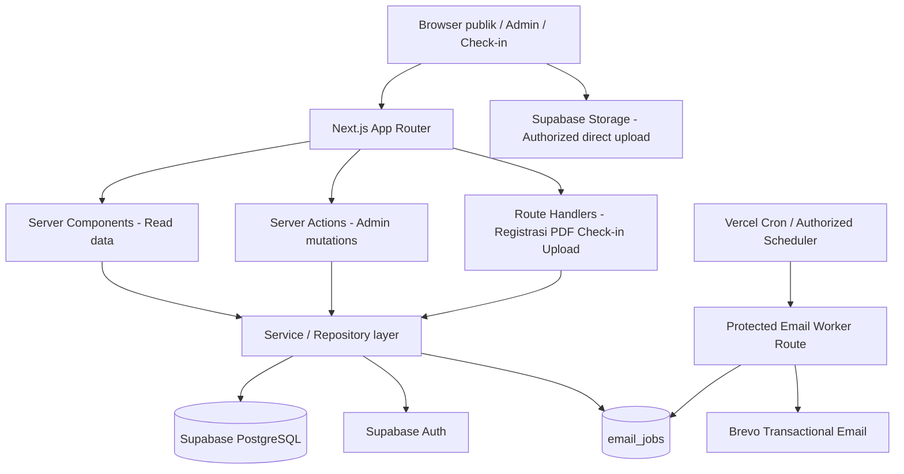
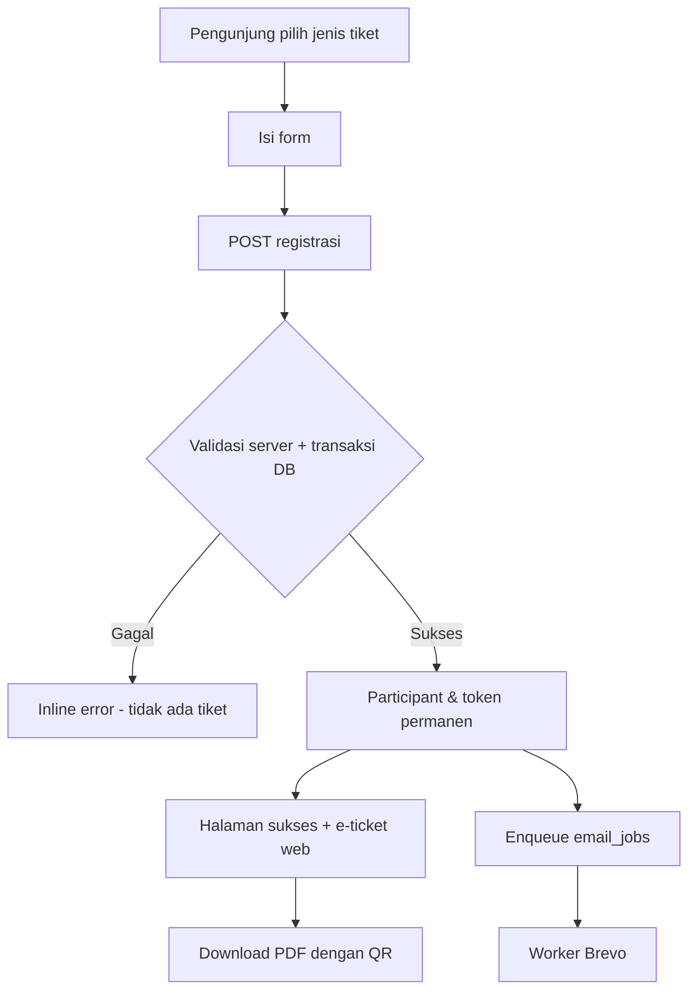
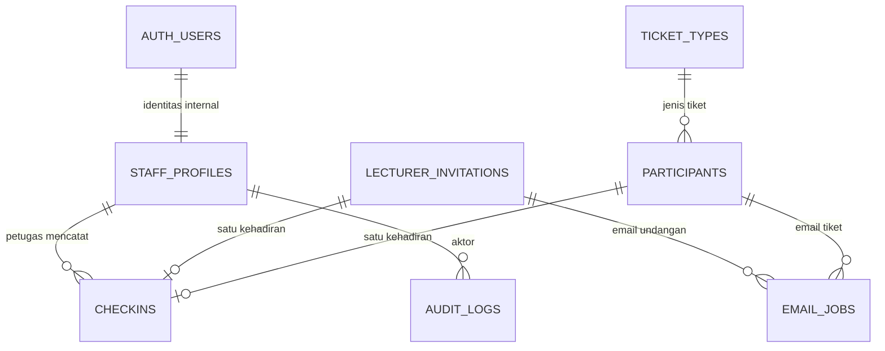

# MEMORIA — PRODUCT REQUIREMENTS DOCUMENT (PRD) BACKEND
## Phase 1 — Core Event System · Next.js Full-stack + Supabase + Brevo

> **Versi:** 1.0 — Baseline implementasi backend, 4 November 2026  
> **Status:** Scope dan keputusan produk Phase 1 disetujui; rancangan tabel/API ini menjadi spesifikasi pelaksanaan, **bukan klaim sudah diimplementasikan**.  
> **Produk:** MEMORIA, satu acara Diesnatalis SIKC.  
> **Kode utama:** Next.js App Router, TypeScript, Supabase PostgreSQL, Supabase Auth, Supabase Storage, Brevo transactional email.  
> **Zona waktu bisnis:** `Asia/Jakarta` (WIB), penyimpanan timestamp dalam `timestamptz`/UTC.  
> **Sumber pendamping:** `docs/MEMORIA-PRD-FRONTEND-V1-FINAL-BASELINE.md` dan `docs/MEMORIA-DESIGN-SYSTEM-AND-FRONTEND-STRUCTURE-V1-FINAL.md`.  
> **Prinsip:** Backend **tidak mengubah karakter desain/animasi publik** dan **tidak menghapus file atau folder proyek yang ada**. Seluruh komponen yang sekarang memakai mock data beralih ke service produksi bertahap.  
> **Pengambilan keputusan:** Keputusan backend terbaru di dokumen ini mengesampingkan keputusan lama di PRD Frontend ketika berbeda. Bagian “Asumsi implementasi dan verifikasi” tidak dianggap sebagai keputusan baru yang dibuat pengguna.

---

## Daftar isi

1. Ringkasan eksekutif dan sasaran
2. Scope Phase 1 dan di luar scope
3. Keputusan terbaru dan perubahan dari PRD Frontend
4. Aktor, autentikasi, dan matriks akses
5. Navigasi dan batas integrasi frontend existing
6. Arsitektur dan prinsip performa
7. Alur utama end-to-end
8. CMS informasi event dan countdown
9. Band tunggal dan teaser Beranda
10. Kontrol halaman Fashion Show/Awarding
11. Jenis tiket dan status otomatis
12. Registrasi mahasiswa seluruh fakultas Telkom
13. Identitas tiket permanen, QR, PDF, dan e-ticket web
14. Data peserta, edit, arsip, pemulihan, dan ekspor Excel
15. Undangan dosen, template, tautan personal, dan QR
16. Check-in kamera/manual dan popup keberhasilan
17. Akun panitia dan role internal
18. Media upload + kompresi 10 MB
19. Brevo dan antrean `email_jobs`
20. Model database minimal dan hubungan entitas
21. Spesifikasi setiap tabel
22. Constraint, index, dan fungsi transaksi SQL
23. RLS, otorisasi, privasi, dan keamanan
24. Kontrak API Route Handlers
25. Kontrak Server Actions dan data reads
26. Cache, pagination, dan target performa
27. Migration Supabase dan struktur folder
28. Environment, deployment, dan kesiapan operasional
29. Error model, status, dan idempotency
30. Rencana integrasi frontend tanpa menghapus pekerjaan
31. Test plan dan acceptance criteria
32. Urutan implementasi dan Definition of Done
33. Keputusan yang dikunci, asumsi, dan dependensi
34. Rujukan teknis resmi

---

## 1. Ringkasan eksekutif dan sasaran

### 1.1 Tujuan

Mengganti simulasi/mock data MEMORIA dengan data nyata tanpa membangun platform multi-event atau layanan terpisah. Scope backend hanya operasional inti: CMS, foto, satu band, jenis tiket gratis, registrasi, e-ticket PDF/QR/email, data peserta, undangan dosen, check-in, akun internal, statistik, dan kontrol Coming Soon untuk dua halaman pemenang.

### 1.2 Prinsip produk

- **Satu event:** tidak perlu `events` multi-tenant maupun `order` pembayaran.
- **Tidak ada login mahasiswa/dosen:** mereka menggunakan form registrasi dan tautan personal.
- **Login hanya internal:** Admin Panitia dan Petugas Check-in.
- **Satu NIM → satu tiket MEMORIA**, lintas semua jenis tiket, termasuk catatan arsip.
- **Nomor tiket + kode tiket + QR tetap** saat Admin mengubah NIM/nama/kontak.
- **Tiket gratis:** tidak ada harga yang dapat diubah, cart, invoice pembayaran, atau payment gateway.
- **Panel admin sederhana:** perubahan CMS tampil di publik setelah Simpan; format panggung/animasi tetap pada frontend.
- **Kesederhanaan:** 7 tabel bisnis inti + 1 tabel antrean email (`email_jobs`) yang disetujui; Supabase Auth dan Storage adalah fasilitas bawaan. Jangan tambah tabel hanya karena pola enterprise umum.
- **Cepat:** server-side reads singkat, Server Actions untuk mutasi dashboard, API Route Handlers hanya untuk proses yang membutuhkan endpoint, email asinkron, query berindex, pagination.
- **Keamanan nyata:** pemeriksaan aturan bisnis di server/database, bukan hanya pada form UI; RLS/revoke grants dan token acak tak mudah ditebak.

### 1.3 Keberhasilan Phase 1

Seorang mahasiswa Telkom dari salah satu delapan fakultas dapat mengambil satu tiket gratis sesuai periode, melihat e-ticket web, mengunduh PDF QR, menerima email Brevo; petugas dapat memindai QR / mencari NIM dan mencatat check-in satu kali; admin dapat mengelola seluruh konten event, tiket, peserta, undangan, akun dan melihat data konsisten antarlayar.

## 2. Scope Phase 1 dan di luar scope

### 2.1 Termasuk Phase 1 — WAJIB

| Kode | Modul | Hasil minimum produksi |
|---|---|---|
| B1-01 | Auth internal | Login/logout, 2 role, kelola akun, nonaktifkan, reset password, admin terakhir terlindungi |
| B1-02 | Informasi event/CMS | Nama acara, tagline, teks, tanggal, jam, lokasi, alamat, perhitungan countdown |
| B1-03 | Band | **Satu** foto band, nama, dan deskripsi; tanpa daftar urutan/lineup |
| B1-04 | Teaser Beranda | Judul/deskripsi/gambar Fashion Show, judul/deskripsi Awarding; tidak hardcode |
| B1-05 | Halaman publik | Kontrol independen Fashion Show dan Awarding: tampilkan konten sementara atau Coming Soon |
| B1-06 | Jenis tiket gratis | CRUD terarah, kuota opsional, publikasi, arsip, jadwal/status dinamis |
| B1-07 | Registrasi & e-ticket | Nama/NIM/prodi bebas/fakultas dropdown/HP/email; tiket permanen, QR, PDF/web, email |
| B1-08 | Data peserta | Cari/filter/pagination, detail, edit 2 tahap, arsip 2 tahap, pulihkan, kirim email ulang, Excel |
| B1-09 | Undangan dosen | Template, daftar, add/edit, undangan personal, QR, Brevo email, tautan WhatsApp |
| B1-10 | Check-in | Kamera scan QR, pencarian manual, identitas, konfirmasi hadir, popup centang dengan nama, riwayat |
| B1-11 | Dashboard & media | Metrik backend, upload foto Supabase Storage dengan kompresi dan validasi |
| B1-12 | Email delivery | `email_jobs` dan worker terjadwal untuk mengirim/mengulang Brevo tanpa blocking registrasi |

### 2.2 Di luar scope Phase 1 — JANGAN dibangun

- Voting mahasiswa, database voting/kandidat, akses private voting yang memvalidasi suara, hasil voting, laporan hasil, penjadwalan voting, dan kolom voting di Data Peserta.
- Halaman admin penentuan pemenang Fashion Show/Awarding, kategori dan foto pemenang, Draft/Publish tiap pemenang, atau pemilihan pemenang otomatis dari voting.
- Payment, order berbayar, gateway pembayaran, akun mahasiswa/dosen, WhatsApp Business API, RSVP dosen, multi-event, CMS page builder, timeline/rundown panitia.
- Layanan backend terpisah (Express/NestJS), microservice, queue server eksternal, tabel analytics clickstream, tabel media khusus, full realtime subscription.

**Frontend eksisting Phase 2:** jangan hapus file/route/komponen yang sudah dibuat. Sembunyikan navigasi operasional Voting & Kelola Pemenang, nonaktifkan mutasi mock voting, dan tampilkan state aman “Fitur belum tersedia” jika URL lama dikunjungi. Data contoh Phase 2 tidak boleh terlihat sebagai hasil produksi. Rute Fashion Show/Awarding dipertahankan.

## 3. Keputusan terbaru dan perubahan dari PRD Frontend

| ID | Keputusan backend terbaru | Pengaruh atas baseline frontend lama |
|---|---|---|
| NEW-01 | Registrasi **mahasiswa lintas seluruh fakultas/prodi Telkom** | Prodi tidak dikunci; fakultas dropdown 8 pilihan, NIM wajib |
| NEW-02 | Satu entri band saja | Hilangkan tombol “Tambah Band” berulang, daftar urutan/drag reorder |
| NEW-03 | Teaser Fashion Show: foto, judul, deskripsi editable | Tidak hardcode teks “Panggung Fashion Show” maupun narasi |
| NEW-04 | Teaser Awarding: judul dan deskripsi editable; **tidak perlu upload foto teaser** | Ilustrasi piala tetap aset desain |
| NEW-05 | Kelola Beranda hanya konten landing | Fashion Show/Awarding sebagai menu sidebar berbeda, bukan submenu pemenang saat ini |
| NEW-06 | Fashion/Awarding Phase 1 hanya toggle tampil vs Coming Soon | Daftar/kartu pemenang tidak disuplai database Phase 1 |
| NEW-07 | Voting & hasil ditunda; tidak ada kolom Vote peserta | Statistik dan Excel peserta tanpa vote |
| NEW-08 | Ticket admin `draft/published/archived`; publik otomatis `upcoming/open/sold_out/closed` | Status bukan tombol manual “upcoming” |
| NEW-09 | Arsip jenis tiket tidak membatalkan tiket aktif yang sudah diterbitkan | Status tipe dan status tiket individu dibedakan |
| NEW-10 | NIM diubah, identitas QR/tiket sama | QR menggunakan token tiket tak berubah, bukan payload NIM |
| NEW-11 | Check-in QR/manual selesai → popup nama + ceklis | Popup hanya setelah commit sukses |
| NEW-12 | Supabase DB/Auth/Storage, Next.js full-stack & SQL migrations | Tidak perlu server API kedua |
| NEW-13 | Foto asli maksimum 10 MB, dikompres otomatis sebelum upload | Proteksi validasi file/storage; alpha foto transparan dipertahankan |
| NEW-14 | Email Brevo memakai `email_jobs` | Email async; tidak perlu status pengiriman di tabel peserta |
| NEW-15 | Undangan dosen personal yang sudah ada memakai URL/QR stabil | Ubah nama/email/template tidak regenerasi token |

**Makna “terbuka untuk umum”:** dalam keputusan terbaru adalah semua mahasiswa/prodi/fakultas Universitas Telkom, **bukan** tamu masyarakat luar kampus. NIM tetap wajib. Pilihan fakultas mengikuti daftar 8 yang disetujui, tidak boleh diam-diam membuka NIM opsional.

## 4. Aktor, autentikasi, dan matriks akses

| Fitur | Publik | Check-in Staff | Admin Panitia |
|---|---|---|---|
| Baca Beranda/Fashion/Awarding | Ya | Ya | Ya |
| Lihat/daftar jenis tiket yang eligible | Ya | Ya | Ya |
| Lihat e-ticket web/PDF | Hanya token personal sah | Hanya token personal sah | Ya, berotorisasi |
| Lihat undangan personal | Hanya token undangan sah | Hanya token sah | Ya |
| Edit CMS/band/teaser/visibilitas | Tidak | Tidak | Ya |
| CRUD tiket & data peserta | Tidak | Tidak | Ya |
| Lihat/tambah dosen/edit template/kirim email | Tidak | Tidak | Ya |
| Baca identitas QR dan konfirmasi check-in | Tidak | Ya | Ya |
| Lihat riwayat check-in | Tidak | Ya | Ya |
| Kelola akun internal | Tidak | Tidak | Ya |
| Jalankan worker email | Tidak | Tidak | Hanya service/cron rahasia |

- Akun internal dibuat via server menggunakan Supabase Auth Admin API oleh Admin Panitia yang sedang login, bukan self-signup publik.
- Akses ditentukan pada server dari sesi dan `staff_profiles.role/is_active`, bukan hanya badge “Ganti Role” pada frontend. Tombol simulasi switch role dari masa mock harus dihapus/dinonaktifkan sebagai pintasan izin, **tanpa menghapus file fiturnya**.
- Supabase Auth menggunakan cookie SSR sesuai versi Next.js existing. `middleware.ts` atau `proxy.ts` dipilih setelah memeriksa versi repo.
- `service_role`/secret key hanya server; tidak boleh ada di bundle browser, logs, atau `NEXT_PUBLIC_*`.
- Admin terakhir tidak bisa dinonaktifkan/diturunkan role, diverifikasi dalam transaksi sehingga dua admin tidak bisa bersamaan menghapus hak admin terakhir.
- Rekomendasi keamanan awal: Admin membuat password sementara; user menggantinya saat pertama login. **Rekomendasi implementasi**, bukan aturan baru yang diklaim sudah disetujui.

## 5. Navigasi dan batas integrasi frontend existing

| URL yang ada/diusulkan | Data backend Phase 1 | Catatan perubahan |
|---|---|---|
| `/` | event settings, band tunggal, teaser Fashion/Awarding | Countdown client menghitung dari `event_start_at` |
| `/fashion-show` | flag `fashion_page_visible` | Off → Coming Soon; On → layout existing tanpa publikasi pemenang baru |
| `/awarding` | flag `awarding_page_visible` | Sama; jangan expose mock pemenang sebagai hasil resmi |
| `/daftar` | daftar jenis tiket (read ringkas + status turunan) | Floating ticket tetap ada |
| `/daftar/[ticketId]` | form registrasi + jenis tiket | NIM wajib, prodi bebas, fakultas 8 |
| `/daftar/berhasil` | e-ticket hasil pendaftaran | Jangan mengandalkan state in-memory saja; gunakan token personal |
| `/tiket/[token]` | e-ticket web personal | Rute baru jika belum ada; token acak |
| `/undangan/[inviteToken]` | undangan personal & QR | Animasi amplop tetap frontend |
| `/panitia/login` | Supabase Auth | Tanpa self-register |
| `/panitia` | metrik agregat | Tidak mengambil seluruh record |
| `/panitia/website/beranda` | event + teaser | Kelola Beranda |
| `/panitia/website/band` | satu form band | Route lama tetap bisa dipakai, tanpa lineup |
| `/panitia/fashion-show` | kontrol toggle tampil/Coming Soon | Sidebar baru atau alias aman dari route lama |
| `/panitia/awarding` | kontrol toggle tampil/Coming Soon | Sidebar baru atau alias aman dari route lama |
| `/panitia/tiket/**` | CRUD jenis tiket | Read dari DB, mutation terjaga |
| `/panitia/peserta/**` | data peserta + edit/arsip/pulihkan | Hilangkan kolom Vote |
| `/panitia/undangan/dosen` | daftar dosen | Kontak + hadir + aksi |
| `/panitia/undangan/template` | template di event settings JSON | Preview menggunakan data event terbaru |
| `/panitia/check-in` | scan, manual, riwayat | Popup sukses nama setelah commit |
| `/panitia/akun` | Supabase Auth + profiles | Dua role |
| `/panitia/voting/**`, `/vote/**` | **deferred** | Tidak boleh menerima/menyajikan hasil voting resmi Phase 1 |

Jangan merombak layout/GSAP, URL publik yang sudah dibagikan, atau font. Prioritas integrasi: ganti data provider/mock adapter, pertahankan presentational components, tambahkan guard/validasi server.

## 6. Arsitektur dan prinsip performa



- Gunakan **server read langsung** (tanpa internal HTTP fetch ke endpoint milik sendiri) dari Server Components ke service/repository.
- Gunakan **Server Actions** untuk data admin dan CRUD; cek ulang sesi/role pada masing-masing action.
- Gunakan **Route Handlers** untuk registrasi publik, token PDF, resolve/confirm check-in dan otorisasi upload.
- Gunakan **satu worker email terlindungi** untuk queue; worker bukan rute publik bebas.
- Baca Beranda cukup 1 query row `event_settings` (termasuk band/teaser), hindari waterfall dari 4 endpoints.
- Countdown 1× per detik di browser, tanpa polling database tiap detik; sumber waktu event dari server.
- Tabel peserta/dosen/tiket dengan pagination, filter di server, query berindex, bukan mengirim seluruh PII ke browser.
- Status jadwal tiket dihitung berdasarkan `now()` di server (bukan cron mengubah status tiap jam).
- Cache hanya data CMS relatif statis dengan invalidasi saat disimpan; jangan cache keputusan final registrasi/check-in/auth.
- Animasi GSAP berjalan di klien tanpa request API berulang.

## 7. Alur utama end-to-end

### 7.1 Pendaftaran tiket



### 7.2 Undangan dosen

Admin simpan template → Admin tambah dosen → sistem buat ID, kode, tautan dan QR unik → Admin memilih Kirim Email (queue) / WhatsApp (membuka chat draft) → dosen klik link → klik **Buka Undangan** → surat dan QR terlihat → petugas check-in.

### 7.3 Check-in

Scan kamera / input manual → `resolve` → server kembalikan identitas minimal + token resolusi singkat → petugas klik **Hadirkan** → `confirm` transaksi tunggal → jika `CREATED`, popup centang hijau dengan nama, tanggal/jam server → Scan Berikutnya. Jika `ALREADY_CHECKED_IN`, tampilkan informasi sebelumnya, **bukan** popup sukses palsu.

### 7.4 Koreksi NIM

Admin membuka peserta → dua tahap verifikasi → ubah NIM saja (atau field lain yang disetujui) → DB cek unique NIM → `participants.id`, `ticket_number`, `qr_token` dan `ticket_access_token` **tidak berubah** → scan QR lama melihat NIM terkini → PDF lama masih teks NIM lama tetapi QR valid; PDF unduh ulang memuat NIM terbaru.

### 7.5 Arsip/pulihkan

Admin dua tahap verifikasi → `active` menjadi `archived` (tidak delete) → penggunaan kuota turun 1 → QR ditolak untuk check-in baru. Pemulihan cek kuota per jenis dan NIM unique, mengaktifkan kembali identitas tiket yang sama; riwayat check-in lama tetap ada. Arsip jenis tiket (`ticket_types.status=archived`) **tidak** membatalkan peserta/tiket lama.

---

## 8. CMS informasi event dan countdown

### 8.1 Input Admin

- `event_name` (wajib), `tagline`, `description`, `event_start_at` (wajib), `event_end_at` (opsional; setelah start), `timezone` (`Asia/Jakarta`), `venue_name` (wajib), `venue_address` (opsional), `footer_text` (opsional).
- Judul `Memoria` di hero, label tanggal/jam, tempat, dan countdown berasal dari satu row. Tidak hardcode 20 November 2026 atau venue contoh dari screenshot.
- Gunakan antarmuka tanggal dan waktu lokal WIB; konversi ke UTC timestamp saat simpan. Hari/tanggal/tahun dan jam teks diturunkan dari timestamp untuk menghindari mismatch.
- Validasi `event_start_at < event_end_at` bila end tersedia.
- Simpan langsung terlihat pada publik dengan cache revalidation; tidak ada Draft/Publish untuk CMS umum.

### 8.2 Countdown

- Pada render server, kirim timestamp ISO UTC dari DB. Di client kalkulasi `max(0, start - now)`; detik, menit, jam, hari terpisah.
- Jangan mengirim API setiap detik.
- Hindari hydration mismatch: gunakan placeholder stabil sebelum client mounted atau timestamp kompensasi client. `prefers-reduced-motion` hanya mengurangi animasi, tidak menghentikan angka.
- Jika sudah lewat: angka tidak negatif; tampilkan copy acara dimulai/sudah berlangsung yang sesuai data end; bila end tidak ada, minimal “Waktu acara telah tiba”.
- Informasi event yang sama dipakai untuk e-ticket web, PDF hasil generasi terbaru, dan undangan personal.

## 9. Band tunggal dan teaser Beranda

### 9.1 Band tunggal

- `band_name`, `band_description`, `band_image_path` (nullable) disimpan di `event_settings` satu row.
- Admin melihat satu form Ganti/Upload Foto, Nama Band, Deskripsi, Simpan. **Tidak ada urutan, tidak ada `bands` tabel, tidak ada Tambah Band #2**.
- Perubahan langsung terlihat di panggung Band. Panggung velvet/animasi dan pedestal tetap komponen frontend, file foto berubah sesuai path Storage.
- Jika foto tidak diisi, tampilkan fallback editorial, jangan image rusak atau data dummy produksi.

### 9.2 Teaser Fashion Show

`fashion_title`, `fashion_description`, `fashion_image_path` editable. Foto yang Admin upload menggantikan model/teaser pada visual runway dan tetap memperoleh efek cahaya/animasi existing; disarankan foto PNG/WebP transparan bila dibutuhkan. Tidak ada input pemenang pada Phase 1.

### 9.3 Teaser Awarding

`awarding_title`, `awarding_description` editable. **Tidak ada upload foto teaser**; patung piala dan light rig tetap ilustrasi desain yang sudah dibuat.

## 10. Kontrol halaman Fashion Show/Awarding

- Masing-masing sidebar punya satu setting boolean: `fashion_page_visible` dan `awarding_page_visible`.
- `false`: route tetap dapat dikunjungi tetapi menampilkan template **Coming Soon** dengan informasi minim dan tombol Beranda.
- `true`: render halaman sesuai frontend existing **tanpa** memublikasikan mock winner atau memperkenalkan form pemenang Phase 1. Apabila section pemenang kosong, tampilkan state publik aman “Informasi pemenang belum tersedia”; jangan render dummy seeded.
- Perubahan hanya Admin, langsung tampak setelah Simpan. Tidak mengubah status halaman satunya.
- Pada Phase 2 kontrol tetap dipakai, lalu halaman masing-masing mendapat CRUD pemenang manual terpisah; Voting Management menjadi modul berbeda.

## 11. Jenis tiket dan status otomatis

### 11.1 Form Admin

- Nama jenis tiket (wajib), deskripsi (opsional).
- Gratis / Rp0 **permanen**, tidak ada field harga yang bisa diedit.
- `capacity` NULL = tidak dibatasi; jika ada, integer positif.
- `registration_open_at` dan `registration_close_at`, keduanya wajib dan berurutan.
- `status`: `draft`, `published`, `archived`; publikasi tipe bukan hasil dari jadwal.
- Tombol: Tambah, Edit, Publish/Unpublish (ke Draft), Archive (dengan konfirmasi), opsional kembalikan Archive → Draft (bukan ke Published otomatis).
- Jika ada peserta aktif, jangan turunkan kuota hingga di bawah jumlah peserta aktif; jangan hapus tipe ticket yang pernah dipakai.

### 11.2 Status publik **derived**, tidak disimpan sebagai enum kedua

Prioritas evaluasi pada saat `now()` di server:

| Administrasi | Aturan waktu/kuota | Status UI publik |
|---|---|---|
| `draft` atau `archived` | Apa saja | **Tidak ditawarkan** di halaman pilih tiket |
| `published` | `now < open_at` | `UPCOMING` |
| `published` | `now >= close_at` | `CLOSED` |
| `published` | Di dalam periode dan `capacity != null` serta `active_count >= capacity` | `SOLD_OUT` |
| `published` | Di dalam periode dan kapasitas cukup/tanpa batas | `OPEN` |

- Di list Admin tetap perlihatkan status admin dan status turunan terpisah. Hindari label `Tidak Aktif` untuk sold out.
- Penggunaan kuota = `COUNT(participants WHERE status='active' AND ticket_type_id=...)`, termasuk yang telah check-in. Arsip peserta mengembalikan kursi; archived jenis tiket tidak mengubah kuota pemakaian historis.
- `UPCOMING`, `SOLD_OUT` dan `CLOSED`: tombol daftar nonaktif, info alasan jelas. Publikasi tidak otomatis membuat tiket OPEN sebelum jam mulai.
- Membaca status boleh cache singkat bila UI mau, tetapi registrasi akhir **selalu** memeriksa status waktu server dan kuota dalam transaksi.
- Ketika jenis tiket di-archive, **registrasi baru tidak diizinkan**, namun tiket peserta lama tetap valid untuk check-in. Ketika peserta lama sudah diarsipkan, pemulihannya diperlakukan sebagai pemulihan hak lama (bukan registrasi baru) dan tetap wajib cek kuota; keputusan yang mungkin perlu UX khusus pada tipe Archived dicatat sebagai asumsi teknis §33.
- Edit periode publikasi tidak mengubah masa berlaku identitas QR peserta yang telah terdaftar.

### 11.3 Kasus bersamaan

Jika tersisa satu kursi dan dua request daftar datang serentak, salah satu sukses dan satu mendapat `TICKET_SOLD_OUT`; jangan membuat count di client sebagai sumber kebenaran. Transaksi membuat insert peserta + enqueue email atomik.

## 12. Registrasi mahasiswa seluruh fakultas Telkom

### 12.1 Field dan validasi

| Field | Tipe | Aturan server |
|---|---|---|
| `ticketTypeId` | UUID | Wajib; tipe Published, jadwal OPEN, kuota cukup |
| `fullName` | string | Wajib, trim; panjang wajar (mis. 2–150) |
| `nim` | string | Wajib; bukan integer; normalisasi trim/case; unique seluruh peserta termasuk archive |
| `studyProgram` | string | Wajib; input bebas, tidak hardcode D4 SIKC |
| `faculty` | enum string | Wajib, hanya delapan pilihan disetujui |
| `phone` | string | Wajib; normalisasi untuk komunikasi WhatsApp; tidak perlu unique |
| `email` | email | Wajib; normalisasi case; tidak perlu unique peserta |
| `idempotencyKey` | string/UUID | Identifier request untuk aman dari retry/double-click (rekomendasi teknis) |

**Daftar fakultas persis:**

1. Fakultas Ilmu Terapan
2. Fakultas Komunikasi Sosial
3. Fakultas Ekonomi Bisnis
4. Fakultas Industri Kreatif
5. Fakultas Informatika
6. Fakultas Teknik Elektro
7. Fakultas Kedokteran
8. Fakultas Rekayasa Industri

- Pastikan penulisan daftar pada UI/backend mengikuti opsi terkini yang disetujui, bukan di-lock ke Fakultas Ilmu Terapan. Jika kebijakan fakultas Universitas Telkom kelak berubah, Admin/owner perlu memutakhirkan daftar; jangan diam-diam menerima nilai bebas selain delapan pilihan saat ini.
- Batas satu tiket berdasarkan `nim_normalized` yang unik di DB, bukan kombinasi NIM dan jenis tiket. Nama sama diperbolehkan.
- Gunakan throttling dan validasi input di public handler; pesan duplikasi NIM tidak membocorkan detail identitas/tiket peserta lain.
- Sukses berarti transaksi DB selesai. Email bisa menyusul; kegagalan Brevo tidak menggagalkan tiket.

### 12.2 Identitas perguruan tinggi

Sistem menerima input NIM dari form; **ini bukan validasi ke sistem akademik Telkom**. Phase 1 tidak mempunyai integrasi SSO/daftar mahasiswa resmi. Form terbuka untuk pendaftar yang mengaku mahasiswa dengan NIM; panitia dapat memeriksa identitas saat acara. Jika dibutuhkan verifikasi institusi ketat, tambahkan sebagai requirement fase berbeda.

### 12.3 Status response

- 201 → tiket berhasil diterbitkan, URL akses personal tersedia.
- 422 → field invalid / nilai fakultas di luar pilihan.
- 409 → NIM sudah terdaftar, jenis tiket sold out, atau idempotency conflict (error code berbeda).
- 403/410 → pendaftaran belum dibuka/sudah ditutup/diarsipkan.
- 429 → rate limit.
- 503 → gangguan backend sementara, jangan mengklaim pendaftaran berhasil.

## 13. Identitas tiket permanen, QR, PDF, dan e-ticket web

### 13.1 Model sederhana tanpa tabel order

Satu baris `participants` menyimpan data mahasiswa plus identitas tiket. Karena tidak ada pembayaran dan satu peserta satu tiket, **tidak perlu `orders` maupun `issued_tickets` terpisah** pada Phase 1.

- `participants.id`: UUID permanen, primary key, tidak bergantung pada NIM.
- `ticket_number`: kode display seperti `MEM-XXXXXX`, unique, immutable.
- `qr_token`: token random high entropy, unique, immutable, **tidak berisi NIM**.
- `ticket_access_token`: token random terpisah untuk akses halaman/PDF personal, unique, immutable.
- `ticket_type_id`: foreign key ke jenis tiket; edit lintas jenis (jika diperbolehkan UI) harus ditangani dengan pemindahan kuota atomik, **tidak** meregenerasi QR/ticket_number.

### 13.2 QR yang tetap berlaku saat NIM berubah

**Payload QR yang direkomendasikan:** `memoria:ticket:v1:<qr_token>` atau URL scanner-terverifikasi menggunakan token yang sama. Scanner mengirim token ke server; server lookup `participants.qr_token` lalu mengambil NIM/nama **terbaru** berdasarkan primary key.

- QR pada PDF lama tetap dapat dipindai setelah NIM diedit.
- PDF lama mungkin masih menampilkan teks NIM lama; unduhan ulang/“Kirim Email” membuat PDF dengan teks NIM terbaru tetapi QR identik.
- Saat peserta archived: token sama, tetapi validasi menjawab `ARCHIVED_TICKET` untuk check-in baru.
- Saat restored: token yang sama kembali valid jika belum check-in; jika sudah check-in, respons “Sudah hadir” tidak direset.
- Saat `ticket_types` archived: peserta **yang active** tetap memiliki QR valid, tidak ikut dinonaktifkan.
- QR hanya berisi token opaque, **tidak** menyematkan nama, NIM, email, atau nomor WhatsApp.

### 13.3 E-ticket web

Rute `/tiket/[ticket_access_token]` harus membaca data peserta terkait + jenis tiket + CMS event. Render: nama peserta, NIM terkini, prodi, fakultas, kategori tiket, nomor tiket, QR, nama event, tanggal/hari/jam WIB, lokasi/alamat, informasi penggunaan.

- Token diperlakukan sebagai bearer secret; gunakan URL random sulit ditebak dan tanpa indexing/search engine; `Cache-Control: private, no-store`, jangan tampilkan data orang lain.
- Jika peserta diarsipkan, halaman boleh menampilkan data identitas untuk referensi Admin/pemegang link dengan status tegas “Tiket Tidak Aktif” dan QR ditandai tidak berlaku; tidak boleh seolah tiket sah.
- Jika token tak valid: error generik, tanpa petunjuk keberadaan peserta lain.

### 13.4 PDF

- `GET /api/tickets/[token]/pdf`: generate on demand; dari sumber data terkini, bukan file PDF statis lama.
- QR sama dengan e-ticket web; perubahan tanggal/venue CMS tercermin pada PDF baru. Nama file contoh `MEMORIA-MEM-000001.pdf`.
- Di PDF tampil event, hari/tanggal, jam, tempat/alamat, nama, NIM, prodi, fakultas, jenis tiket, nomor tiket, kode yang diperlukan, QR dan instruksi singkat.
- Pastikan font tertanam/teks tidak terpotong, QR hitam-putih dengan quiet zone, tidak tertindih overlay dekoratif.
- PDF privat: response `application/pdf`, `Content-Disposition: attachment`, `no-store`; rate-limit permintaan berulang agar tidak disalahgunakan.
- Email Brevo memakai lampiran PDF yang digenerate dari service yang sama, bukan memanggil rute internal HTTP publik untuk mengambil data secara tidak aman.

### 13.5 Token security

Gunakan CSPRNG (cryptographically secure) minimal 128-bit entropy untuk token personal, ideal 192–256 bit. Jangan token berdasarkan NIM, email, nomor urut, atau URL slug mudah ditebak. Token tidak boleh dicetak dalam log analytics. Batasi baca DB langsung; tindakan check-in hanya oleh petugas dengan sesi sah. Bila perlu penonaktifan darurat setelah tautan bocor, keamanan memerlukan kebijakan revocation/rotasi token yang kelak mengubah QR; **tidak** dilakukan otomatis pada koreksi NIM.

## 14. Data peserta, edit, arsip, pemulihan, dan ekspor Excel

### 14.1 Tampilan data

- Dua tab: **Peserta Aktif** dan **Arsip Peserta**.
- Kolom: nama, NIM, prodi, fakultas, jenis tiket, email/WhatsApp, status hadir, waktu check-in, aksi.
- **Tidak ada kolom Vote** dan tidak ada statistik voting Phase 1.
- Filter jenis tiket, kehadiran, status; search nama/NIM; paginasi 25 atau 50 record.
- Export **Excel `.xlsx` saja**, sesuai filter yang dipilih atau semua bila tanpa filter; konten ekspor sesuai whitelist kolom, tidak memuat token QR/link personal, password, atau audit rahasia.

### 14.2 Aksi

| Aksi | Flow | Hasil |
|---|---|---|
| Detail | Admin buka panel detail | Data lengkap + tiket dan riwayat check-in bila ada |
| Kirim Email | Admin konfirmasi email tujuan → enqueue `ticket_resend` | Notifikasi “Email dijadwalkan dikirim” (bukan terkirim jika Brevo belum respon) |
| Edit Data | Edit form → preview perbedaan (verifikasi 1) → reautentikasi Admin (verifikasi 2) → submit | Cek NIM unique, audit; token/QR/nomor tetap |
| Hapus Data | Preview dampak arsip (verifikasi 1) → reautentikasi Admin + konfirmasi eksplisit (verifikasi 2) → Arsip | `status=archived`, QR tidak aktif, kuota kembali |
| Pulihkan | Pilih peserta arsip → konfirmasi → cek kuota + NIM + status → restore | Tiket lama aktif lagi, count kuota bertambah |

**Tidak hard-delete peserta.** Data diarsipkan untuk koreksi operasional; akses data arsip tetap hanya Admin. Jika peserta sudah hadir lalu diarsipkan, catatan check-in tetap ada untuk audit.

### 14.3 Verifikasi dua tahap yang benar

Tahap 1 adalah konfirmasi perubahan dan dampak. Tahap 2 harus benar-benar memverifikasi identitas Admin di server (misalnya *recent re-authentication* / password yang diverifikasi dengan mekanisme Supabase Auth), **bukan** sekadar mengetik `HAPUS` di browser lalu dianggap aman. Password tidak disimpan/ditulis dalam log atau data peserta; tiket tidak dimutasi sebelum verifikasi sukses.

- Persetujuan tahap 2 berjangka singkat dan terikat Admin + jenis operasi + record/versi perubahan. Hindari replay edit lama.
- Setiap edit, arsip dan pulihkan tulis audit `actor_id`, timestamp, target, perubahan aman (hindari menyalin data pribadi penuh bila tidak diperlukan).
- Jika dua Admin mengedit bersamaan, gunakan pemeriksaan `updated_at`/version optimistic lock dan respons konflik.

### 14.4 Kuota & perpindahan jenis tiket

Jika Admin mengubah jenis tiket peserta (bila tindakan ini tersedia pada frontend), transaksi harus sekaligus memeriksa kapasitas tipe tujuan, mengubah relasi, dan melepas kursi tipe lama. Identitas tiket tidak berubah. Bila fitur pindah jenis tidak tersedia, jangan tambahkan diam-diam ke UI; service mampu menolak `TICKET_TYPE_CHANGE_NOT_ALLOWED`.

## 15. Undangan dosen, template, tautan personal, dan QR

### 15.1 Template dari CMS

Simpan `invitation_template` sebagai JSONB terstruktur pada `event_settings` satu row, bukan tabel baru:

```json
{
  "subject": "Undangan MEMORIA",
  "greeting": "Kepada Yth. Bapak/Ibu {{nama_dosen}}",
  "body": "Dengan hormat, kami mengundang Bapak/Ibu ...",
  "closing": "Atas perhatian dan kehadirannya kami ucapkan terima kasih.",
  "senderName": "Panitia MEMORIA"
}
```

- Substitusi variabel yang diizinkan dari whitelist: `nama_dosen`, `nama_acara`, `tanggal_acara`, `waktu_acara`, `lokasi_acara`, `link_undangan`. Reject/escape placeholder tak dikenal; output HTML harus di-escape untuk mencegah script injection.
- Template disimpan → undangan personal yang dibuka kemudian langsung memakai template terbaru. Preview Admin memakai data contoh, tanpa mengirim email.
- Jam/tempat surat mengikuti `event_settings`, bukan string jadwal terpisah di dalam template.

### 15.2 Data dosen

- Nama lengkap dan gelar, email unik **hanya untuk undangan aktif**, nomor WhatsApp, kode undangan manual, public token, QR token, `is_active`, timestamp.
- Tambah dosen → generate token dan kode satu kali → persisten → link personal `https://<domain>/undangan/<token>`.
- Edit nama/email/HP → data surat diperbarui, `invitation_code`, `public_token`, `qr_token` tetap.
- Nonaktifkan undangan: tidak diterima untuk check-in baru; tidak hard-delete data/riwayat.
- Email sudah dipakai undangan aktif lain → tolak `DUPLICATE_INVITATION_EMAIL`.

### 15.3 Pengiriman

- **Email:** Admin klik Kirim Email → konfirmasi → enqueue `lecturer_invitation` dengan penerima terbaru → worker Brevo mengirim body/tautan undangan; QR ada di surat web, tidak perlu ditempel sebagai QR di body email bila belum diperlukan.
- **WA:** Admin klik Kirim WA → buat `wa.me` URL dengan pesan personal + tautan. Browser membuka WhatsApp, panitia menekan tombol Kirim sendiri. Jangan mencatat seolah pesan WA sudah terkirim.
- **Salin Link:** mengambil token undangan yang sudah ada, tidak regenerasi.
- **Tidak ada kolom status pengiriman email permanen** di UI; backend `email_jobs` hanya untuk antrian/reties dan troubleshooting terkontrol.

### 15.4 Halaman publik

Animasi awal menampilkan amplop **tertutup**, klik `Buka Undangan` memicu animasi terbuka dan surat keluar; isi dari template terbaru + data dosen/event. Button `Lihat QR Undangan` scroll/fokus ke QR yang bisa dipindai. Animasi tidak mengubah token/validitas QR.

## 16. Check-in kamera/manual dan popup keberhasilan

### 16.1 Scanner kamera

- Petugas login membuka `/panitia/check-in`, memberi izin kamera. Frontend memakai QR decoder nyata (bukan simulasi), scan QR tiket mahasiswa atau undangan dosen.
- QR hanya memuat token `memoria:ticket:v1:...` / `memoria:invitation:v1:...`; backend resolve berdasarkan tipe. Jangan percaya nama/NIM yang tersisip dalam teks QR dari sumber asing.
- Scanner jeda pembacaan setelah menemukan token agar tidak membanjiri endpoint; setelah dialog dibatalkan/selesai boleh scan berikutnya.
- Bila kamera ditolak/tidak tersedia, tampilkan alternatif pencarian manual.

### 16.2 Manual

- Mahasiswa: cari NIM terkini → lihat identitas (nama, NIM, jenis tiket, status) → tombol Hadirkan.
- Dosen: cari email atau kode undangan → lihat nama/gelar + status → Hadirkan.
- Jika hasil ambigu, tampilkan daftar pilihan terbatas yang dapat dipastikan petugas; jangan membuat check-in hanya berdasarkan nama tanpa identitas.
- Jangan mengizinkan `POST confirm` dengan data identitas mentah tidak tervalidasi dari browser. Gunakan opaque, short-lived **resolution token** server atau validasi ulang pada confirm dengan ID target + type + sesi Admin/Petugas; semua final check di DB.

### 16.3 Popup baru — wajib

Setelah insert checkin pertama berhasil, tampilkan dialog sukses:

- Ikon centang hijau dengan micro-animation.
- Judul **Check-in Berhasil!**
- Nama orang yang baru hadir (nama terbaru dari server).
- Label Mahasiswa / Dosen / Tamu Kehormatan.
- Tanggal dan jam `checked_at` dalam WIB.
- Tombol **Scan Berikutnya** (reset panel result, re-arm camera bila ada).

**Popup hanya setelah `CREATED`, tidak pada `ALREADY_CHECKED_IN`/network failure.** Jika sudah pernah check-in, tampilkan waktu pertama, jangan overwrite. Jika dua petugas bersamaan, hanya satu insert (UNIQUE constraint DB). Tidak ada fitur tutup check-in, tidak perlu status open/close gate.

### 16.4 Waktu, statistik, log

- `checked_at` diisi default DB/server; jangan memakai jam device.
- `checkins` menyimpan satu record per orang, `method='qr'|'manual'`, `checked_by=auth.uid()`.
- Dashboard count mahasiswa hadir + dosen hadir; total = gabungan keduanya. Tidak termasuk yang hanya membuka QR tanpa klik Hadirkan.
- Status hadir turunan dari `checkins` dan dipakai untuk Data Peserta/Undangan.
- Event tidak punya batas check-in waktu; validitas tiket/undangan aktif dan satu-satunya check-in adalah aturan utama.

## 17. Akun panitia dan role internal

- Supabase Auth menyimpan login email/password; `staff_profiles` menyimpan nama, role, active.
- Admin membuat akun baru lewat Server Action memakai Admin API server-only. **Tidak boleh membuka signup publik**.
- Login memverifikasi sesi Supabase, lalu profile ada, `is_active=true`; jika `checkin_staff` redirect `/panitia/check-in`, jika Admin redirect `/panitia`.
- Role Admin dapat melihat semua. Role Check-in Staff hanya akses scanner/manual/riwayat. Middleware/proxy hanya untuk UX cepat; Server Actions, Route Handlers, RLS & DB functions tetap menjadi sumber otorisasi.
- Aksi Edit akun, Reset password, Nonaktifkan/Aktifkan; email unik mengikuti Supabase Auth. Jangan pernah menampilkan password lama.
- Reset password melalui alur aman; jangan mengirim password mentah via email umum. Jika Admin memasukkan password sementara, force-change pada first login direkomendasikan jika disetujui.
- Admin terakhir tidak bisa dinonaktifkan atau diturunkan role. Protect against simultaneous operation using DB function / lock.
- Kegagalan pembuatan profile sesudah Auth user dibuat harus direkonsiliasi (hapus Auth user yang belum lengkap secara terkontrol atau retry idempotent); jangan membiarkan orphan account berhak login.
- Login/logout/role check harus diuji di Vercel production-like environment, termasuk cookies SSR/refresh.

## 18. Media upload + kompresi 10 MB

### 18.1 Keputusan

- Foto yang dipilih Admin boleh maksimum **10 MB file asli**. Frontend melakukan validasi ukuran input dan kompresi otomatis sebelum upload.
- Format input aman: JPEG, PNG, WebP; file transparan harus tetap punya alpha, hasil WebP transparan jika cocok. Hindari upload user SVG/HTML yang berisiko XSS untuk bucket publik.
- Target hasil teroptimasi disarankan <= 2 MB dan dimensi sisi panjang ~1600–2000 px; bukan jaminan semua foto mencapai target. Jika hasil masih besar, tampilkan peringatan atau lakukan kompres ulang berkualitas adaptif.
- Metadata yang disimpan adalah Storage object path, bukan base64 gambar di Postgres.

### 18.2 Flow cepat

Admin memilih foto → browser cek MIME/ukuran/dimensi → kompres/re-encode (pertahankan alpha) → preview → server memeriksa sesi Admin dan memberikan izin/signed upload path terbatas → browser upload langsung ke Supabase Storage → server verifikasi object, metadata, ownership/path dan content-type → simpan `*_image_path` pada CMS → invalidasi cache → publik menggunakan asset terbaru.

- Jangan mengirim file asli 10 MB melalui Next.js Route Handler Vercel (batas payload fungsi). Upload langsung ke Supabase Storage; pakai resumable TUS bila hasil > ~6 MB / koneksi tidak stabil.
- Simpan bucket publik contoh `memoria-media` untuk foto band/teaser saja, tidak untuk token QR/data pribadi. Upload/edit tetap hanya Admin. Folder `band/`, `fashion/`, `cms/` opsional, path unik UUID dan tidak ditimpa agar cache/CDN konsisten.
- RLS pada `storage.objects` dan/atau signed upload URL dengan path yang diotorisasi. Browser tidak mendapat secret key.
- Validasi original 10 MB pada browser adalah UX; backend/storage **harus** membatasi file yang benar-benar diterima dan tipe kontennya—batas browser saja tidak aman jika request dimanipulasi.
- Penggantian foto yang lama tidak menghapus file existing secara membabi buta. Asset orphan dapat dibersihkan di maintenance terpisah hanya setelah dipastikan tidak direferensikan.

### 18.3 Preview dan fallback

Jika upload gagal, data CMS lama dipertahankan, tampilkan retry. Jika file setelah kompres kehilangan alpha atau kualitas buruk, tampilkan preview agar Admin bisa batal. Jika tidak ada foto Band, gunakan fallback desain existing tanpa hardcode nama artis.

## 19. Brevo dan antrean `email_jobs` (ACC)

### 19.1 Tujuan

Email tiket dan undangan **tidak menghambat transaksi registrasi/penyimpanan**. `email_jobs` adalah tabel teknis kedelapan, bukan kolom status email di daftar peserta.

### 19.2 Alur enqueue

- Registrasi sukses membuat peserta + email job `ticket_initial` **dalam transaksi yang sama**.
- Admin menekan Kirim Ulang Tiket → buat job `ticket_resend` dengan key dedupe untuk satu aksi.
- Admin menekan Kirim Undangan Dosen → buat job `lecturer_invitation`.
- `pending` jobs diklaim worker (lock/lease) → Brevo API → sukses `sent` plus message ID → gagal sementara `retry` dengan backoff → gagal permanen `failed` dengan error internal sanitasi.
- Tidak ada pengiriman email jika transaksi pendaftaran rollback.
- Retry dibatasi (rekomendasi default 5 upaya dengan exponential backoff). Admin dapat mencoba ulang lewat tombol jika gagal permanen tanpa memerlukan dashboard email sendiri.

### 19.3 Perilaku UX yang jujur

- Setelah pendaftaran, halaman sukses dan PDF langsung dapat diakses. Email diproses asynchronous; copy UI **“Tiket berhasil diterbitkan; email sedang diproses”**, jangan menjamin “sudah terkirim” bila baru masuk antrean.
- Sesudah klik Kirim Email dosen/resend, tampilkan **“Permintaan pengiriman dijadwalkan”**; bukan “Terkirim” sampai provider menerima.
- Tidak ada status email pada tabel Data Peserta maupun daftar dosen, sesuai keputusan.

### 19.4 Worker

- Protected route contoh `GET /api/internal/email-worker` dipanggil Vercel Cron/scheduler yang tersedia. Wajib validasi `CRON_SECRET`/authorization, rahasia hanya server.
- Worker mengambil batch kecil (mis. 10–25), mengunci secara atomik dengan `FOR UPDATE SKIP LOCKED`/lease, tidak memproses job yang sama serentak.
- Generate konten dari record terkini, lampirkan e-ticket PDF dari generator internal, panggil Brevo `POST /v3/smtp/email` dengan API key server-only.
- Gunakan batas waktu request, klasifikasi 429/5xx (retry), 4xx invalid address (fail), catat provider message ID dan waktu.
- Bila response Brevo timeout setelah email terkirim tapi sebelum DB menerima sukses, retry dapat menyebabkan **email duplikat**. Jaminan “tepat sekali” secara absolut tidak realistis tanpa dukungan dedupe penyedia; gunakan idempotency job + upaya terkontrol, jelaskan sebagai *at-least-once delivery best effort*.
- Cron interval bergantung batas plan Vercel. Jangan menjanjikan pengiriman dalam hitungan detik tanpa queue worker yang memproses segera. Konfigurasi harus disesuaikan dengan paket deployment.
- Tidak ada email marketing/subscribe; hanya transactional.

### 19.5 Brevo delivery

- Sender email dan nama dari env (sender diverifikasi di Brevo).
- Email mahasiswa: subject MEMORIA E-Ticket, ringkasan event, nomor tiket, link personal, lampiran PDF QR.
- Email dosen: sapaan personal, isi template, waktu/tempat, link undangan. QR dilihat pada halaman undangan.
- Batasi ukuran attachment PDF, escape input pada HTML, sertakan versi plain text jika memungkinkan.
- Jangan menaruh `ticket_access_token`, `qr_token`, email, atau data sensitif pada log/analytics umum.

---
## 20. Model database minimal dan hubungan entitas

### 20.1 Tabel yang dipakai

| No. | Tabel bisnis | Fungsi utama | Mengapa tidak dipisah lagi |
|---|---|---|---|
| 1 | `staff_profiles` | Role dan data staff | Auth login di Supabase Auth bawaan |
| 2 | `event_settings` | Satu event, CMS, band, teaser, template, visibility | MEMORIA hanya satu event; mencegah terlalu banyak tabel CMS |
| 3 | `ticket_types` | Beberapa jenis tiket gratis dan jadwal | Tiket terbit tidak butuh order/payment |
| 4 | `participants` | Registrasi + identitas tiket permanen | Satu peserta satu tiket; tidak butuh tabel `issued_tickets` |
| 5 | `lecturer_invitations` | Undangan dosen dengan URL/QR | Template tersimpan di `event_settings` |
| 6 | `checkins` | Kehadiran mahasiswa/dosen | Satu tabel untuk dua jenis pengunjung |
| 7 | `audit_logs` | Tindakan Admin penting | Tidak perlu event-sourcing full |
| 8 | `email_jobs` | Queue pengiriman tiket/undangan dan retry | Telah ACC, tidak menjadi kolom status UI |

Di luar 8 tabel tersebut, Supabase Auth memiliki tabel internal pengguna dan Supabase Storage memiliki metadata object bawaan. Migration bisa menambah index, SQL functions, policies, trigger, dan sequences **tanpa menambah tabel bisnis baru**.

### 20.2 Relasi



`event_settings` berdiri sendiri sebagai singleton `id=1`; CMS dan template dibaca tanpa join untuk halaman publik. `CHECKINS` hanya punya tepat satu foreign key target non-null, peserta atau dosen.

### 20.3 Aturan identitas & soft deletion

- Semua primary key UUID kecuali singleton `event_settings` (integer ID tetap) dan optional sequence generator nomor tiket.
- Tidak ada `DELETE` fisik pada peserta, tiket terbit, dosen, maupun checkin oleh UI operasional.
- Nomor/kode/QR token tidak boleh berubah akibat koreksi NIM, email, jenis tiket, atau template.
- Semua timestamp memakai `timestamptz` dengan server-generated values. Gunakan satu timezone display `Asia/Jakarta`.

## 21. Spesifikasi setiap tabel

> Tipe ditulis sebagai usulan PostgreSQL. Final schema migration boleh menyesuaikan nama kolom dengan adapter FE yang sudah ada, **tanpa mengubah makna bisnis**. `NOT NULL`, `UNIQUE`, `CHECK`, dan FK wajib dibuktikan lewat migration dan test.

### 21.1 `staff_profiles`

| Kolom | Tipe | Aturan |
|---|---|---|
| `id` | uuid PK FK `auth.users(id)` | Identitas staff |
| `name` | text NOT NULL | Nama dashboard |
| `email` | text NOT NULL | Copy untuk list Admin; Supabase Auth tetap sumber login; sinkron saat diubah |
| `role` | text NOT NULL | `admin` atau `checkin_staff` |
| `is_active` | boolean NOT NULL DEFAULT true | User nonaktif tidak bisa aksi/login dashboard |
| `must_change_password` | boolean DEFAULT false | Opsional bergantung kebijakan akun awal |
| `created_at`, `updated_at` | timestamptz | Server |

Index unik email normalized, index role/is_active. Jangan membuat `password` di tabel ini. `email` copy harus dijaga konsistensi pada update email Auth.

### 21.2 `event_settings`

| Kolom | Tipe | Aturan |
|---|---|---|
| `id` | smallint PK CHECK (`id=1`) | Tepat satu row event |
| `event_name` | text NOT NULL | CMS nama acara |
| `tagline`, `description` | text | CMS umum |
| `event_start_at`, `event_end_at` | timestamptz | Start wajib; end opsional |
| `timezone` | text DEFAULT `'Asia/Jakarta'` | Bukan field waktu kedua |
| `venue_name`, `venue_address` | text | Venue name wajib |
| `footer_text` | text | Opsional |
| `band_name`, `band_description`, `band_image_path` | text | Band tunggal |
| `fashion_title`, `fashion_description`, `fashion_image_path` | text | Teaser Fashion |
| `awarding_title`, `awarding_description` | text | Teaser Awarding tanpa upload foto |
| `fashion_page_visible`, `awarding_page_visible` | boolean DEFAULT false | Off = Coming Soon |
| `invitation_template` | jsonb NOT NULL | Subject/greeting/body/closing/senderName |
| `updated_at` | timestamptz | Server |

Validasi bahwa `event_end_at` kosong atau lebih besar dari start; JSON schema template dicek di service; jangan membuat `SELECT *` publik yang membuka template internal jika tidak dibutuhkan.

### 21.3 `ticket_types`

| Kolom | Tipe | Aturan |
|---|---|---|
| `id` | uuid PK | Jenis tiket |
| `name` | text NOT NULL | Nama yang tampil |
| `description` | text | Opsional |
| `capacity` | integer NULL | NULL tanpa batas; kalau ada > 0 |
| `registration_open_at` | timestamptz NOT NULL | Waktu mulai |
| `registration_close_at` | timestamptz NOT NULL | Waktu akhir, > open |
| `status` | text NOT NULL | `draft`, `published`, `archived` |
| `created_at`, `updated_at` | timestamptz | Server |

Tidak ada kolom harga mutable dan tidak ada kolom `available_seats` permanen. Count derived dari peserta aktif dalam transaksi. Indeks `(status, registration_open_at, registration_close_at)` untuk list publik.

### 21.4 `participants`

| Kolom | Tipe | Aturan |
|---|---|---|
| `id` | uuid PK | UUID permanen |
| `full_name` | text NOT NULL | Nama |
| `nim` | text NOT NULL | Input teks; unique normalized |
| `study_program` | text NOT NULL | Prodi bebas |
| `faculty` | text NOT NULL | 8 fakultas whitelist |
| `phone` | text NOT NULL | Nomor kontak |
| `email` | text NOT NULL | Email bukan unique |
| `ticket_type_id` | uuid NOT NULL FK ticket_types | Jenis tiket |
| `ticket_number` | text UNIQUE NOT NULL | Nomor display permanen |
| `qr_token` | text UNIQUE NOT NULL | QR opaque permanen, tidak pernah berisi NIM |
| `ticket_access_token` | text UNIQUE NOT NULL | Akses e-ticket/PDF personal |
| `status` | text NOT NULL DEFAULT active | `active` / `archived` |
| `archived_at` | timestamptz NULL | Timestamp arsip |
| `created_at`, `updated_at` | timestamptz | Server |

Index unique normalized `lower(btrim(nim))` (atau fungsi normalisasi setara) tanpa mengecualikan archived. Indeks `(ticket_type_id, status)`, `created_at`, `lower(full_name)`/trigram search bila data sudah besar. Jangan log token di audit atau expose via dataset publik.

**Idempotency registrasi:** untuk menghindari tabel baru, request retry dapat direkonsiliasi dengan NIM dan (opsional) fingerprint `idempotency_key` yang disimpan pada `participants` dan unique selama lifecycle. Jika retry mengacu NIM yang sama dan key cocok, kembalikan hasil yang sama tanpa membuat ticket/email kedua; jika key berbeda, respons duplicate NIM generik. Key opsional di migration namun disarankan untuk UX koneksi buruk.

### 21.5 `lecturer_invitations`

| Kolom | Tipe | Aturan |
|---|---|---|
| `id` | uuid PK | Undangan permanen |
| `full_name` | text NOT NULL | Nama + gelar |
| `email` | text NOT NULL | Unique jika `is_active=true` (case-insensitive) |
| `phone` | text NOT NULL | WhatsApp |
| `invitation_code` | text UNIQUE NOT NULL | Pencarian manual |
| `public_token` | text UNIQUE NOT NULL | Akses tautan personal |
| `qr_token` | text UNIQUE NOT NULL | QR check-in dosen |
| `is_active` | boolean DEFAULT true | Nonaktif tidak boleh checkin baru |
| `created_at`, `updated_at` | timestamptz | Server |

Index unique partial `ON lower(btrim(email)) WHERE is_active = true`; periksa collision ketika mengaktifkan kembali undangan. Tidak ada kolom email-delivery state di list.

### 21.6 `checkins`

| Kolom | Tipe | Aturan |
|---|---|---|
| `id` | uuid PK | Record kehadiran |
| `participant_id` | uuid FK NULL | Terisi hanya untuk mahasiswa |
| `lecturer_id` | uuid FK NULL | Terisi hanya untuk dosen |
| `checked_at` | timestamptz NOT NULL DEFAULT now() | Server time |
| `method` | text NOT NULL | `qr` / `manual` |
| `checked_by` | uuid NOT NULL FK staff_profiles | Petugas yang mengonfirmasi |

Constraint XOR: tepat satu FK terisi. `UNIQUE(participant_id)` dan `UNIQUE(lecturer_id)` mencegah duplikat. Indeks `checked_at DESC` untuk riwayat. Jangan menyimpan `is_checked_in` duplikat di peserta/dosen.

### 21.7 `audit_logs`

| Kolom | Tipe | Aturan |
|---|---|---|
| `id` | uuid PK | Unik |
| `actor_id` | uuid FK staff_profiles | Pelaku |
| `action` | text NOT NULL | Contoh `PARTICIPANT_EDIT`, `ARCHIVE`, `RESTORE`, `STAFF_ROLE_CHANGE` |
| `entity_type`, `entity_id` | text, uuid | Target |
| `details` | jsonb | Ringkasan perubahan yang disanitasi |
| `created_at` | timestamptz DEFAULT now() | Server |

Audit bukan tempat menyimpan secret/token/credential/password. Jika ingin menyimpan nilai NIM lama/baru untuk jejak perubahan, batasi akses audit dan pertimbangkan masking/retensi; cukup catat key yang berubah dan tindakan bila detail pribadi tidak diperlukan.

### 21.8 `email_jobs` — tambahan yang telah disetujui

| Kolom | Tipe | Aturan |
|---|---|---|
| `id` | uuid PK | ID job |
| `kind` | text NOT NULL | `ticket_initial`, `ticket_resend`, `lecturer_invitation` |
| `participant_id` | uuid FK NULL | Untuk email tiket |
| `lecturer_id` | uuid FK NULL | Untuk undangan |
| `recipient_email` | text NOT NULL | Snapshot email tujuan saat permintaan dibuat; periksa masih relevan saat memproses |
| `dedupe_key` | text UNIQUE NOT NULL | Hindari enqueue ganda aksi sama |
| `status` | text NOT NULL | `pending`,`processing`,`retry`,`sent`,`failed`,`cancelled` |
| `attempts` | integer DEFAULT 0 | Penghitungan retry |
| `run_after` | timestamptz DEFAULT now() | Jadwal upaya berikutnya |
| `locked_at`, `lease_until` | timestamptz NULL | Worker claim/lease |
| `provider_message_id` | text NULL | ID Brevo jika sukses |
| `last_error_code` | text NULL | Error teknis pendek, tanpa PII/token |
| `created_at`, `updated_at`, `sent_at` | timestamptz | Audit job |

Index `(status, run_after)`, index `lease_until`; `CHECK` tepat satu dari participant/lecturer terisi sesuai kind; hanya service/worker dapat baca/write. Tidak ada akses public/table UI status pengiriman. Job bukan bukti bahwa email sudah sampai inbox; `sent` berarti Brevo menerima request secara berhasil, bukan bukti delivery.

## 22. Constraint, index, dan fungsi transaksi SQL

### 22.1 Constraint prioritas tinggi

```sql
-- Ilustrasi kontrak constraint: final ditulis dalam migration setelah audit repo.
CREATE UNIQUE INDEX participants_nim_unique
  ON public.participants (lower(btrim(nim)));

CREATE UNIQUE INDEX lecturer_active_email_unique
  ON public.lecturer_invitations (lower(btrim(email)))
  WHERE is_active = true;

ALTER TABLE public.checkins ADD CONSTRAINT checkins_exactly_one_target
  CHECK ((participant_id IS NOT NULL) <> (lecturer_id IS NOT NULL));

CREATE UNIQUE INDEX checkins_participant_once
  ON public.checkins(participant_id) WHERE participant_id IS NOT NULL;
CREATE UNIQUE INDEX checkins_lecturer_once
  ON public.checkins(lecturer_id) WHERE lecturer_id IS NOT NULL;
```

**Jangan jalankan blok ilustrasi di atas dua kali atau tanpa pemeriksaan schema existing.** SQL final harus migration idempotent/sejalan urutan yang benar dan memuat FK, check enum, unique token, proteksi hak akses.

### 22.2 Transaksi `register_participant`

Parameter hasil validasi service: ticketTypeId, nama, NIM, prodi, fakultas, phone, email, idempotency key dan token yang dihasilkan server.

Satu transaksi DB:

1. `SELECT ticket_types ... FOR UPDATE` untuk tipe target.
2. Periksa `published`, `now()` di dalam periode, kapasitas aktif `count < capacity`.
3. Cek NIM unique dan fingerprint idempotency.
4. Insert `participants` dengan token random yang belum dipakai dan nomor tiket permanen dari sequence yang aman.
5. Insert `email_jobs` `ticket_initial` dengan dedupe key registrasi.
6. Commit lalu kirim identitas tiket ke frontend.

Jika step apa pun gagal, rollback seluruh transaksi. Exception unique dari kompetisi registrasi dipetakan ke `DUPLICATE_NIM`; full quota ke `TICKET_SOLD_OUT`. Batasi EXECUTE untuk public dan authenticated yang tidak berwenang; function hanya dipanggil server dengan service privileges dan `search_path` eksplisit/aman. Hindari query count di server terpisah yang menyebabkan race condition.

### 22.3 Transaksi `archive_participant` dan `restore_participant`

- Admin validated recent authorization sebelum menjalankan mutation.
- Lock target peserta + ticket_type; cek status, NIM uniqueness (pada edit), dan pada restore cek kuota.
- Ubah status `archived`/`active`, audit pada transaksi yang sama. Tidak mengubah QR.
- Di bawah race concurrency, dua restore/registrasi ke kursi terakhir harus diserialisasikan oleh lock tipe tiket yang sama.
- Restore dengan ticket_type archived tetap diizinkan sebagai pemulihan tiket yang sudah pernah diterbitkan jika capacity mencukupi; jika kebijakan ini diubah oleh panitia, implementasikan sebagai satu guard eksplisit, bukan efek tidak sengaja dari status archive tipe.

### 22.4 Transaksi `confirm_checkin`

- Input dari server: target type + UUID yang sudah tervalidasi ulang + ID staff dari session, bukan `checked_by` yang dikirim browser.
- Cek role staff aktif, peserta/invitation aktif, lalu insert ke `checkins`.
- Unique constraint memberi satu pemenang jika concurrent; konflik dipetakan `ALREADY_CHECKED_IN`, return record pertama tanpa overwrite waktu.
- Perhatian: `resolve` dan `confirm` dua langkah; di confirm **wajib validasi ulang**, karena peserta bisa diarsipkan sesudah resolve.
- Jika gagal DB, jangan menampilkan popup sukses.

### 22.5 SQL function privileges

- Semua function mutasi berhak istimewa harus punya `search_path` aman, nama schema eksplisit, dan `REVOKE EXECUTE FROM PUBLIC/anon/authenticated` kecuali grant yang jelas diperlukan.
- Pemeriksaan admin terakhir harus atomik dengan lock/advisory lock atau transaksi fungsi yang sama; dua request simultan tidak boleh menghilangkan seluruh Admin.
- Buat test concurrent untuk registrasi terakhir, restore terakhir dan check-in ganda.

## 23. RLS, otorisasi, privasi, dan keamanan

### 23.1 Pola keamanan paling sederhana

Untuk Phase 1, seluruh akses tabel bisnis dari browser **dilarang**. Browser menerima hanya data hasil Server Components / Server Actions / Route Handlers yang diproyeksikan (field whitelist). Auth browser menggunakan key publishable untuk sesi, bukan untuk query peserta. Supabase Storage mengizinkan upload Admin melalui signed upload yang dibatasi path/expiry/role.

- **RLS aktif** pada seluruh 8 tabel bisnis dan grants diatur explicit; tidak memberikan generic SELECT/INSERT/UPDATE `anon` atau `authenticated` untuk tabel PII/secret.
- Server menggunakan Supabase client dengan sesi untuk mengecek user identity/role; operasi privileged menggunakan client server-only terpisah dan hanya setelah authorize.
- Pada CMS publik, jangan expose seluruh `event_settings` kepada anon karena row tersebut juga memuat template undangan; kirim **public projection** yang hanya berisi field benar-benar publik.
- Bukan solusi aman jika hanya meng-hidden menu; semua mutasi harus mengecek sesi dan peran setiap kali.
- Petugas Check-in menerima hasil resolve minimal (nama, NIM/email yang perlu, jenis pengunjung, status dan waktu); tidak boleh query tabel peserta secara bebas.
- Private ticket/invitation detail diambil melalui token personal high entropy lewat server, bukan `select * participants` dari browser Supabase anon.

### 23.2 Token publik dan informasi pribadi

- Jangan mengeluarkan daftar peserta publik, nomor WA, data email, atau token via sitemap, SSR static cache/CDN, error logs, analytics, atau console.
- Halaman token personal memakai `no-store` serta `noindex` dan tidak membuka detail data tanpa token benar. Rate limit, respon kesalahan generik.
- Jika memakai QR berupa URL, jangan menaruh PII di path/query. Potensi screenshot/QR ditiru tetap ada; validasi hanya oleh staff sah, hanya satu check-in, petugas bisa memeriksa identitas fisik jika perlu.
- Jangan expose `service_role`, `SUPABASE_SECRET_KEY`, `BREVO_API_KEY`, `CRON_SECRET` dalam `NEXT_PUBLIC_*`.
- Kunci env hanya tersedia server; rotate key apabila bocor.
- Cek CORS/CSRF, same-site cookie dan origin untuk aksi mutasi sensitif; gunakan perlindungan default Next.js sesuai versi dan tes eksplisit.

### 23.3 Rate limiting, spam, dan brute force

- Registrasi publik: batasi per IP + action + window dan normalisasi NIM; rate limit tidak boleh menghalangi registrasi sah massal.
- Ticket/token PDF lookup: rate limit token invalid/percobaan berulang; jangan membeberkan perbedaan detail “NIM benar tapi email salah”.
- Login internal: manfaatkan kebijakan Supabase Auth; log percobaan gagal tanpa password.
- Upload: Admin-only, whitelist MIME/jenis gambar, ukuran final dan path, larang file berbahaya; tidak bergantung sepenuhnya pada validasi browser.
- Cron email: bearer secret/CRON_SECRET dan server-side lock, batasi batch dan percobaan.

### 23.4 Audit, backup, dan retensi

- Audit log tindakan admin penting, bukan request publik yang banyak. Tidak boleh berisi token atau password.
- Backup database sebelum migration produksi dan perubahan berisiko; pastikan rencana restore Supabase sesuai plan.
- Retensi data mahasiswa/dosen setelah event perlu kebijakan organisasi terpisah; **jangan** menetapkan auto-delete tanpa keputusan panitia atau kebijakan kampus.
- Data contoh frontend tidak boleh di-seed ke produksi; seed.sql hanya untuk development/test.

---
## 24. Kontrak API Route Handlers

> **Strategi jumlah API:** hanya **5 endpoint operasional utama** sesuai rancangan, ditambah **2 endpoint penunjang yang memang memerlukan respons file/worker**: ekspor Excel dan worker email. Total **7 handler**, bukan REST CRUD untuk tiap tabel. Semua baca CMS/list dashboard menggunakan Server Components dan service langsung tanpa `/api/...` round trip internal. Contoh path dapat diselaraskan dengan repo selama contracts tetap sama.

### 24.1 Matriks handler

| # | Method & path | Pemanggil | Fungsi | Cache |
|---|---|---|---|---|
| 1 | `POST /api/registrations` | Publik | Validasi + buat tiket + enqueue email atomik | `no-store` |
| 2 | `GET /api/tickets/[token]/pdf` | Pemegang token | PDF terbaru + QR yang sama | `private, no-store` |
| 3 | `POST /api/checkins/resolve` | Staff/Admin | Validasi token QR atau pencarian manual, return preview | `no-store` |
| 4 | `POST /api/checkins/confirm` | Staff/Admin | Pencatatan check-in satu kali | `no-store` |
| 5 | `POST /api/uploads/authorize` | Admin | Izin path/signed upload token foto | `no-store` |
| + | `GET /api/admin/participants/export` | Admin | Download XLSX aman, sesuai filter | `private, no-store` |
| + | `GET /api/internal/email-worker` | Cron rahasia | Batch email_jobs → Brevo | `no-store` |

**Tidak ada** `GET /api/event`, `GET /api/band`, `GET /api/ticket-types`, `GET /api/participants`, dan sejenisnya bila dipakai hanya oleh halaman Next.js milik aplikasi sendiri. Ini mengurangi HTTP waterfall. Perlu penambahan endpoint jika kelak ada mobile client lain, bukan sekarang.

### 24.2 Response envelope yang konsisten

```ts
// Untuk endpoint JSON (bukan PDF/XLSX):
type ApiSuccess<T> = { success: true; data: T; requestId?: string };
type ApiError = {
  success: false;
  error: { code: string; message: string; fieldErrors?: Record<string, string> };
  requestId?: string;
};
```

HTTP status sesuai makna error; teks pesan berbahasa Indonesia, disanitasi, tidak membuka stack trace, token, atau data orang lain.

### 24.3 `POST /api/registrations`

**Request contoh**

```json
{
  "ticketTypeId": "00000000-0000-4000-8000-000000000001",
  "fullName": "Andi Pratama",
  "nim": "7708220001",
  "studyProgram": "Sistem Informasi",
  "faculty": "Fakultas Informatika",
  "phone": "081234567890",
  "email": "andi@example.com",
  "idempotencyKey": "9c1c15a0-1bd0-4af3-bb7d-8f20b2471124"
}
```

**Response 201 contoh**

```json
{
  "success": true,
  "data": {
    "ticketNumber": "MEM-000001",
    "ticketUrl": "/tiket/opaque-personal-access-token",
    "pdfUrl": "/api/tickets/opaque-personal-access-token/pdf",
    "email": { "state": "queued" }
  }
}
```

Contoh `opaque-personal-access-token` hanya placeholder, **bukan** format/token asli. Jangan memasukkan QR token ke response kecuali rendering halaman memerlukannya setelah akses sah. Jika retry dengan idempotency key yang sama dan payload sama, hasilnya harus merujuk **tiket yang sama** tanpa job email ganda; jangan kembalikan informasi tiket jika key NIM lain berbeda.

**Error codes minimum:** `VALIDATION_ERROR`, `INVALID_FACULTY`, `DUPLICATE_NIM`, `TICKET_NOT_FOUND`, `TICKET_NOT_PUBLISHED`, `REGISTRATION_NOT_OPEN`, `REGISTRATION_CLOSED`, `TICKET_SOLD_OUT`, `RATE_LIMITED`, `INTERNAL_ERROR`.

### 24.4 `GET /api/tickets/[token]/pdf`

- Verifikasi token akses personal, record, dan rate limit.
- Response sukses: bytes PDF `application/pdf` + filename; jangan memakai JSON base64 sebagai output umum.
- Ticket archived: boleh unduh dengan watermark **TIDAK AKTIF** atau return error eksplisit pada pemegang token; hindari keluarnya PDF yang tampak valid. Spesifikasi UI prefer watermark agar pemegang tahu alasan, backend harus tetap menolak QR saat check-in.
- `404 TICKET_NOT_FOUND` untuk token invalid (jangan leak NIM), `429 RATE_LIMITED`, `503 PDF_GENERATION_FAILED`.
- Gunakan generator yang sama untuk Brevo attachment, bukan duplikasi template.

### 24.5 `POST /api/checkins/resolve`

**Request QR**

```json
{ "mode": "qr", "qrPayload": "memoria:ticket:v1:opaque-qr-token" }
```

**Request manual mahasiswa**

```json
{ "mode": "manual", "personType": "participant", "query": "7708220001" }
```

**Request manual dosen**

```json
{ "mode": "manual", "personType": "lecturer", "query": "DOSEN-HND-01" }
```

**Response 200 contoh**

```json
{
  "success": true,
  "data": {
    "personType": "participant",
    "displayName": "Andi Pratama",
    "identifierLabel": "NIM",
    "identifierMasked": "7708••••01",
    "ticketTypeName": "General Admission",
    "attendanceStatus": "NOT_CHECKED_IN",
    "resolutionToken": "short-lived-signed-token",
    "expiresInSeconds": 120
  }
}
```

`resolutionToken` mengikat target, staff session dan expiry, tanpa PII sebagai source of truth. Untuk `ALREADY_CHECKED_IN`, response memuat waktu pertama dan mematikan tombol Hadirkan; untuk status archived, `ARCHIVED_TICKET`/`INACTIVE_INVITATION` dan tombol nonaktif. Hindari response yang membeberkan kontak pribadi lengkap jika tidak diperlukan.

**Errors:** `INVALID_QR`, `NOT_FOUND`, `ARCHIVED_TICKET`, `INACTIVE_INVITATION`, `AMBIGUOUS_SEARCH`, `UNAUTHORIZED`, `FORBIDDEN`, `RATE_LIMITED`. Pencarian manual dapat berupa exact NIM/email/kode; search nama longgar tidak diperlukan Phase 1.

### 24.6 `POST /api/checkins/confirm`

**Request**

```json
{ "resolutionToken": "short-lived-signed-token", "method": "qr" }
```

**Response baru berhasil (201)**

```json
{
  "success": true,
  "data": {
    "outcome": "CREATED",
    "displayName": "Andi Pratama",
    "personType": "participant",
    "checkedAt": "2026-11-04T08:05:00Z",
    "method": "qr"
  }
}
```

Hanya `outcome=CREATED` yang boleh memicu popup **Check-in Berhasil!**. Konfirmasi ulang (misalnya scan QR dua kali) mengembalikan `ALREADY_CHECKED_IN` dengan `checkedAt` asli dan bukan `CREATED`. `resolutionToken` expired atau staff berubah harus gagal dan petugas resolve ulang. Endpoint mencatat checked_by dari Supabase Auth, bukan request body.

### 24.7 `POST /api/uploads/authorize`

**Request** (setelah browser kompresi)

```json
{
  "purpose": "band",
  "fileName": "foto-band.webp",
  "contentType": "image/webp",
  "fileSize": 782201
}
```

**Response** berisi signed upload URL/token pendek atau path upload yang hanya bisa dipakai oleh Admin yang terotorisasi; tujuan hanya `band`, `fashion`, atau aset CMS yang memang diizinkan. Server menghasilkan UUID object path, bukan menerima arbitrary path dari browser; setelah upload sukses, server verifies object, lalu Server Action CMS menyimpan path. Jangan memproses file bytes dalam endpoint ini.

### 24.8 `GET /api/admin/participants/export`

- Server verify Admin; parse filter yang juga dipakai tabel Data Peserta: status active/archive, ticket type, attendance, search jika disediakan.
- Export XLSX dengan columns whitelist: nama, NIM, prodi, fakultas, email, phone, jenis tiket, kehadiran, checked_at (WIB), created_at. **Tanpa voting, token, URL personal, password, atau audit**.
- File download attachment; batas size/time realistis untuk Vercel; bila jumlah besar, batasi/rencanakan background export pada fase terpisah, jangan mengambil semua rows tanpa guard.
- Sanitasi cell yang diawali `=`, `+`, `-`, `@` sebelum menulis workbook agar tidak menjadi formula injection. Tipe NIM harus disimpan sebagai text di Excel untuk mempertahankan nol di depan.

### 24.9 `GET /api/internal/email-worker`

- `Authorization: Bearer <CRON_SECRET>` diverifikasi server (atau header standar schedule terkait). Tanpa secret → 401/403.
- Batasi batch, lock dan lease job, panggil Brevo dengan retry; return ringkasan agregat `{ claimed, sent, retried, failed }`, tanpa PII.
- Tidak diakses browser, tidak terindeks, bukan halaman dashboard.

## 25. Kontrak Server Actions dan data reads

### 25.1 Server Actions — bentuk operasi

| Modul | Nama tindakan konseptual | Guard + efek |
|---|---|---|
| CMS | `saveEventSettings` | Admin; update row 1; revalidate Beranda, undangan, template tiket PDF berikutnya |
| Band | `saveBandContent` | Admin; update nama/foto/deskripsi tunggal; revalidate Beranda |
| Teaser | `saveFashionTeaser`, `saveAwardingTeaser` | Admin; konten langsung terbit |
| Visibility | `setFashionPageVisible`, `setAwardingPageVisible` | Admin; masing-masing boolean; revalidate route |
| Tickets | `createTicketType`, `updateTicketType`, `publishTicketType`, `archiveTicketType` | Admin; capacity/jadwal tervalidasi; no hard delete |
| Participants | `updateParticipant`, `archiveParticipant`, `restoreParticipant` | Admin; 2-stage edit/archive; transaction + audit; revalidate list/stat |
| Tickets Email | `queueTicketResend` | Admin; enqueue job, bukan direct Brevo |
| Lecturer | `createLecturerInvitation`, `updateLecturerInvitation`, `deactivateLecturerInvitation` | Admin; token undangan permanen |
| Template | `saveLecturerTemplate` | Admin; whitelist placeholders; revalidate undangan personal |
| Lecturer Email | `queueLecturerEmail` | Admin; enqueue job |
| Accounts | `createStaff`, `updateStaff`, `resetStaffPassword`, `deactivateStaff` | Admin; Supabase Auth Admin API + profile + safeguards |

Form validasi memakai schema terpusat (mis. Zod) di layer service. Kontrak Action return union terstruktur `{ ok:true, data }` atau `{ ok:false, code, fieldErrors }`; jangan throw raw DB error ke client. Semua Action mengaudit mutasi penting dan memeriksa role lagi setiap request.

### 25.2 Server data access (bukan API HTTP)

| Read service | Data yang diambil | Penggunaan |
|---|---|---|
| `getPublicHomepage()` | Proyeksi public CMS row event | Beranda, satu read utama |
| `getPublicPageVisibility(type)` | 1 boolean + copy coming soon | `/fashion-show` & `/awarding` |
| `listPublicTicketTypes()` | Published types + derived status + ringkas kapasitas | `/daftar` |
| `getTicketTypeForRegistration(id)` | Tipe terpilih dan status dari server | `/daftar/[id]` |
| `getTicketByAccessToken(token)` | Data personal whitelist + event | E-ticket web dan PDF |
| `getInvitationByToken(token)` | Dosen dan surat + event | Undangan |
| `getAdminDashboardStats()` | Aggregates counts | `/panitia` |
| `listAdminParticipants(filters,page)` | 25–50 rows + count | Data Peserta |
| `listAdminTicketTypes()` | Types + active counts | Kelola Tiket |
| `listAdminLecturers(filters,page)` | Undangan + checkin | Daftar Dosen |
| `listAttendanceHistory(filters,page)` | Checkin + profil minimum | Check-in riwayat |
| `listStaffProfiles()` | Nama/email/role/status | Kelola Akun |

Jangan membuat `getAllParticipants()` pada Dashboard yang mengunduh semua peserta lalu menghitung statistik di Javascript. Pakai agregat DB `COUNT`, join terbatas, atau satu SQL function read-only.

### 25.3 UI integration contract

- Semua tombol existing yang menerima mock data dipetakan ke Actions/reads terkait.
- State loading/pending dibuat per tombol, tidak freeze seluruh halaman.
- Modal konfirmasi menunggu response server sebelum tampil sukses.
- Setelah mutasi, update bagian yang terpengaruh saja; gunakan invalidasi tag/path dengan tepat sesuai versi Next.js. Jika menggunakan Cache Components, ikuti API cache versi repo dan bedakan `updateTag`/`revalidateTag` sesuai fungsi.
- Tidak melakukan browser `fetch` ulang penuh setiap detik hanya karena countdown/animasi.

## 26. Cache, pagination, dan target performa

### 26.1 Kebijakan caching

| Data | Cache? | Alasan |
|---|---|---|
| CMS event, band, teaser | Ya, dengan invalidasi on-save | Jarang berubah; cepat untuk Beranda |
| Visibility Fashion/Awarding | Ya, invalidasi langsung | Flag kecil |
| Ticket types list | Cache pendek atau revalidate setelah mutasi | Jadwal derived; jangan simpan status client terlalu lama |
| Validasi akhir registrasi + kuota | **Tidak** | Harus latest dan transaksi aman |
| Personal ticket, undangan private | **Tidak untuk shared/public cache** | Berisi data pribadi dan token |
| Check-in resolve/confirm | Tidak | Wajib realtime |
| Admin data peserta/dosen | Private/dynamic | PII; search dan pagination |
| Email queue | Tidak | Worker transaksi |

Countdown hanya berjalan di browser dari timestamp event. `SOLD_OUT` UI boleh sedikit tertunda tetapi klik Daftar selalu harus menjalankan pengecekan atomik terbaru dan mengembalikan error yang benar.

### 26.2 Query dan index

- Homepage 1 row CMS, projected fields only.
- Ticket listing satu query types + count active (aggregate, jangan N+1 per jenis).
- Peserta pagination server-side `limit/offset` awal boleh, cursor pagination opsional jika data besar. Search NIM exact/indexed; nama substring dapat trigram jika terbukti perlu.
- Dashboard `COUNT(*) FILTER` / aggregate DB untuk jumlah peserta aktif, undangan aktif, check-in jenis, kuota jenis tiket.
- Email worker batch kecil indexed by `(status,run_after)`.
- Check-in lookup QR token menggunakan unique index; NIM normalized unique, invitation_code unique.

### 26.3 Performance acceptance — sasaran, bukan janji jaringan

| Operasi | Sasaran engineering untuk uji staging pada kondisi normal |
|---|---|
| Beranda | Tidak ada waterfall request ke 4 API CMS terpisah; hero dapat render dari 1 read utama |
| Countdown | 0 network requests per tick |
| QR lookup+confirm | P95 masing-masing idealnya < 1 detik tanpa kendala jaringan berat |
| Registrasi | UI dapat menampilkan sukses segera setelah commit; tidak menunggu Brevo/attachment |
| Data peserta | Halaman hanya mengambil maksimal 25–50 record per page |
| Email | Antrean persisten dan retry; jadwal deliver bergantung worker/plan deployment |
| Upload | Bytes file tidak melewati Vercel Function, progres & retry tersedia |
| Image | Lazy load foto non-hero, ukuran sesuai area, cache bust via path unik |

Ukur dengan browser Network tab dan logs staging. Jangan menandai acceptance pass hanya karena build berhasil.

---
## 27. Migration Supabase dan struktur folder

### 27.1 Aturan migration wajib

- Gunakan **Supabase CLI + SQL migration versioned** di `supabase/migrations/`, commit Git. Jangan mengandalkan perubahan tabel manual di dashboard production tanpa migration.
- Pisahkan Supabase development dan production bila memungkinkan.
- **Jangan pernah menjalankan** `supabase db reset` terhadap database production; command reset hanya untuk local/dev yang memang boleh kehilangan data.
- Sebelum `db push` production: backup/recovery point, review SQL destructive, dry-run, test RLS, verifikasi project target.
- Migration bukan berarti aplikasi langsung live; koordinasikan schema dan perubahan frontend/server agar tidak merusak versi yang sedang berjalan.
- Hindari membuat ulang tabel yang sudah ada. Jika repo/project Supabase sebelumnya telah punya tabel/constraint, audit dan tambahkan migration perubahan, bukan drop-and-recreate.

### 27.2 Urutan file migration (nama contoh)

```text
supabase/
├── config.toml
├── migrations/
│   ├── <timestamp>_staff_and_single_event.sql
│   ├── <timestamp>_ticket_types_participants.sql
│   ├── <timestamp>_lecturers_checkins.sql
│   ├── <timestamp>_audit_and_email_jobs.sql
│   ├── <timestamp>_indexes_rls_grants.sql
│   └── <timestamp>_transactional_rpc_functions.sql
├── seed.sql                 # DEVELOPMENT ONLY, data contoh; jangan apply ke prod
└── tests/
    ├── constraints.sql
    ├── rls.sql
    ├── registration_concurrency.sql
    └── checkin_concurrency.sql
```

`<timestamp>` dihasilkan CLI; jumlah migration tidak harus tepat enam, namun urutkan FK, policies, fungsi transaksi dengan benar. Fungsi dapat dipecah atau disatukan selama hasil sama.

### 27.3 Alur CLI yang aman

```bash
# setup awal sekali di repository yang sama
supabase init                         # hanya jika folder supabase/ belum ada
supabase start                        # lingkungan local (jika Docker tersedia)
supabase migration new memoria_core   # buat file baru, isi SQL berdasarkan PRD
supabase db reset                     # LOKAL saja, untuk uji migration + seed dev
supabase test db                      # bila test SQL/pgTAP disiapkan

# sesudah login & link ke project remote yang benar
supabase migration list --remote
supabase db push --dry-run --remote
# review perubahan, backup production, lalu:
supabase db push --remote
```

Jangan otomatis menjalankan push ke production dari coding agent tanpa parameter/approval deployment yang sesuai. Di CI/CD, pisahkan tahap migration dan deployment aplikasi dengan rollback plan.

### 27.4 Struktur folder Next.js — tambah tanpa menghapus

```text
memoria/                                 # root existing, jangan re-init
├── docs/
│   ├── MEMORIA-PRD-FRONTEND-V1-FINAL-BASELINE.md
│   ├── MEMORIA-DESIGN-SYSTEM-AND-FRONTEND-STRUCTURE-V1-FINAL.md
│   └── MEMORIA-PRD-BACKEND-PHASE-1-V1-FINAL-BASELINE.md
├── src/                                 # atau app/ root sesuai repo existing
│   ├── app/
│   │   ├── (public)/                    # existing public pages
│   │   ├── panitia/                     # existing admin/staff pages
│   │   ├── tiket/[token]/page.tsx
│   │   └── api/
│   │       ├── registrations/route.ts
│   │       ├── tickets/[token]/pdf/route.ts
│   │       ├── checkins/resolve/route.ts
│   │       ├── checkins/confirm/route.ts
│   │       ├── uploads/authorize/route.ts
│   │       ├── admin/participants/export/route.ts
│   │       └── internal/email-worker/route.ts
│   ├── lib/
│   │   ├── supabase/
│   │   │   ├── browser.ts
│   │   │   ├── server.ts
│   │   │   └── service.ts               # server-only privileged client
│   │   ├── auth/
│   │   │   ├── require-admin.ts
│   │   │   └── require-checkin-role.ts
│   │   ├── validation/
│   │   │   ├── registration.ts
│   │   │   ├── tickets.ts
│   │   │   ├── invitations.ts
│   │   │   └── upload.ts
│   │   ├── services/
│   │   │   ├── cms.service.ts
│   │   │   ├── ticket-types.service.ts
│   │   │   ├── registration.service.ts
│   │   │   ├── participant.service.ts
│   │   │   ├── ticket-pdf.service.ts
│   │   │   ├── invitation.service.ts
│   │   │   ├── checkin.service.ts
│   │   │   ├── email-jobs.service.ts
│   │   │   ├── storage.service.ts
│   │   │   ├── staff.service.ts
│   │   │   └── dashboard.service.ts
│   │   └── brevo/client.ts
│   ├── actions/
│   │   ├── cms.actions.ts
│   │   ├── tickets.actions.ts
│   │   ├── participants.actions.ts
│   │   ├── lecturers.actions.ts
│   │   └── staff.actions.ts
│   ├── types/
│   │   ├── database.generated.ts
│   │   └── memoria-domain.ts
│   └── features/                        # komponen UI existing tetap
├── supabase/
│   ├── migrations/
│   ├── config.toml
│   ├── seed.sql
│   └── tests/
├── tests/
│   ├── unit/
│   ├── integration/
│   └── e2e/
├── .env.example
├── .gitignore
├── next.config.*                         # existing
├── package.json                          # existing
└── vercel.json                           # tambahkan hanya bila cron dipakai
```

Struktur ini **contoh tanggung jawab folder**, bukan perintah memindahkan seluruh route existing. Gunakan aliases/adapter bila repository memakai `(admin)` route group atau `src/features` berbeda. Jangan membuat folder duplikat `app/` dan `src/app/` secara sembarangan.

## 28. Environment, deployment, dan kesiapan operasional

### 28.1 Environment template

```dotenv
# Publishable untuk Supabase Auth/session browser
NEXT_PUBLIC_SUPABASE_URL=
NEXT_PUBLIC_SUPABASE_PUBLISHABLE_KEY=

# SERVER-ONLY; tidak pernah NEXT_PUBLIC_
SUPABASE_SECRET_KEY=
BREVO_API_KEY=
BREVO_SENDER_EMAIL=
BREVO_SENDER_NAME=
CRON_SECRET=

# URL publik produksi; tidak mengandung password/token
NEXT_PUBLIC_SITE_URL=https://memoria-sikc.vercel.app

# Opsional pengamanan/ konfigurasi teknis
APP_TIMEZONE=Asia/Jakarta
```

Nama env dapat diselaraskan dengan konfigurasi repo/client Supabase yang benar; jangan membuat dua secret key alias tanpa alasan. `.env.local` dan nilai Vercel disimpan rahasia; commit hanya `.env.example` tanpa nilai asli. Brevo sender harus terverifikasi di sisi provider.

### 28.2 Deployment

1. Tentukan target Supabase dev/prod, lakukan migration + seed **hanya dev**.
2. Buat Staff Admin awal via provisioning server-only/one-time bootstrap dengan secret, bukan web signup terbuka. Hilangkan akses bootstrap setelah dipakai.
3. Set bucket media dan Storage policies, upload test.
4. Set env Vercel sesuai project/environment, sender Brevo dan Cron secret.
5. Deploy backend sambil menjaga fitur frontend existing. Jangan mencampur data dummy di production.
6. Uji registrasi nyata di staging, PDF QR, email, scan kamera, manual, edit NIM, arsip/pulihkan, dan 2 role.
7. Aktifkan scheduled email worker sesuai batas cron pada paket yang dipakai; jika schedule tidak memadai, pilih scheduler terpercaya alternatif sebelum peluncuran. **Jangan** mengganti queue menjadi fire-and-forget tak terjamin diam-diam.
8. Amati error server, email_jobs retry, dan performance pada traffic simulasi.

### 28.3 Observability minimal

- Catat request ID, endpoint/action, status HTTP, waktu proses, kode error; jangan log NIM utuh, QR, token personal, password.
- Monitor jumlah job `pending/retry/failed`, tidak perlu menu dashboard email untuk petugas.
- Alert bila email menumpuk atau check-in error meningkat; bisa melalui fasilitas Vercel/Supabase yang tersedia, tidak wajib menambah aplikasi monitoring Phase 1.
- Dokumentasikan prosedur resending, koneksi kamera gagal, tiket duplikat, dan worker berhenti.

## 29. Error model, status, dan idempotency

### 29.1 Domain error codes

| Area | Code | Pesan publik singkat |
|---|---|---|
| Registrasi | `DUPLICATE_NIM` | NIM sudah memiliki tiket MEMORIA. Hubungi panitia bila perlu koreksi. |
| Registrasi | `TICKET_SOLD_OUT` | Kuota tiket ini sudah habis. |
| Registrasi | `REGISTRATION_NOT_OPEN` | Pendaftaran tiket belum dibuka. |
| Registrasi | `REGISTRATION_CLOSED` | Pendaftaran tiket sudah ditutup. |
| Registrasi | `INVALID_FACULTY` | Pilih fakultas dari daftar tersedia. |
| Tiket | `ARCHIVED_TICKET` | Tiket ini tidak aktif. Silakan hubungi panitia. |
| Undangan | `INACTIVE_INVITATION` | Undangan tidak aktif. Hubungi panitia. |
| Check-in | `ALREADY_CHECKED_IN` | Pengunjung sudah hadir pada [waktu]. |
| Check-in | `INVALID_QR` | QR tidak dikenali. Coba scan ulang atau manual. |
| Check-in | `RESOLUTION_EXPIRED` | Verifikasi kedaluwarsa. Cari atau scan kembali. |
| Admin | `FORBIDDEN` | Akun tidak memiliki izin. |
| Admin | `CONFLICT_UPDATE` | Data berubah oleh admin lain. Muat ulang sebelum menyimpan. |
| Email | `EMAIL_QUEUED` | Permintaan email masuk antrean pengiriman. |
| Upload | `FILE_TOO_LARGE` | Maksimal ukuran foto asli 10 MB. |
| Upload | `INVALID_FILE_TYPE` | Gunakan foto JPG, PNG, atau WebP. |

Pesan rinci server (`last_error_code`) tidak selalu disajikan publik. Semua request punya penanganan timeout/network dan tombol retry yang aman.

### 29.2 Idempotency

- Registrasi: `idempotencyKey` + unique NIM untuk menghindari double click/retry, error tidak membuat dua kursi terpakai.
- Check-in: unique target DB; attempt kedua return ALREADY_CHECKED_IN dengan waktu pertama, bukan update.
- Kirim email: dedupe key per aksi; tombol resending yang sengaja diklik lagi dapat membuat job baru setelah konfirmasi, tanpa mengubah ticket token.
- Edit/arsip: ulang operasi archive pada peserta archived → hasil `ALREADY_ARCHIVED` yang tidak mengurangi kuota dua kali.
- Migration: version tracking membuat satu migration tidak diterapkan ulang sebagai data mutation.

### 29.3 Network failure scenario

Jika request registrasi sukses commit tetapi client kehilangan response (tab tertutup/koneksi putus), retry key yang sama mengembalikan tiket yang sama secara aman; jangan membuka tabel peserta publik untuk mencari berdasarkan NIM tanpa autentikasi. Jika user tidak punya key/recovery valid, proses pemulihan dilakukan melalui panitia berdasarkan verifikasi identitas yang memadai.

## 30. Rencana integrasi frontend tanpa menghapus pekerjaan

### 30.1 Prinsip handoff

- **Audit dulu** route existing, state management dan service mock.
- Jangan hapus file/folder/documentation, jangan reset repo, jangan menimpa keseluruhan desain atau me-rewrite GSAP.
- Buat adapter repository produksi dengan interface sesuai contract mock, kemudian migrasikan fitur satu per satu.
- Untuk route lama `panitia/website/fashion-show`, `panitia/website/awarding`, gunakan alias/redirect yang tetap bekerja agar bookmark panitia tidak langsung error; kelola pemenang Phase 2 dinonaktifkan tanpa menghapus UI code.
- Jangan lakukan fetch CMS dari client setelah Server Component sudah menyuplai data yang sama.
- Browser localStorage mock **tidak boleh** menjadi sumber data produksi; jangan memigrasikan identitas/dummy mahasiswa fiktif secara otomatis ke Supabase production.

### 30.2 Matriks penggantian data mock

| Frontend existing | Sumber baru | Uji langsung |
|---|---|---|
| Hero nama/tanggal/lokasi/countdown | `event_settings` | Edit event Admin → hero + PDF/undangan terbaru berubah |
| Panggung Band | `event_settings.band_*` + Storage | Ganti foto/name/description tanpa merusak ilustrasi |
| Teaser Fashion | `event_settings.fashion_*` | Judul/deskripsi/foto Admin berubah |
| Teaser Awarding | `event_settings.awarding_*` | Judul/deskripsi Admin berubah, ilustrasi piala tetap |
| Navbar Fashion/Awarding | `*_page_visible` | Off Coming Soon, On tampil konten existing aman |
| Pilih tiket | `ticket_types` + active count | Upcoming → Open → Sold Out → Closed berdasarkan waktu dan kuota |
| Registrasi | `participants` + SQL RPC | Satu NIM satu tiket, PDF/QR valid |
| Success/PDF/E-ticket | `participants + event_settings` | NIM edit tetap QR sama |
| Data peserta | `participants/checkins` | Cari, filter, archive/restore, export Excel tanpa vote |
| Undangan Dosen | `lecturer_invitations + event_settings` | Template + link/QR stabil, Brevo job |
| Scan/Manual | `checkins` SQL transaction | Popup sukses nama, duplicate ditolak |
| Kelola akun | Supabase Auth + profiles | 2 role, tidak ada role switch palsu |
| Dashboard | aggregate DB | Statistik sesuai data terkini, bukan seed |

### 30.3 Perubahan UI wajib agar tidak bertentangan

- Form prodi jadi input bebas, fakultas dropdown 8.
- Band editor satu form, hapus kendali urutan dari UI (jangan menghapus file riwayat kode jika disyaratkan no-delete).
- Kelola Website menampilkan Beranda/Band/Teaser; Fashion Show dan Awarding sidebar terpisah untuk toggle Coming Soon.
- Sembunyikan menu Voting & Hasil Voting pada Phase 1; hilangkan kolom Vote dari Data Peserta dan ekspor.
- Check-in menampilkan popup checkmark + nama saat server success, bukan hanya toast.
- Email toast memakai pesan “dijadwalkan/diproses” selama masih antrean.
- PDF/QR benar-benar dari server/DB, tidak memakai token dummy statis.

## 31. Test plan dan acceptance criteria

### 31.1 Pendaftaran, tiket, QR

| ID | Skenario | Hasil wajib |
|---|---|---|
| T-01 | Registrasi NIM baru di tiket OPEN | 201, satu peserta/tiket, job email pending |
| T-02 | Registrasi NIM yang sama pada jenis tiket lain | Ditolak `DUPLICATE_NIM` |
| T-03 | Nama sama, NIM berbeda | Keduanya dapat daftar jika kuota tersedia |
| T-04 | NIM arsip mencoba daftar baru | Ditolak; diarahkan hubungi Admin/pulihkan |
| T-05 | Fakultas tidak termasuk whitelist | 422; pesan validasi |
| T-06 | Prodi berbeda dari D4 SIKC | Diterima bila teks valid |
| T-07 | Tiket Draft/Archived didaftarkan | Ditolak; tidak tampil publik |
| T-08 | Sebelum jam buka | Status UPCOMING, registrasi ditolak |
| T-09 | Tepat jam mulai WIB | Status OPEN jika kuota ada |
| T-10 | Setelah jam tutup | Status CLOSED, registrasi ditolak |
| T-11 | 2 pendaftar mengambil 1 kursi bersamaan | Tepat satu sukses; tidak oversold |
| T-12 | Capacity NULL | Pendaftaran tidak dibatasi kuota, tetap validasi jadwal |
| T-13 | Capacity habis sebelum close | SOLD_OUT, bukan “Inactive” |
| T-14 | Arsip jenis tiket dengan peserta existing | Peserta lama tetap memiliki QR aktif |
| T-15 | Edit NIM | PDF baru mencetak NIM baru, QR lama tetap scan target sama |
| T-16 | Unduh PDF | Berisi event, tanggal, waktu, tempat, peserta, QR yang terbaca |
| T-17 | Token e-ticket salah | Tidak mengungkap data peserta; no-store |
| T-18 | Retry registrasi key sama | Tidak membuat dua tiket/job email |
| T-19 | Email Brevo gagal | Tiket tetap terbit, PDF tetap bisa diunduh |
| T-20 | Event diubah Admin | Countdown/undangan/PDF baru mengikuti perubahan |

### 31.2 Data peserta dan arsip

| ID | Skenario | Hasil wajib |
|---|---|---|
| P-01 | List peserta 100+ records | Pagination server, cepat, tanpa data vote |
| P-02 | Filter ticket/status/attendance | Count dan list sesuai filter |
| P-03 | Edit NIM bentrok | Ditolak, data tidak berubah |
| P-04 | Edit tanpa verifikasi kedua | Ditolak |
| P-05 | Arsip tanpa verifikasi kedua | Ditolak |
| P-06 | Arsip peserta active | Kuota kembali, token unchanged namun tidak bisa check-in |
| P-07 | Pulihkan saat kuota cukup | Identitas tiket lama aktif lagi |
| P-08 | Pulihkan saat kuota penuh | Ditolak tanpa oversold |
| P-09 | Restore bersamaan dengan registrasi kursi terakhir | Tepat satu sukses |
| P-10 | Peserta yang sudah hadir diarsip lalu pulihkan | Waktu check-in pertama tetap sama |
| P-11 | Export Excel | Bukan CSV, NIM sebagai text, tanpa vote/token, aman formula injection |
| P-12 | Data Peserta staff check-in coba akses | Ditolak meski URL diketahui |

### 31.3 Undangan dosen dan email

| ID | Skenario | Hasil wajib |
|---|---|---|
| D-01 | Admin tambah dosen | Token link/QR/code dibuat satu kali |
| D-02 | Email duplikat untuk dua undangan aktif | Ditolak |
| D-03 | Admin ganti email/nama | Token URL/QR lama tetap; surat menampilkan data terbaru |
| D-04 | Template berubah | Undangan personal menampilkan template baru |
| D-05 | Klik Kirim Email | Job masuk queue, UI tidak mengklaim terkirim duluan |
| D-06 | Worker Brevo sukses | Job `sent` menyimpan message ID |
| D-07 | Brevo 429/5xx | Retry backoff, tidak menghilangkan undangan |
| D-08 | WA dibuka | Hanya prefilled pesan, tidak klaim WhatsApp telah terkirim |
| D-09 | Undangan nonaktif | Check-in baru ditolak, riwayat tetap |
| D-10 | Link undangan invalid | Halaman error aman |

### 31.4 Check-in

| ID | Skenario | Hasil wajib |
|---|---|---|
| C-01 | Kamera scan QR mahasiswa valid | Preview identitas, tombol Hadirkan |
| C-02 | Kamera scan QR dosen valid | Preview dosen, tombol Hadirkan |
| C-03 | Manual NIM | Hasil memakai NIM terbaru |
| C-04 | Manual email/kode dosen | Hasil undangan yang tepat |
| C-05 | Confirm check-in pertama | 201, popup ceklis nama + waktu WIB |
| C-06 | Scan ulang QR sudah hadir | `ALREADY_CHECKED_IN`, tanpa popup sukses baru |
| C-07 | Dua petugas confirm bersamaan | Satu insert kehadiran, satu already-checked-in |
| C-08 | Peserta diarsip sesudah resolve sebelum confirm | Confirm ditolak |
| C-09 | Kamera ditolak permission | Pesan jelas + tab manual tetap berfungsi |
| C-10 | Hari acara lewat | Tidak otomatis menutup check-in |
| C-11 | Staf nonaktif mencoba check-in | Ditolak server |
| C-12 | QR yang mengandung NIM palsu | Tidak dipercaya; hanya token server yang valid |

### 31.5 CMS, akun, storage, security, performa

| ID | Skenario | Hasil wajib |
|---|---|---|
| S-01 | Edit hero CMS | Konten publik berubah tanpa menunggu redeploy |
| S-02 | Edit satu Band | Foto/nama/deskripsi berubah, tidak ada urutan band |
| S-03 | Edit teaser Fashion | Foto/judul/deskripsi berubah, efek GSAP tetap |
| S-04 | Edit teaser Awarding | Judul/deskripsi berubah, tanpa form foto teaser |
| S-05 | Toggle page visibility off | Coming Soon, URL tidak hilang |
| S-06 | Toggle page visibility on | Konten placeholder aman, tanpa mock pemenang |
| S-07 | Upload asli 10MB lalu kompres | File valid bisa masuk Storage, path baru tampil |
| S-08 | Upload asli > 10MB | Ditolak UI; storage tetap melindungi final payload |
| S-09 | PNG/WebP alpha | Transparansi tidak hilang setelah optimasi |
| S-10 | Upload tanpa Admin session | Ditolak |
| S-11 | Check-in staff membuka CMS/Admin akun | Ditolak server |
| S-12 | Nonaktifkan Admin terakhir | Ditolak atomik |
| S-13 | Browser mencoba query tabel peserta via anon | Ditolak RLS/grants |
| S-14 | Secret env dibundle di browser | Test harus memastikan tidak ada |
| S-15 | Worker tanpa cron secret | Ditolak |
| S-16 | Halaman countdown 10 detik | Tidak terjadi 10 network requests |
| S-17 | Dashboard loaded | Statistik agregat; tidak memuat semua peserta |
| S-18 | Semua route Phase 1 di desktop/mobile | Tidak crash/hydration error |
| S-19 | Voting route lama di Phase 1 | Tidak dapat melakukan voting sungguhan atau publish mock result |
| S-20 | Backend deploy ulang | Data tersimpan Supabase, tidak reset ke seed |

### 31.6 Test methods

- Unit: input schema, status tiket derived, tanggal WIB/UTC, token parsing, email template HTML escaping.
- Integration DB: migration, unique NIM, active invitation unique email, checkin XOR unique, RLS/grants, transaksi kuota, restore, role constraints, worker claim.
- Contract tests: 5 core handlers + 2 penunjang, auth/403/404/error codes, idempotency.
- E2E: Browser route dan interaksi Admin → publik; registrasi → PDF → scan manual/QR; dosen → surat → QR → check-in.
- Cross-browser camera: perangkat HTTPS, mobile camera permission, fallback manual. `localhost` dev diizinkan untuk kamera tetapi produksi wajib HTTPS.
- Performance: profile Network dan server timings, data participants 500–1000 seed dev, concurrency test untuk kapasitas/scan terakhir.
- Email integration: gunakan inbox testing/staging, jangan kirim massal ke mahasiswa/dosen asli saat QA.

## 32. Urutan implementasi dan Definition of Done

### 32.1 Batch implementasi

| Batch | Kegiatan | Gate selesai |
|---|---|---|
| 0 | Audit repository, env, docs, mock adapters, versi Next.js | Mapping route/data source terdokumentasi, tidak ada file terhapus |
| 1 | Supabase migrations 8 tabel + Auth/roles/RLS + bootstrap Admin | Unit DB/RLS lulus, staff bisa login/akses sesuai role |
| 2 | CMS event/band/teaser + page visibility | Admin simpan → publik berubah, Coming Soon benar |
| 3 | Storage upload + kompres 10 MB | Foto Admin bisa upload/ganti, path persist dan tampil publik |
| 4 | Jenis tiket dan status waktu/kuota | UPCOMING/OPEN/SOLD_OUT/CLOSED, tidak oversold |
| 5 | Registrasi, identitas permanen, e-ticket web/PDF/QR | Satu NIM satu tiket, edit NIM tidak merusak QR |
| 6 | `email_jobs` + Brevo worker | Email job queue, retry, link/PDF benar |
| 7 | Data peserta, edit/arsip/pulihkan/Excel | Dua verifikasi, kuota benar, XLSX tanpa vote |
| 8 | Template + daftar dosen + tautan/QR/WA/email | Undangan personal stabil dan dapat dibuka |
| 9 | Check-in QR/manual + popup + riwayat | Konfirmasi sekali, nama dan waktu nyata |
| 10 | Dashboard aggregates + hardening + E2E + deployment | Tidak ada data dummy di produksi, no PII leak, QA ditandatangani |

Pekerjaan boleh paralel bila tidak melanggar dependensi. Jangan mulai Phase 2 Voting/Pemenang saat Phase 1 belum memenuhi acceptance.

### 32.2 Definition of Done (DoD)

Sebuah modul baru dianggap selesai bila:

1. Aksi benar-benar menyimpan/membaca Supabase, bukan hanya localStorage/mock.
2. Validasi server dan otorisasi role telah diuji pada akses tidak sah.
3. Migration, constraint, RLS, dan test relevan tersedia serta tercatat di Git.
4. Loading, error, success, empty states pada UI existing benar dan tidak misleading.
5. Tidak ada breaking change yang menghapus file/folder, route, atau aset penting.
6. Berfungsi setelah hard refresh/new session di deployment staging.
7. Mobile & desktop diuji, terutama kamera QR dan PDF.
8. Tidak ada secret, data peserta atau token yang terbuka pada publik/logs.
9. Build, typecheck, lint dan test berjalan; yang gagal dicatat jujur, bukan disembunyikan.
10. Ada ringkasan file baru/diubah, migrasi terpasang, endpoint diuji, isu tersisa.

## 33. Keputusan dikunci, asumsi, dan dependensi

### 33.1 Keputusan bisnis LOCKED

- Satu acara MEMORIA dan dua role internal.
- Registrasi untuk mahasiswa Universitas Telkom seluruh prodi/fakultas yang didukung, NIM wajib; 8 fakultas dropdown, prodi bebas.
- Satu NIM satu tiket di seluruh acara; beberapa jenis tiket gratis, kuota opsional.
- Tiket punya status admin Draft/Published/Archived, sedangkan Upcoming/Open/Sold Out/Closed dihitung otomatis.
- Arsip jenis tiket menghentikan registrasi baru tetapi tidak membatalkan tiket orang yang sudah terdaftar.
- Peserta dapat diedit, diarsip, dipulihkan dengan aturan verifikasi/kuota; NIM berubah tanpa mengganti nomor tiket, kode, dan QR.
- E-ticket web/PDF mempunyai QR; PDF dan email memakai data saat dibuat serta template event terbaru.
- Brevo transactional email lewat env dan `email_jobs` queue; tidak ada kolom status kirim pada tabel peserta.
- Dosen punya undangan personal dari template, link dan QR permanen, email/WA, satu email satu undangan aktif.
- Check-in kamera QR/manual, tanpa waktu penutupan; popup ceklis berisi nama setelah sukses nyata.
- CMS Beranda editable; Band hanya satu; Fashion Teaser foto/judul/deskripsi; Awarding teaser judul/deskripsi tanpa upload foto.
- Sidebar Fashion Show dan Awarding dipisah, Phase 1 hanya Coming Soon/tampil; data pemenang manual nanti terpisah dari kandidat Voting.
- Tidak ada Voting & Hasil Voting Phase 1, dan tidak ada kolom Vote pada peserta.
- Next.js full-stack + Supabase DB/Auth/Storage + SQL Migration. Foto asli max 10 MB, dikompres otomatis sebelum Storage.
- Tujuh tabel inti + satu tabel `email_jobs` telah diterima sebagai rancangan minimal yang akan diimplementasikan setelah audit existing schema.

### 33.2 Asumsi teknis yang harus diverifikasi ketika implementasi

| Topik | Default rekomendasi di PRD | Butuh cek |
|---|---|---|
| Password awal panitia | Force change at first login | Keputusan policy akun belum dinyatakan eksplisit di chat terbaru |
| Halaman Published Phase 1 | Menampilkan konten layout aman tanpa winner dummy | Copy Coming Soon/empty state perlu diselaraskan FE |
| Restore peserta saat tipe tiket archived | Boleh restore hak lama jika kuota masih cukup | Kebijakan hanya menetapkan tiket issued tetap sah; restore adalah interpretasi operasional |
| Tiket archived PDF | Tampil status/watermark tidak aktif bila dibuka | UI sesuai desain tiket |
| Email worker cadence | Scheduler mengikuti paket Vercel; best-effort asynchronous | Batas paket Cron / kebutuhan cepat real event |
| Fakultas delapan | Daftar statis tervalidasi server | Kebijakan kampus mungkin berubah |
| Dua tahap Admin verification | Recent re-auth server-bound | Metode UX final dan dukungan Supabase auth API existing |
| Batas ekspor XLSX | Sync secure file route untuk data skala acara | Ukuran peserta aktual, limit function |
| Registrasi retry | Idempotency key per submit | Integrasi adapter form FE |
| Media upload | Browser kompres + authorized direct upload | Kualitas foto transparan dan storage policies |

**Jika asumsi teknis ternyata tidak cocok dengan repository/plan layanan, dokumentasikan penyesuaian dan alasan, bukan mengubah keputusan bisnis diam-diam.**

### 33.3 Dependensi operasional

- Project Supabase tersedia dan akses migration/Auth/Storage disiapkan oleh pemilik project.
- Brevo API key dan sender email diberikan lewat ENV, bukan diketik di chat/log.
- Domain publik Vercel stabil untuk link undangan/e-ticket; domain yang sudah dibagikan jangan diganti tanpa redirect.
- Admin awal dibuat secara aman dan petugas hadir memiliki HP/laptop dengan kamera di browser HTTPS.
- Kebijakan pembatasan akses dan retensi data peserta mengikuti penyelenggara/kampus.

## 34. Rujukan teknis resmi

Bagian ini berisi rujukan **teknologi dan constraint platform** yang dapat berubah, bukan sumber keputusan bisnis acara. Verifikasi versi package/plan saat implementasi.

- Next.js App Router, caching dan revalidation: <https://nextjs.org/docs/app/getting-started/revalidating>
- Supabase SQL Migration dan deploy: <https://supabase.com/docs/guides/deployment/database-migrations>
- Supabase CLI: <https://supabase.com/docs/reference/cli/introduction>
- Supabase Auth SSR Next.js: <https://supabase.com/docs/guides/auth/server-side/creating-a-client?framework=nextjs>
- Supabase RLS/grants: <https://supabase.com/docs/guides/database/postgres/row-level-security>
- Supabase Storage security: <https://supabase.com/docs/guides/storage/security/access-control>
- Supabase Standard Upload: <https://supabase.com/docs/guides/storage/uploads/standard-uploads>
- Supabase Resumable Upload (TUS): <https://supabase.com/docs/guides/storage/uploads/resumable-uploads>
- Vercel Function limits (4.5 MB body): <https://vercel.com/docs/functions/limitations>
- Vercel Cron security: <https://vercel.com/docs/cron-jobs/manage-cron-jobs>
- Brevo Transactional Email API: <https://developers.brevo.com/reference/send-transac-email>

---

## Lampiran A — Ringkasan paling ringkas untuk engineer

**Bangun sekarang:** 8 tabel (7 bisnis + `email_jobs`), 5 endpoint inti + export XLSX + cron worker; seluruh CRUD panitia via Server Actions; CMS dan list via Server Components. Role Admin & Check-in, pendaftaran 8 fakultas + NIM, ticket PDF QR permanen, dosen template, kamera/manual, email queue, Storage foto max 10 MB dengan kompres. Coming Soon Fashion/Awarding. **Jangan bangun voting/pemenang.**

**No delete:** audit repo existing, jaga seluruh file/folder, dokumen `docs/`, animasi GSAP dan route; ganti sumber mock data secara bertahap, jangan merombak desain.

**Keberhasilan nyata:** Admin ganti nama/tanggal/foto → publik berubah; mahasiswa daftar → PDF dan QR valid → Admin edit NIM → QR lama masih mengidentifikasi peserta terbaru → scan → popup ceklis nama → data kehadiran tersimpan satu kali; dosen menerima undangan personal → QR → check-in; email diproses Brevo tanpa menghambat registrasi.

## Lampiran B — Checklist sebelum menulis prompt coding backend

- [ ] Pastikan document ini ada di `docs/` repository bersama PRD Frontend dan Design System.
- [ ] Audit versions: Next.js, Supabase JS/SSR, GSAP, package manager, lint/test.
- [ ] Audit data access mock existing, route/Server Actions, env, bucket, Supabase project current.
- [ ] Konfirmasi pihak yang mengoperasikan deployment migration production dan backup.
- [ ] Pastikan semua 8 tabel/constraint/RLS/email_jobs masuk migration.
- [ ] Pastikan token QR bersifat immutable saat NIM berubah.
- [ ] Pastikan jalur PDF dan Excel berbentuk download file (bukan payload JSON besar).
- [ ] Pastikan satu sumber event settings untuk hero, countdown, surat, dan PDF.
- [ ] Pastikan scanner nyata decode QR dan memanggil backend; popup hanya setelah commit.
- [ ] Pastikan email queued async via worker terlindungi.
- [ ] Pastikan Voting dan Kelola Pemenang tidak ikut diimplementasikan pada Phase 1.
- [ ] Jalankan test concurrent, RLS, role, dan browser end-to-end sebelum go-live.

**AKHIR DOKUMEN — MEMORIA PRD BACKEND PHASE 1 V1.0**
